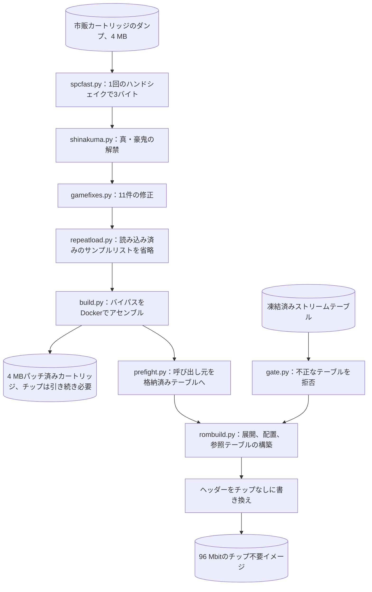
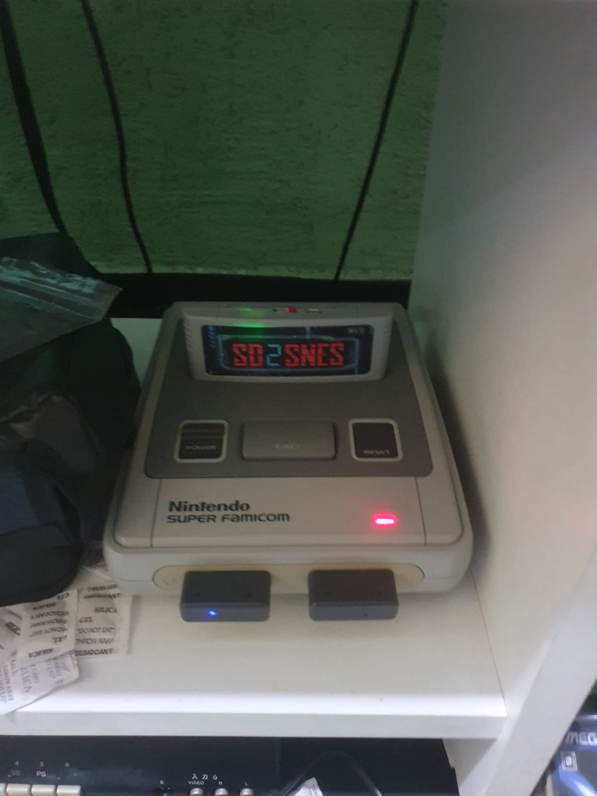
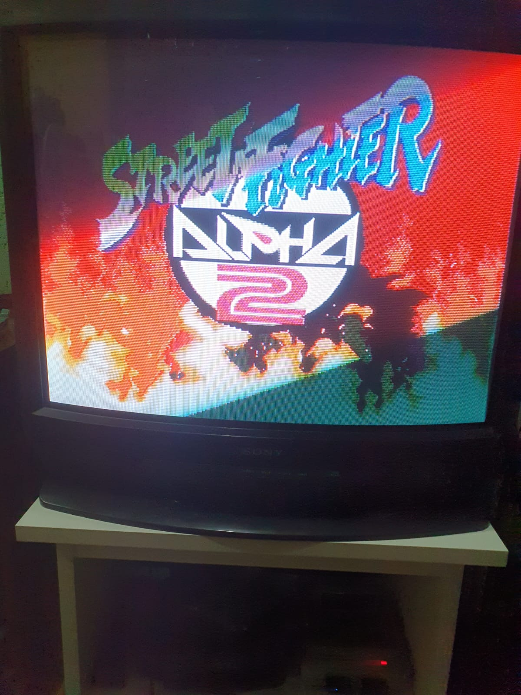
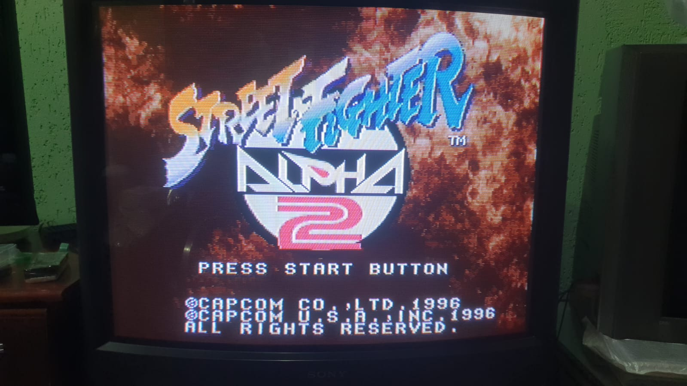
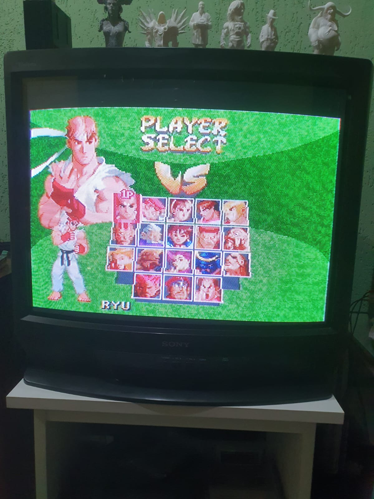
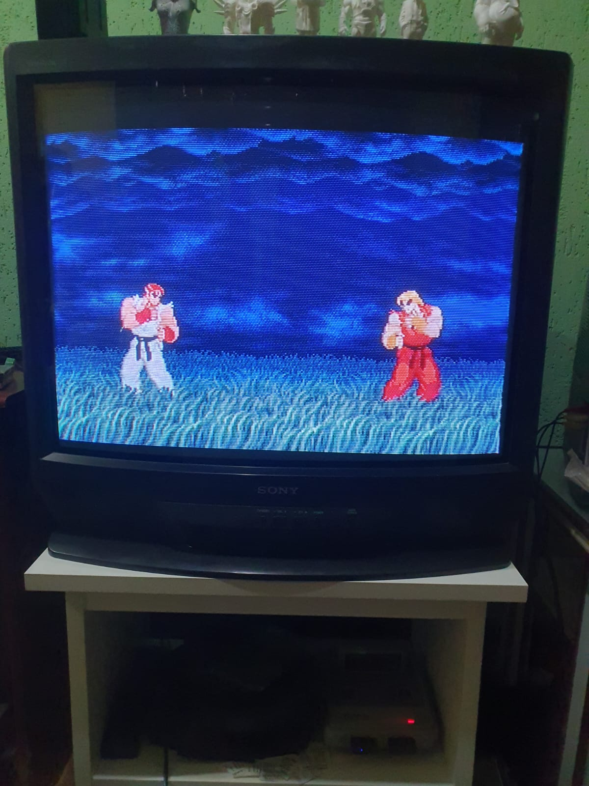
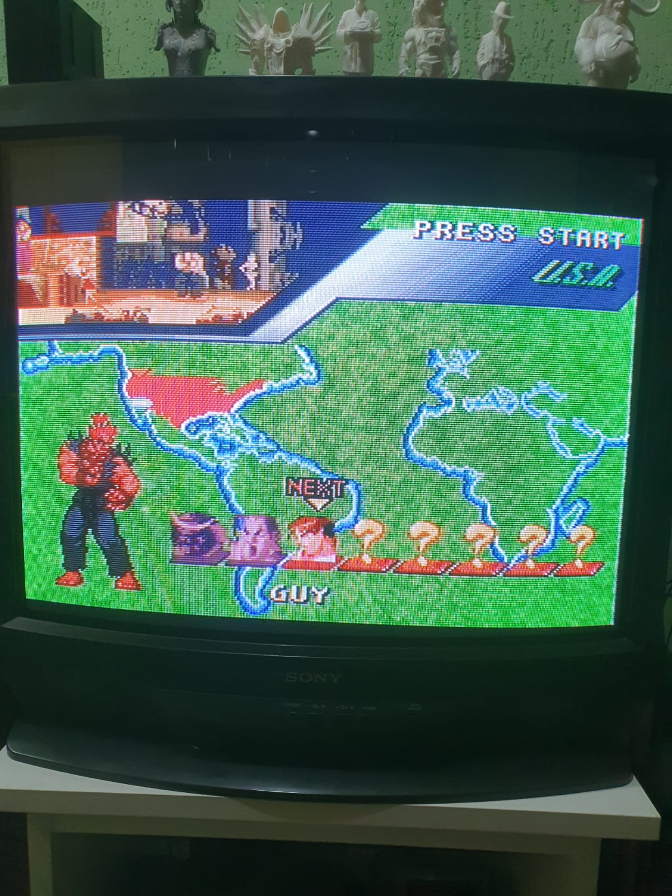
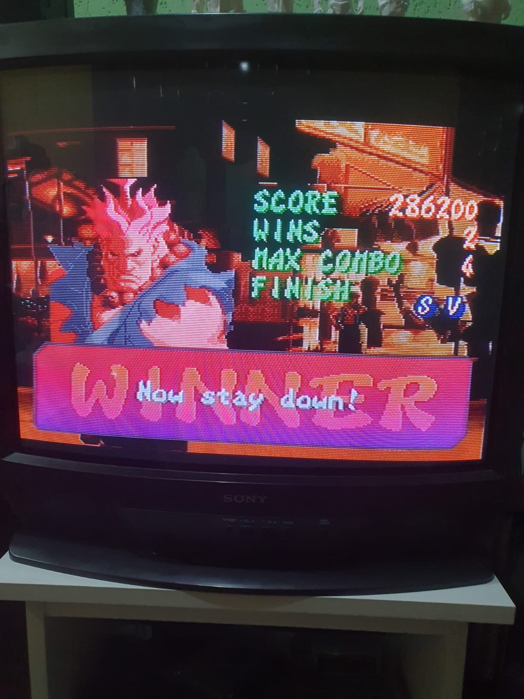
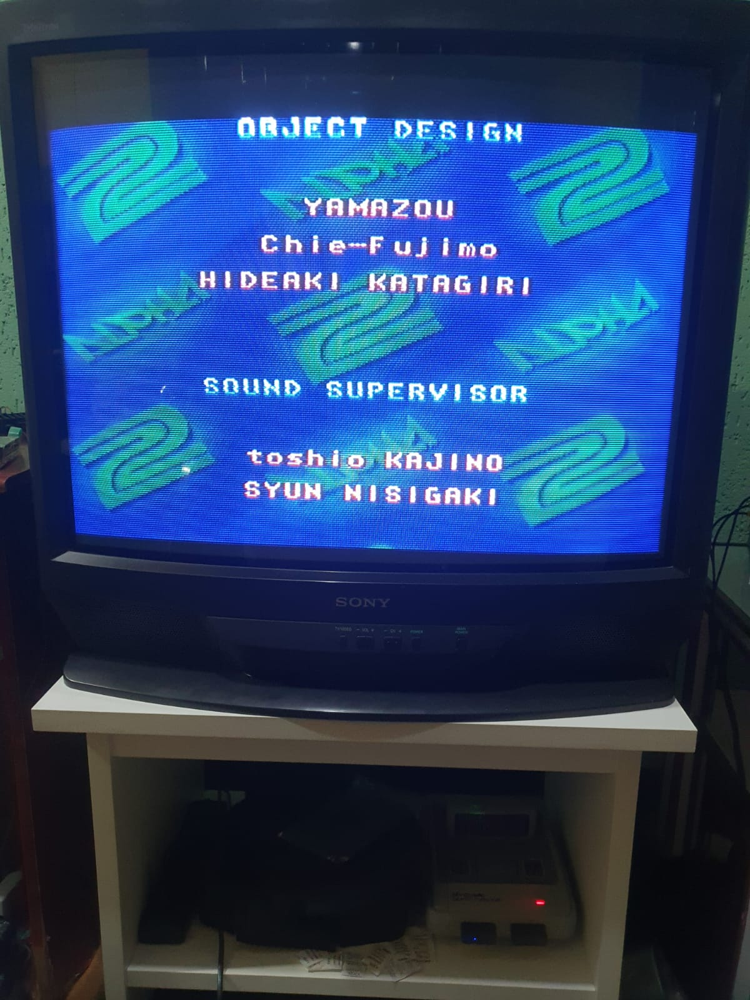
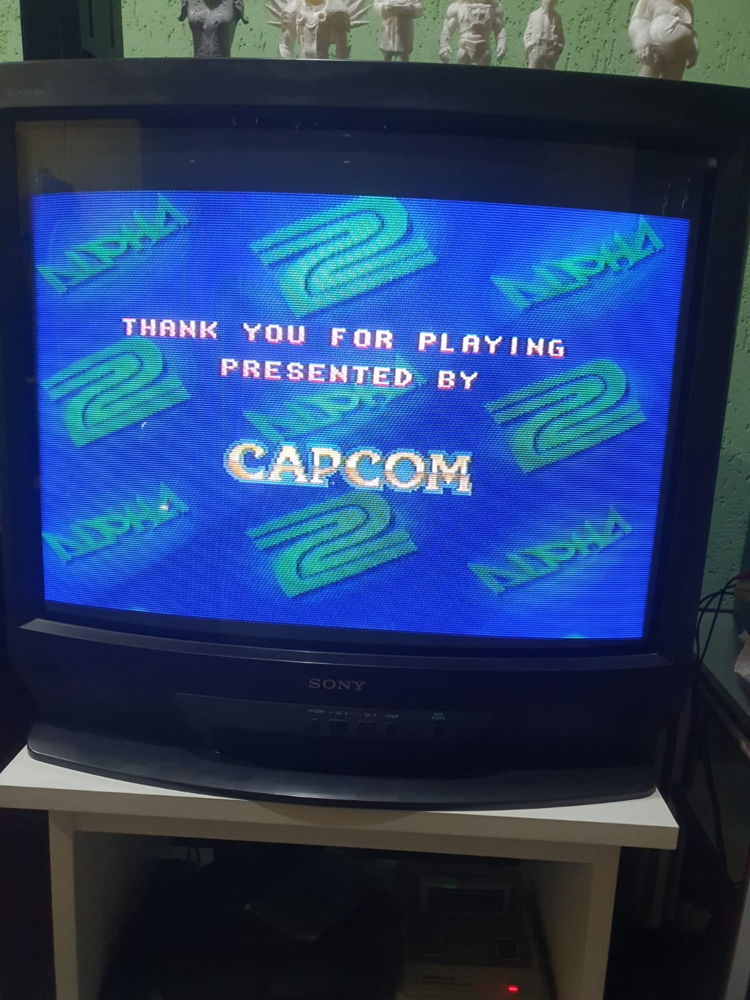

<div align="center">

# S-DD1なしのStreet Fighter Alpha 2

<strong>スーパーファミコン用のStreet Fighter Alpha 2とStreet Fighter Zero 2を、S-DD1展開チップを設計から取り除いた形で再構築するツール群です。snes9x自身の展開器と、利用者が用意する市販カートリッジを基準に検証しています。</strong>

[English](README.md) | 日本語 | [简体中文](README.zh-Hans.md) | [繁體中文 (香港)](README.zh-HK.md)

[](https://github.com/gufranco/snes-street-fighter-alpha-2-nochip/actions/workflows/ci.yml)
[](https://github.com/gufranco/snes-street-fighter-alpha-2-nochip/releases)
[](LICENSE)

</div>

<p align="center">
  <a href="#install">インストール</a> |
  <a href="#the-interface">インターフェース</a> |
  <a href="#is-it-right">正しいか</a> |
  <a href="#working-on-it">開発に参加する</a> |
  <a href="https://github.com/gufranco/snes-street-fighter-alpha-2-nochip/issues">Issue</a>
</p>

---

5,672本のストリームを展開してsnes9xの`sdd1emu.cpp`とバイト単位で比較し、相違は0件です。20本のイメージをそれぞれ12,000フレーム実行し、参照ミスは0件です。テストは1,286件、ステートメントとブランチの100%カバレッジゲートがあり、標準ライブラリ以外のPython依存はありません。

```python
import hardware

mapper = hardware.load("mapper")
addresses = ((0x00, 0x8000), (0x40, 0x0000), (0x40, 0x8000), (0xC0, 0x0000), (0xC0, 0x8000))

for bank, address in addresses:
    offset = mapper.address_to_file(bank, address, 192)
    print(f"${bank:02X}:{address:04X} is file offset {offset:#09x}")
```

```
$00:8000 is file offset 0x0000000
$40:0000 is file offset 0x0800000
$40:8000 is file offset 0x0200000
$C0:0000 is file offset 0x0a00000
$C0:8000 is file offset 0x0600000
```

この例は、固定されたカートリッジマップに対し、5つのコンソールアドレスが192バンクのイメージのどこに対応するかを問い合わせます。192バンクは、このプロジェクトが構築する96 Mbitのチップなしイメージのサイズです。ファイルはハーフバンクの2つのプレーンを持ちます。バンク`$00`はオフセット0でバンク0の上位半分を読みます。バンク`$40`は自身の記憶領域の両半分を公開します。バンク`$C0`は記憶領域を持ちません。その2つの半分はバンク`$80`と`$00`の下位半分です。これにより、展開済みグラフィックスが`$40`-`$7D`を埋める一方で、元の4 MBのROMは`$C0`-`$FF`で読める状態を保ちます。

<a id="install"></a>

## インストール

| 要件 | バージョン |
|:--|:--|
| Python | 3.12以降 |
| git | 任意。9つのサブモジュールの取得に使います |
| Docker | 現行の任意のリリースで、起動していること。[`build.py`](build.py)、[`pack.py`](pack.py)、snes9xとの照合はツールチェーンをコンテナで実行します |
| 自分のカートリッジダンプ | 各4,194,304バイト。`roms/`に置き、[ダンプ](#the-dumps)に記載の名前にします |

```bash
git clone --recurse-submodules https://github.com/gufranco/snes-street-fighter-alpha-2-nochip.git
cd snes-street-fighter-alpha-2-nochip
python3 doctor.py
```

> [!IMPORTANT]
> このプロジェクトが照合の基準とするモデルはすべて独立したリポジトリで、ルートにサブモジュールとして固定されています。そのため`--recurse-submodules`は必須です。これを付けずに作ったクローンは`git submodule update --init --recursive`で修復できます。download-zipリンクから得たソースアーカイブにはサブモジュールの内容が含まれず、修復できないため、クローンしてください。

ドクターは、マシン、固定された各モデルのバージョン、`roms/`内の各ダンプの状態とSHA-256、展開器がデコードできるか、`docker`がパス上にあるか、各モデル自身のドクターが出す報告を表示します。`roms/`にないダンプは、合格しなかったチェックとして数えます。報告は1行で終わり、終了コードは1つ目の形式なら0、2つ目なら1です。

```
  N checks, nothing to report
  K of N checks did not pass
```

バグ報告には出力全体を貼り付けてください。

リリースは[Semantic Versioning](https://semver.org/)に従い、semantic-releaseがコミット履歴から作成します。各リリースにはタグが付き、[リリースページ](https://github.com/gufranco/snes-street-fighter-alpha-2-nochip/releases)に掲載されます。リリースにイメージは含まれません。[`pack.py`](pack.py)が書き出す各イメージは、ファイル名にバージョンを含みます。

<a id="the-interface"></a>

## インターフェース

### イメージの構築

```bash
python3 tools/identify.py
python3 pack.py
python3 pack.py usa
```

[`tools/identify.py`](tools/identify.py)は、`roms/`内の各ダンプを[`artifacts.manifest.json`](artifacts.manifest.json)と照合します。[`pack.py`](pack.py)は、指定された各リージョンのチップなしイメージを構築します。何も指定しなければ両方を構築します。イメージは機器ごとに1回ずつ、機器ごとのフォルダーに分けて`dist/v<version>/`へ書き出し、すべてのファイルを`SHA256SUMS`マニフェストに記載します。USA版の場合は次のとおりです。

```
  v<version>/emulator/sfa2-usa-nochip-v<version>.sfc  12,582,912 bytes
  v<version>/supereverdrive/sfa2-usa-nochip-v<version>.sfc  12,582,912 bytes
  v<version>/sd2snes/sfa2-usa-nochip-v<version>.smc  12,583,424 bytes
  v<version>/fxpak/sfa2-usa-nochip-v<version>.smc  12,583,424 bytes
  v<version>/gamedoctor/sfa2-usa-nochip-v<version>.smc  12,583,424 bytes
  v<version>/SHA256SUMS  5 images
```

カートリッジやエミュレーターの名前が付いたフォルダーを選んでください。どのファイルも中身は同じイメージです。違うのは、その前に置く512バイトと、ヘッダーが宣言するチップセットです。各機器はそれを見てイメージのマップを決めるためです。

| フォルダー | 対象 | イメージの前にあるもの |
|:--|:--|:--|
| `emulator` | snes9xなどのエミュレーター | 何もありません。ヘッダーはチップを宣言せず、それはイメージについて事実です |
| `supereverdrive` | Super EverDrive | `emulator`と同じファイルです |
| `sd2snes` | SD2SNESとSD2SNES Pro | 空の512バイトのコピー機ヘッダーと、6つのヘッダーコピーすべてでのチップ`$43`です |
| `fxpak` | FXPAK Pro | `sd2snes`と同じファイルです。同じファームウェアで動きます |
| `gamedoctor` | Game Doctor SF7 | 4 Mbitの24チャンクすべてをマップする512バイトのGame Doctorヘッダーです |

sd2snesファームウェアが96 Mbitマップを使うのは、ヘッダーがチップ`$43`または`$45`を宣言している場合だけで、リリースv1.11.2ではさらにファイルがちょうど12,583,424バイトである必要があり、前にある512バイトは読みません。Game Doctorは、アドレス空間の各領域を配置するためにその512バイトだけを読みます。どちらのヘッダーも[snes-rom-image-python](https://github.com/gufranco/snes-rom-image-python)の`copier`モジュールが書き出します。Game Doctorのマップはカートリッジのマップから導出してスロットごとに確かめたもので、herrkuhnさんがGame Doctor SF7で両リージョンを動かしたヘッダーとバイト単位で同じです。

[`pack.py`](pack.py)は、市販ダンプに対して下記のパッチを順に実行し、Dockerでバイパスをアセンブルし、試合前テーブルを追加し、固定されたストリームテーブルからイメージを配置し、プレーンなROMを宣言するようヘッダーを書き換えます。何かを書き出す前に、各リージョンのストリームテーブルに対して[`gate.py`](gate.py)を実行し、指摘が1つでもあれば停止します。

| コマンド | 引数 | 終了コード |
|:--|:--|:--|
| [`pack.py`](pack.py) | `[usa] [jp]` | 0は書き出し完了、1はダンプの欠落、ゲートの失敗またはアセンブルの失敗、2は不明なリージョン |
| [`tools/identify.py`](tools/identify.py) | `[file name ...]`、既定はマニフェストが宣言するすべてのダンプ | 0は1つ以上のダンプが正しく誤りがない、1は誤ったダンプがあるか正しいものがない、2はその名前の宣言済みダンプがない |
| [`gate.py`](gate.py) | `[usa] [jp]` | 0はすべてのテーブルが合格、1は指摘あり、2は不明なリージョン |
| [`doctor.py`](doctor.py) | なし | 0はすべてのチェックが合格、1はそれ以外 |

[`tools/identify.py`](tools/identify.py)は、各ダンプを7つの状態のいずれかで示します。`ok`、`missing`、`no digest published`、`wrong size`、`wrong content`、`known bad dump`、`another entry`です。最後の4つは構築を妨げます。構築を妨げるダンプと欠落したダンプのそれぞれについて、macOS、Linux、Windows PowerShell用のダイジェストコマンドを表示します。

```
  sfa2-usa-final.sfc: ok  [Street Fighter Alpha 2, USA]
      read as bare, 4,194,304 bytes
      crc32  9C59DDFF
      sha256 910a29f834199c63c22beddc749baba746da9922196a553255deade59f4fc127
  sfz2-jp-final.sfc: ok  [Street Fighter Zero 2, Japan]
      read as bare, 4,194,304 bytes
      crc32  7455A7CF
      sha256 f15731675e22dbf3882b777b2d8cd541a637dfdf5d8880c83903cf1e0b64590e
  sfa2-usa-vc-sound-restored.sfc: ok  [SNES Classic dump with the sound restored]
      read as bare, 4,194,304 bytes
      crc32  72A9E2C1
      sha256 f8aa2ae1f4bc993092fc282a883ecaf669269c17a175a5f43fa95e9da6459dc0

  3 of 3 declared dumps present and correct
```

[`gate.py`](gate.py)は、ソースが重複するテーブル、記録された長さにデコードされないエントリ、テーブルが網羅していない記録済みのハードウェア要求、64スロットを超えるキー走査のいずれかを含むテーブルを拒否します。固定されたテーブルでは次のように表示します。

```
  jp: 2,855 streams, ok
  usa: 2,817 streams, ok
```

### パッチ

各パッチは、`apply(rom)`呼び出しとコマンドラインを持つモジュールです。`apply`はROMのバイト列を受け取り、パッチ適用後のバイト列を返します。`prefight.apply`以外のすべてのパッチは、ヘッダーのチェックサムも書き換えます。各パッチは適用箇所をバイトシグネチャで見つけるため、1つのモジュールで両リージョンに対応します。パッチを2回適用すると、入力がそのまま返ります。どのシグネチャにも一致しないROMは`ValueError`で拒否されます。

| モジュール | コマンド | 変更内容 |
|:--|:--|:--|
| [`spcfast.py`](spcfast.py) | `spcfast.py <source-rom> <output-rom>` | サンプル転送。21か所、420バイト |
| [`shinakuma.py`](shinakuma.py) | `shinakuma.py <source-rom> <output-rom>` | 真・豪鬼の解禁。2バイト |
| [`gamefixes.py`](gamefixes.py) | `gamefixes.py <source-rom> <output-rom>` | [得られるもの](#what-you-get)に記載の11件の修正 |
| [`repeatload.py`](repeatload.py) | `repeatload.py <source-rom> <output-rom>` | 読み込み済みの基本サンプルリストをスキップします。`$C7:F600`の61バイトのルーチンを使います |
| [`prefight.py`](prefight.py) | `prefight.py <source-rom> <output-rom>` | 試合前テーブル構築ルーチンの2つの呼び出し元を、完成済みテーブルを1回のDMAで転送する61バイトのルーチンへ振り向けます |

どのコマンドも、出力を書き出したときは0、出力パスがソースパスと同じときは1、引数の数が誤っているときは2で終了します。拒否されたROMは`ValueError`のトレースバックで終わります。

```python
import gamefixes
import prefight
import repeatload
import shinakuma
import spcfast

blank = bytes(0x400000)
for patch in (spcfast, shinakuma, gamefixes, repeatload, prefight):
    try:
        patch.apply(blank)
    except ValueError as refusal:
        print(f"{patch.__name__}: {refusal}")

print(spcfast.patch_bytes(), len(spcfast.PATCH), len(prefight.table()))
print(len(gamefixes.FIXES), len(gamefixes.EMPTY_CALLS))
```

```
spcfast: this is not an unpatched retail Alpha 2 or Zero 2 ROM
shinakuma: no Shin Akuma unlock gate found
gamefixes: this ROM carries none of the sites these fixes name
repeatload: the sound engine's allocator setup is not where this patch expects it
prefight: no pre-fight table builder found
420 21 24704
8 3
```

4 MBのゼロ埋めブロックはどのシグネチャも含まないため、すべてのパッチがそれを拒否します。最後の2行は、サンプル転送パッチのサイズ、24,704バイトの試合前テーブル、そして11件の修正を構成する8件のシグネチャ修正と3件の空呼び出し書き換えです。

| 呼び出し | 戻り値 |
|:--|:--|
| `spcfast.is_stock(rom)`, `spcfast.is_patched(rom)` | ドライバーが市販版のものか、すでにパッチ済みか |
| `spcfast.checksum(rom)`, `spcfast.write_checksum(rom)` | ヘッダーのチェックサムと、`$7FDC`にチェックサムと補数を書き込んだROM |
| `shinakuma.find_gate(rom)` | 解禁ゲートのファイルオフセット、または`None`。2回以上現れる場合は`ValueError`を送出します |
| `gamefixes.survey(rom)` | 各エントリ名を`applied`、`already`、`absent`のいずれかに対応付けたもの |
| `gamefixes.changed_bytes(rom)` | チェックサムを除き、エントリが変更するバイト数 |
| `gamefixes.report(rom, say=print)` | 調査結果をエントリごとに1行で表示します |
| `repeatload.is_patched(rom)`, `repeatload.report(rom, say=print)` | スキップが入っているかどうかと、フック、ルーチン、マーカーのアドレス |
| `prefight.table()` | 24,704バイトのテーブル。16ビットワード64個からなる行が193行です |
| `prefight.find_builder(rom)`, `prefight.find_callers(rom)` | 構築ルーチンのファイルオフセットと、それを呼ぶ各呼び出しのオフセット |

### イメージビルダー

[`rombuild.py`](rombuild.py)は96 Mbitのイメージを配置します。`rombuild.build(rom, entries, image_banks=192, extra=())`は、バイパス済みの4 MBのROMとストリームのリストを受け取り、`image`、`destinations`、`tables`、`regions`を持つ`Result`を返します。`extra`はストリームの後に配置される`(address, bytes)`ペアのタプルで、[`pack.py`](pack.py)はこれを使って`$5F0000`に試合前テーブルを追加します。4,194,304バイトでないROMは`ValueError`を送出します。収まらないストリームは`rombuild.AllocationError`を送出し、残っている最大の空き領域を示します。

`rombuild.entries_from_map(mapping)`は、`{source: length}`マッピングをエントリに変換します。[`usastreams.py`](usastreams.py)と[`jpstreams.py`](jpstreams.py)は、それぞれ固定されたテーブルを`STREAMS`として持ちます。これは`(source, length)`ペアのタプルです。

[`sdd1tables.py`](sdd1tables.py)は、変換ルーチンが読む4つの参照テーブルを構築します。ソースの下位16ビットが他のストリームと重なるストリームは、その後の最初の空きスロットに入ります。

```python
from collections import namedtuple

import sdd1tables

Stream = namedtuple("Stream", "source")
tables = sdd1tables.build(
    [
        (Stream(0x001234), 0x400000),
        (Stream(0x011234), 0x410000),
        (Stream(0x001235), 0x420000),
    ]
)
for slot in tables.slots:
    destination = tables.dest_bank[slot] << 16 | tables.dest_high[slot] << 8 | tables.dest_low[slot]
    print(f"slot {slot:#06x}  key ${tables.key[slot]:02X}  destination ${destination:06X}")
```

```
slot 0x1234  key $C0  destination $400000
slot 0x1235  key $C1  destination $410000
slot 0x1236  key $C0  destination $420000
```

2つ目のストリームは`$1234`で1つ目と衝突し、1スロット先へ移ります。3つ目は自分のスロットがすでに使われているため、`$1236`へ移ります。ルーチンはソースの下位16ビットから、キーバイトがソースバンクと一致するまで前方へ走査するため、3つとも解決します。`sdd1tables.build`は、どの配置でもすべての走査が一意にならない場合に`sdd1tables.PlacementError`を送出します。バンク`$00`の転送先については、走査が空きスロットと区別できないため`ValueError`を送出します。

### 命名とリリースマニフェスト

```python
import pack

print(pack.output_name("usa", "2.0.0"))
print(pack.output_name("jp", "0.0.0"))
print(pack.manifest_line("sfz2-jp-nochip-v2.0.0.sfc", b""))
```

```
sfa2-usa-nochip-v2.0.0.sfc
sfz2-jp-nochip-v0.0.0-dev.sfc
e3b0c44298fc1c149afbf4c8996fb92427ae41e4649b934ca495991b7852b855  sfz2-jp-nochip-v2.0.0.sfc
```

`pack.output_name(region, release=None)`は[`version.py`](version.py)のバージョンを付け、バージョン`0.0.0`には`-dev`を付けます。`pack.headed_name(region, release=None)`は、コピー機ヘッダー付きの形に同じ方法で`.smc`で終わる名前を付けます。`pack.release_folder(release=None)`は`dist/`の下の`v<version>`フォルダーです。`pack.forms_of(region, image)`は、1つのリージョンが書き出す各ファイルのパスとバイト列を`pack.DEVICES`の項目ごとに1つずつ返し、ヘッダーのないイメージには`NoHeader`を送出します。`pack.unify_headers(image)`は、タイトルとマップバイトが一致するバンク末尾のすべてのコピーに最初のヘッダーを上書きするため、続く書き換えが6つすべてに届きます。`pack.manifest_line(name, image)`は`SHA256SUMS`の1行です。`pack.build(region, workdir)`は1つのリージョンの完成イメージを返し、Dockerと市販ダンプを必要とします。`pack.REGIONS`は、各リージョンの市販ダンプとバイパスパッチを示します。アセンブルに失敗すると、[`build.py`](build.py)の出力を持つ`pack.AssemblyFailed`を送出します。

### すべてのコマンド

| コマンド | 引数 | 動作 |
|:--|:--|:--|
| [`build.py`](build.py) | `<patch.asm> <source-rom> <output-rom>`、または`--image` | ネットワークのないコンテナでasar 1.81を使ってパッチをアセンブルし、出力をパッチの隣に書き出します。`--image`はコンテナの構築だけを行います |
| [`rombuild.py`](rombuild.py) | `<patched-rom> <tagged-rom> <output.sfc>` | タグ付きダンプ内のストリームマップから96 Mbitのイメージを配置します |
| [`mapcheck.py`](mapcheck.py) | `<rom>` | ダンプのリージョンに対応する固定テーブルを検査します。重複、デコードできないエントリ、走査距離です |
| [`patchrun.py`](patchrun.py) | `<built-image> <patched-rom> <tagged-rom>` | アセンブル済みの変換ルーチンを65816モデル上ですべてのストリームについて実行し、指す先を比較します |
| [`sdd1ref.py`](sdd1ref.py) | `<rom> [cases] [seed]`、既定は500ケースとシード20260813 | ランダムなオフセットを、コンテナ内のsnes9xの`sdd1emu.cpp`とPythonモデルの両方で展開して比較します |
| [`sdd1map.py`](sdd1map.py) | `<tagged-rom> <source-rom> [output.bin]` | タグ付きダンプ内の`SDD1`タグからストリームマップを読み出します |
| [`sdd1find.py`](sdd1find.py) | `<source-rom> <reference-rom> [start] [stop]` | 同じグラフィックスを展開済みで持つダンプと照らし合わせ、内容からストリームを見つけます |
| [`sdd1sites.py`](sdd1sites.py) | `<source-rom> <tagged-rom>` | 圧縮データ外にあるチップのレジスタへの書き込みをすべて列挙し、各起動箇所を逆アセンブルします |
| [`analyse.py`](analyse.py) | 4つのROMパス | Star Oceanの2つのダンプとAlpha 2の2つのダンプで、圧縮らしく見えるブロックを分析します |
| [`tools/verify_streams.py`](tools/verify_streams.py) | `[usa] [jp]` | 固定テーブル内のすべてのストリームをsnes9xの`sdd1emu.cpp`に通し、Pythonの展開器と比較します |
| [`tools/verify_image.py`](tools/verify_image.py) | `[image]`、既定は`build/all/jp-both-free.sfc` | 完成イメージの参照テーブルをコンソールと同じようにたどり、各転送先のバイトを比較します |
| [`tools/rebuild_all.py`](tools/rebuild_all.py) | なし | すべてのリージョンとパッチセットを、カートリッジ、バイパス、チップなしイメージとして`build/all/`に構築します |
| [`tools/validate_all.py`](tools/validate_all.py) | `[name filter]` | `build/all/`内の各イメージをエミュレータハーネス上で12,000フレーム実行し、検証表を表示します |
| [`tools/compare_audio.py`](tools/compare_audio.py) | `[--fights] [--roster N] [--budget N] <stock> <patched>` | 2つのビルドを転送ごとに比較します |
| [`tools/tour_audio.py`](tools/tour_audio.py) | `[name filter] [roster] [budget]`、既定は`both-cart`、18、12000 | すべてのキャラクターを順にプレイし、停止と破損した転送を報告します |
| [`tools/driver_run.py`](tools/driver_run.py) | `<rom>` | パッチ前後のオーディオドライバーをSPC700モデルとS-SMP全体で実行し、サイクルを数えます |
| [`tools/sample_audit.py`](tools/sample_audit.py) | `<apu-ram-image> <directory-page> [sample ...]` | 64 KBのサウンドRAMイメージを、そのアドレスのサンプルディレクトリからオーディオチップと同じように読み、範囲外にはみ出すサンプル、自身の外でループするサンプル、バイトを共有するサンプルを報告します |
| [`tools/sample_reuse.py`](tools/sample_reuse.py) | `[log ...]`、既定は`build/soundwalk/grp-*.txt` | ハーネスログ内のすべてのサンプル転送を、サウンドRAMのシャドウに対して再生します |
| [`tools/stage_diff.py`](tools/stage_diff.py) | `[before] [after] [tag]` | 2つのビルドですべての対戦カードを進め、異なるフレームを数えます |
| [`tools/tile_shape.py`](tools/tile_shape.py) | `<rom> [streams]` | 展開済みストリームが4bppタイルを繰り返す頻度を、同じ長さのランダムなバイト列と比較して測定します |
| [`tools/tour_oracle.py`](tools/tour_oracle.py) | なし | 市販カートリッジを動かし、チップに何を要求するかを記録します |
| [`tools/harvest_jp.py`](tools/harvest_jp.py) | なし | ゲートが判定する日本版ストリームの候補を提示します |
| [`tools/converge_jp.py`](tools/converge_jp.py) | なし | 1ラウンドで何も追加されなくなるまで、それらの実行を繰り返します |
| [`tools/freeze_spcfast.py`](tools/freeze_spcfast.py) | `[--check]` | サンプル転送パッチをアセンブルし、その差分から[`spcfast.py`](spcfast.py)を書き直します。`--check`は書き込まずに比較します |

必須引数の数が誤っているコマンドは2で終了します。[`mapcheck.py`](mapcheck.py)、[`patchrun.py`](patchrun.py)、[`sdd1ref.py`](sdd1ref.py)、2つのverifyツール、[`tools/validate_all.py`](tools/validate_all.py)、[`tools/compare_audio.py`](tools/compare_audio.py)、[`tools/tour_audio.py`](tools/tour_audio.py)は、チェックが失敗すると1、それ以外は0で終了します。

```bash
python3 tools/verify_streams.py
python3 tools/verify_image.py build/all/usa-both-free.sfc
```

```
  jp: all 2855 streams identical to the reference
  usa: all 2817 streams identical to the reference
```

```
  image usa-both-free.sfc, 2,817 streams
  unresolved lookups: 0
  streams whose bytes in the image are wrong: 0
```

[`tools/verify_streams.py`](tools/verify_streams.py)は、200ストリームごとに進捗行も表示します。[`tools/verify_image.py`](tools/verify_image.py)は、イメージのファイル名からリージョンを読み取ります。

## 仕組み

Street Fighter Alpha 2は、グラフィックスの大半を圧縮して保持しています。市販カートリッジ内のS-DD1は、ゲームの要求に応じてDMAの途中でそれを展開します。チップがなければグラフィックスはありません。

このプロジェクトは、すべてのストリームを事前に展開し、その結果をより大きなイメージに配置し、ゲームがチップを起動する7か所にパッチを当てて、代わりに完成済みのバイト列を読むようにします。結果はコプロセッサもマッパーチップもない通常のSNES ROMで、カートリッジは96 Mbitを保持して提供する必要があります。

各試合前の待ち時間はサウンドドライバーにあり、ドライバーはハンドシェイク1回につき1バイトずつオーディオチップへサンプルを渡します。受信ループを書き直して、ハンドシェイク1回につき3バイトを運ぶようにすると、その大半がなくなります。

[`pack.py`](pack.py)は次の手順を順に実行します。

1. [`spcfast.py`](spcfast.py)が、サンプル転送でハンドシェイク1回につき3バイトを運ぶようにします。
2. [`shinakuma.py`](shinakuma.py)が真・豪鬼を解禁します。
3. [`gamefixes.py`](gamefixes.py)が11件の修正を適用します。
4. [`repeatload.py`](repeatload.py)が、読み込み済みのサンプルリストをスキップします。
5. [`build.py`](build.py)が、7つの起動箇所に対してバイパスをアセンブルします。結果は4 MBのパッチ済みカートリッジで、これはまだチップを必要とします。
6. [`prefight.py`](prefight.py)が、試合前テーブル構築ルーチンの呼び出し元を振り向けます。
7. [`rombuild.py`](rombuild.py)が、すべてのストリームを展開し、イメージを配置し、参照テーブルを構築します。
8. チップのないプレーンなROMを宣言するよう、ヘッダーを書き換えます。

バイパスが配置より先なのは、バイパスが読む圧縮データを配置が回収するためです。ヘッダーが最後なのは、完成イメージのチェックサムを計算するためです。



### チップと、それを置き換えるもの

S-DD1はメモリをマッピングしますが、Alpha 2はこの機能を使わず、バンク`$C0`から`$FF`が4 MBを線形に公開したままです。S-DD1は展開も行います。CPUが`$4801`に0以外のバイトを書き込み、A-busアドレスが固定されたチャネルでDMAを開始すると、チップは生のバイトをコピーする代わりにストリームをデコードして転送先へ書き込みます。`$4801`は自動でクリアされるため、ゲームはストリームごとにこれを再設定します。

各リージョンで7か所がチップを起動しており、[`asm/sdd1-bypass.asm`](asm/sdd1-bypass.asm)と[`asm/sdd1-bypass-jp.asm`](asm/sdd1-bypass-jp.asm)に列挙されています。各箇所は、[`asm/sdd1-translate.asm`](asm/sdd1-translate.asm)にある共有ルーチンの呼び出しに置き換えられます。このルーチンは、展開済みのコピーが配置された場所を参照し、DMAのソースを書き換え、A-bus固定ビットをクリアして、転送を通常のインクリメント読み出しにします。

参照は、バンク`$60`から`$63`にある4つの64 KBテーブルで、ソースアドレスの下位16ビットをインデックスとします。キーとしてのソースバンク、次に転送先の下位バイト、上位バイト、バンクです。キーが衝突した場合はそのアドレス以降の最初の空きスロットに入り、ルーチンはバンクバイトが一致するまで前方へ走査します。[`mapcheck.py`](mapcheck.py)は、USAテーブルの走査距離を測定します。

```
  streams        2,817
  duplicates     0
  undecodable    0
  scan distance  median 0, worst 31 (budget 64)
  RESULT         OK
```

日本版テーブルは2,855本のストリームを持ち、中央値は同じく0、最悪値は31です。

### イメージが96 Mbitである理由と、そのアドレス指定

展開後のグラフィックスは、USAテーブルで5,013,058バイト、日本版で5,047,300バイトになり、4 MBのカートリッジには収まりません。イメージは12 MBに増えますが、ミラーとワークRAMを考慮すると、64 KBのバンク192個は24ビットのアドレス空間に収まりません。

この配置では、すべてのバンクを2つに分け、その半分ずつをファイルの2つのプレーンに格納します。バンク`$C0`以上は記憶領域を持たず、2つ目のプレーンへのウィンドウです。

| バンク | 公開範囲 | 供給元 |
|:--|:--|:--|
| `$00`-`$3F`, `$80`-`$BF` | `$8000`-`$FFFF`のみ、LoROM | 上位半分のプレーン |
| `$40`-`$7D` | 64 KB全体、HiROM方式 | 両方のプレーン |
| `$C0`-`$FF` | 64 KB全体 | 下位半分のプレーン。自身の領域は持ちません |

バンク`$C0+k`は、`$8000`-`$FFFF`でバンク`k`の下位半分を、`$0000`-`$7FFF`でバンク`$80+k`の下位半分を公開します。これにより、192バンクの記憶領域が、バンク切り替えもマッピングレジスタもなしに256バンクのアドレス空間を覆います。本書ではこれをウィンドウ付きLoROMマップと呼びます。ExLoROM、ExHiROM、Jumbo LoROMは線形バンクを追加してアドレス空間を拡張しますが、このマップは代わりに領域を2つ目の記憶プレーンへ別名付けします。この規則はneviksti氏によるStar Oceanのチップなし変換に由来し、解析によって復元したものです。固定されたカートリッジマップはこれを`address_to_file`として実装しています。

| 領域 | 内容 |
|:--|:--|
| バンク`$00`-`$3F` | 元のROMのLoROMビュー |
| バンク`$40`-`$7D` | 展開済みグラフィックス |
| バンク`$5F` | `$5F0000`の試合前テーブル |
| バンク`$60`-`$63` | 4つの参照テーブル |
| バンク`$7E`-`$7F` | ワークRAM用に予約 |
| バンク`$80`-`$BF` | `$00`-`$3F`のFastROMミラー |
| バンク`$C0`-`$FF` | 元の4 MBのROM。線形で、ウィンドウとして置かれます |

空きバンクだけではすべての展開済みストリームを保持できません。そのため、ストリームを展開した後は、元になった圧縮バイト列をウィンドウバンク内で回収します。その際、各ストリームが実際に消費した範囲を使います。

### 待ち時間

市販カートリッジでの試合前の転送バースト1回分は47,915バイトで、1フレームあたり約260バイト、1ラインにつき1バイトです。ボトルネックはオーディオチップのRAM上の受信ループです。ゲームは独自のサウンドドライバーを転送し、そのドライバーはブートプロトコルを1バイトあたり55サイクルで再実装しています。

そのドライバーはRAM上にあるため、置き換えられます。出荷する受信ルーチンは、ハンドシェイク1回につき各データポートに1バイトずつ、計3バイトを、ハンドシェイクあたり49サイクルで運びます。[`tools/driver_run.py`](tools/driver_run.py)は、オーディオユニット全体で両方に48バイトを通して測定します。

```
  48 bytes through the driver as it ships and as it is patched
  stock     48 handshakes,   720 instructions
  patched   16 handshakes,   192 instructions
  landed at 0x2000: 000306090c0f1215
  landed at 0x3000: 0104070a0d101316
  landed at 0x4000: 0205080b0e111417
  the same two runs on the whole audio unit, which counts cycles
  stock     48 handshakes,   2640 cycles
  patched   16 handshakes,    784 cycles
  faster by 3.37 times
  stand-in and unit agree on every byte: True
```

| | 1バイトあたりのサイクル | 最長停止、日本版 | 最長停止、USA版 |
|:--|:--|:--|:--|
| 市販版 | 55 | 2.60 s | 2.90 s |
| 本ビルド | 16.3 | 0.72 s | 0.80 s |

3つの転送先ポインタはブロックの3分の1ずつ離れているため、格納インデックスは1ずつ進み、ページの桁上がりはハンドシェイク256回に1回だけ発生します。

オーディオポートの両側は同じクロックで動いていないため、本体がポートに書き込んでいる最中の読み取りは、古いビットと新しいビットが混ざった値を返すことがあります。受信側はカウンタが一致している間は1回だけ読みます。新しいブロックが始まったと判断する前には、オーディオチップのブートプログラムが`$FFE9`から`$FFED`で行うように、もう一度読みます。そこでの判断の誤りは、ドライバが二度と取り消さない唯一の判断です。SPC700モデルでは、先へ進んだように見えるカウンタの読み取りが1回あるだけで、2回目の読み取りのないループは永久に回り続けます。これが、カートリッジで報告された[issue 31](https://github.com/gufranco/snes-street-fighter-alpha-2-nochip/issues/31)のCapcomロゴ後の黒い画面です。2回目の読み取りは、バイトを運ぶ経路には何のコストもかけません。SD2SNES Mk.II互換機では、この転送だけを加えた4 MBの市販ROMが、読み取り1回ではロゴの後に黒い画面になり、2回ではゲームを最後まで遊べます。

ゲームには転送ルーチンが7つあり、そのうち1つはオーディオチップのマスクROMブートローダーも駆動します。ブートローダーはハンドシェイク1回につき1バイトを受け取ります。ドライバーは各ブロックヘッダーにすでにある種別バイトで分岐します。3は3バイト単位を意味し、ブート経路には手を加えません。これでドライバーの通信量の93%をカバーします。

[`repeatload.py`](repeatload.py)のスキップは、全キャラクターを一巡する間に、USA版カートリッジで840,766バイト、日本版で303,340バイトを節約します。

### 試合前テーブル

各試合の前に、ゲームは決して変わらない24,704バイトのテーブルを27フレームかけて計算します。チップなしイメージは完成済みテーブルを`$5F0000`に持ち、1回のDMAで転送します。4 MBのカートリッジは構築ルーチンを残します。どちらの市販ROMでも`$FF`の埋め草の最長の連続は3,197バイトで、テーブルはどのアドレスにも収まらないためです。

<a id="what-you-get"></a>

## 得られるもの

| 形式 | サイズ | チップが必要か | 出力元 |
|:--|:--|:--|:--|
| 96 Mbitのチップなし | 12,582,912バイト | いいえ | [`pack.py`](pack.py)、および[`tools/rebuild_all.py`](tools/rebuild_all.py)の`*-free.sfc` |
| sd2snesファームウェア向け96 Mbitのチップなし | 12,583,424バイト | いいえ。ただしヘッダーは宣言しています | [`pack.py`](pack.py)、`sd2snes`と`fxpak`フォルダー |
| Game Doctor向け96 Mbitのチップなし | 12,583,424バイト | いいえ | [`pack.py`](pack.py)、`gamedoctor`フォルダー |
| 4 MBのパッチ済みカートリッジ | 4,194,304バイト | はい。S-DD1をすでにエミュレートしているハードウェア向けです | [`tools/rebuild_all.py`](tools/rebuild_all.py)の`*-bypass.sfc` |

どちらも、高速化したサンプル転送、真・豪鬼の解禁、修正を含みます。試合前テーブルを含むのはチップなしイメージだけです。

解禁は2バイトです。真・豪鬼は1996年から市販カートリッジに入っており、2021年まで記録されていなかった隠しコマンドの奥にありました。

### 修正

[`gamefixes.py`](gamefixes.py)に11件のエントリがあります。USA版ファイルの218バイト、日本版の60バイトを変更し、どちらの数にも4バイトのチェックサムが含まれます。どのエントリもバイトシグネチャで見つけるため、1つのテーブルで両リージョンに対応します。一致しないROMはパッチを拒否し、2回適用しても何も変わりません。

| 修正 | リージョン | 内容 |
|:--|:--|:--|
| ソドムの名前、4画面 | USA | USA版で変更された名前を、体力ゲージの下、セレクト画面、対戦画面、結果画面で元に戻します。日本版ROMはすでにこの名前を持っています |
| 豪鬼の勝利ポーズの順序 | 両方 | アーケードの順序にし、無音のポーズのインデックスもそれに合わせて移します |
| オブジェクトテーブルのオーバーフロー | 両方 | 9つ目の影フレームが要求されたときに、生存オブジェクト数が実在するオブジェクト数を超えないようにします |
| 投げられる父親のスプライト | 両方 | サガットがダンの父親をつかんでいるフレームの、3つのスプライトレコード |
| 空呼び出しの除去 | 両方 | 次のバイトが`rts`である素の`rtl`への45個のロング呼び出しを、直接戻るよう書き換えます |

[`gamefixes.py`](gamefixes.py)は書き込む前に調査結果を表示します。最初の2つのパッチを適用した後のUSA版ダンプでは次のとおりです。

```
  thrown father sprite             applied  0x3ea956  regions usa, jp
  sodom name on the life bar       applied  0x0088c7  regions usa
  sodom name on the select screen  applied  0x00d68c  regions usa
  sodom name on the vs screen      applied  0x002260  regions usa
  sodom name on the vs results screen applied  0x1ab82e  regions usa
  object table overflow            applied  0x057537  regions usa, jp
  akuma win pose order             applied  0x020048  regions usa, jp
  akuma silent win pose index      applied  0x01e944  regions usa, jp
  empty routine at $FF:FF4D        applied  42 call sites
  empty routine at $F0:1EEF        applied  1 call sites
  empty routine at $FF:FEA1        applied  2 call sites
  214 bytes to change across 11 entries
[done] build/step3.sfc (4,194,304 bytes)
```

<a id="the-dumps"></a>

## ダンプ

名前はNo-Introの命名に従います。どのダイジェストもコピー機ヘッダーを含まないファイル全体のもので、[`tools/identify.py`](tools/identify.py)は測定前にヘッダーがあれば取り除きます。判定はSHA-256で行い、CRC32はいまだにCRC32をキーとするデータベースとの照合用にあります。

| ファイル | 読み込み先 | SHA-256 | CRC32 |
|:--|:--|:--|:--|
| Street Fighter Alpha 2, USA | `roms/sfa2-usa-final.sfc` | `910a29f834199c63c22beddc749baba746da9922196a553255deade59f4fc127` | `9C59DDFF` |
| Street Fighter Zero 2, Japan | `roms/sfz2-jp-final.sfc` | `f15731675e22dbf3882b777b2d8cd541a637dfdf5d8880c83903cf1e0b64590e` | `7455A7CF` |
| DarkAkuma氏のSNES Classicダンプ | `roms/sfa2-usa-vc-sound-restored.sfc` | `f8aa2ae1f4bc993092fc282a883ecaf669269c17a175a5f43fa95e9da6459dc0` | `72A9E2C1` |

3つ目のファイルは市販カートリッジではありません。[`usastreams.py`](usastreams.py)の生成元である`SDD1`ストリームタグを含み、これを読むのは[`rombuild.py`](rombuild.py)、[`sdd1map.py`](sdd1map.py)、[`sdd1sites.py`](sdd1sites.py)、[`patchrun.py`](patchrun.py)だけです。両方のストリームテーブルはリポジトリに固定されているため、[`pack.py`](pack.py)が必要とするのは2つの市販ダンプだけです。

## 各段階を手作業で構築する

```bash
mkdir -p build
python3 spcfast.py    roms/sfa2-usa-final.sfc  build/step1.sfc
python3 shinakuma.py  build/step1.sfc          build/step2.sfc
python3 gamefixes.py  build/step2.sfc          build/step3.sfc
python3 repeatload.py build/step3.sfc          build/step4.sfc
python3 build.py      asm/sdd1-bypass.asm build/step4.sfc bypass.sfc
python3 rombuild.py   asm/bypass.sfc roms/sfa2-usa-vc-sound-restored.sfc build/nochip.sfc
python3 -c 'import hardware, pathlib; r = hardware.load("romimage"); pathlib.Path("build/final.sfc").write_bytes(r.rewrite.declare_rom_only(r.dump.read("build/nochip.sfc")))'
```

この手順は、タグ付きダンプ内のストリームマップから、試合前テーブルなしのUSA版イメージを構築します。[`rombuild.py`](rombuild.py)はタグから2,815本のストリームを読みます。これは[`pack.py`](pack.py)が使う固定テーブルの2,817本より2本少ない数です。

```
  streams   2,815
  graphics  5,012,738 bytes across 90 banks
  image     12,582,912 bytes (96 Mbit)
```

[`build.py`](build.py)は出力をパッチの隣に書き出すため、バイパスは`asm/bypass.sfc`に置かれます。日本版にはタグ付きダンプがないため、そのイメージは[`pack.py`](pack.py)からのみ得られます。

## 既知の制限

**日本版のストリームテーブルは、完全であることを証明できません。** 誰も要求しないストリームは見つけられません。このテーブルは、動作するハードウェアから記録した[`requests_jp.py`](requests_jp.py)の1,661件の要求をすべて網羅しており、探索は収束しました。もしある画面がおかしく表示されたら、市販カートリッジでその画面まで進め、チップに何を要求するかを読み取り、それを追加してください。USA版テーブルはタグ付きダンプから得たもので、この制限はありません。

**2件の修正は画面上で実証されていません。** オブジェクトテーブルのオーバーフローには、8つの影フレームの同時発生と飛び道具の衝突が必要です。投げられる父親のスプライトは、ここにあるどの駆動スクリプトも到達しない場面にあります。どちらも逆アセンブルに基づいており、同じ実行で、どちらも到達する部分には何の変化も与えないことを示しています。

**FXPAK Proでの`.sfc`の動作は説明がつきません。** FXPAK Proはsd2snesファームウェアで動き、そのソースではチップ`$00`のヘッダーは通常のLoROMとして扱われます。ファームウェア1.11.2のSD2SNES Mk.II互換機でも`.sfc`は黒い画面のままです。下のFXPAK Proの行は、それが分かる前に記録されたものです。ファームウェアのバージョンを記録して再実行するまでは、そのカートリッジでは`fxpak`フォルダーのファイルを使ってください。

[`OPEN-QUESTIONS.md`](OPEN-QUESTIONS.md)は、未解決の問いすべてを、それを解決する測定とともに列挙しています。

## エミュレータ対応

これらのイメージは、どのエミュレータも持っていなかったマップを必要とします。このマップは[プルリクエスト1082](https://github.com/snes9xgit/snes9x/pull/1082)としてsnes9xにマージされたため、現行のビルドで読み込めます。議論は[issue 1081](https://github.com/snes9xgit/snes9x/issues/1081)にあり、作業はフォークの[`sdd1-decompressed-map`](https://github.com/gufranco/snes9x/tree/sdd1-decompressed-map)ブランチにあります。

出回っているチップなし変換は市販版のヘッダーを保持しているため、もう含んでいないチップを主張します。それに基づいて判定するエミュレータは、チップのエミュレーションを有効にし、誤った配置を適用します。イメージパッケージは、これらのイメージでヘッダーが現れる6か所すべてで、チップセットとサイズのフィールドを書き換えます。元のROMがウィンドウバンクとFastROMミラーにミラーされているためです。ヘッダーが正しくなった後に残った差は配置そのもので、マージされた変更がそれを追加します。

ares、Mesen2、bsnes、Mednafenは、これらのイメージでは実行されていません。

## オーディオ経路を変更するパッチの検証

[`spcfast.py`](spcfast.py)はサンプル転送ループを置き換え、[`repeatload.py`](repeatload.py)は要求されたリストが読み込み済みのときに転送をスキップします。どちらも、オーディオプロセッサが最終的に保持するバイトを変えてはなりません。2回の実行の終了時にオーディオプロセッサのメモリを比較しても、これは判定できません。パッチがタイミングを変えるため、2回の実行はドライバーが異なる地点にある状態で止まるからです。

```bash
python3 tools/compare_audio.py build/all/jp-base-cart.sfc build/all/jp-spc-cart.sfc
python3 tools/compare_audio.py --fights build/all/jp-spc-cart.sfc build/all/jp-both-cart.sfc
```

比較は転送ごとに行います。カートリッジが渡すすべてのブロックを、カートリッジにまだあるバイトと照合するため、バイトを落とすループは、それを落としたブロックで失敗します。どのソースが転送されたかも報告します。スキップは転送するソースを減らすことはあっても、別のソースを転送することはないためです。また、1バイトあたりの書き込み回数も報告します。これは高速なループが変える数値です。`--roster`と`--budget`は巡回するキャラクターとキャラクターごとのフレーム数を設定し、既定は18と4000です。

キャラクターの巡回だけではスキップに到達しません。どのキャラクターも異なるリストを読み込むためです。`--fights`は試合に入って戻ります。読み込み済みのリストを要求する方法はこれしかありません。

<a id="the-models-underneath"></a>

## 基盤となるモデル

ある部品が何をするかについての主張は、すべてインポートパス上のモデルが行い、ここでは行いません。各モデルは独立したリポジトリで、ルートにサブモジュールとして固定されています。どのモデルにも[`hardware.py`](hardware.py)を通じてのみアクセスします。`hardware.load(name)`はパッケージを返すか、チェックアウトを埋めるコマンドを含む`hardware.ModelMissing`を送出します。一覧にない名前は`hardware.UnknownPackage`を送出します。

| 名前 | リポジトリ | 答えること |
|:--|:--|:--|
| `sdd1` | [snes-sdd1-python](https://github.com/gufranco/snes-sdd1-python) | ストリームに対して展開器が何を出力するか |
| `mos65xx` | [mos65xx-python](https://github.com/gufranco/mos65xx-python) | カートリッジ自身のコードを実行すると何をするか |
| `spc700` | [sony-spc700-python](https://github.com/gufranco/sony-spc700-python) | オーディオプロセッサが何をするか |
| `ssmp` | [sony-s-smp-python](https://github.com/gufranco/sony-s-smp-python) | 音源とブートプログラムを含むオーディオプロセッサ。サイクルを数えます |
| `sdsp` | [sony-s-dsp-python](https://github.com/gufranco/sony-s-dsp-python) | 何がミキサーに届くか |
| `mapper` | [snes-mapper-python](https://github.com/gufranco/snes-mapper-python) | アドレスがカートリッジのどこに対応するか |
| `romimage` | [snes-rom-image-python](https://github.com/gufranco/snes-rom-image-python) | ヘッダーの内容、その書き換え方、ダンプのダイジェスト |
| `snesgfx` | [snes-graphics-python](https://github.com/gufranco/snes-graphics-python) | 展開済みストリームがタイルとして読めるか |
| `snesdriver` | [snes-driver-python](https://github.com/gufranco/snes-driver-python) | カートリッジがコードのどこでチップとやり取りするか |

モデルは汚れた状態で始まります。メモリとレジスタは任意ですが再現可能な値を持ち、ここでクリアされたマシンを必要とする処理は自分でそれを設定します。

<a id="is-it-right"></a>

## 正しいか

展開器は、[`ref/`](ref)にある固定されたコンテナでソースからビルドしたsnes9x 1.63の`sdd1emu.cpp`と比較しています。[`tools/verify_streams.py`](tools/verify_streams.py)は、USA版2,817本と日本版2,855本のすべてのストリームを両方に通し、相違はありません。その後、[`tools/verify_image.py`](tools/verify_image.py)が、完成イメージから参照テーブルを通じてすべてのストリームを読み戻します。

イメージの組み合わせは、2リージョン×4パッチセット×2カートリッジ形式の16本と、パッチを1つずつ外したUSA版の対照ビルド4本です。[`tools/validate_all.py`](tools/validate_all.py)は、それぞれを[`emu/`](emu)のハーネス上で12,000フレーム実行します。最後に記録された実行では、20本すべてが読み込まれ、すべてが12,000フレーム中12,000フレームを出力し、参照ミスはありませんでした。

| チェック項目 | 方法 |
|:--|:--|
| 起動と描画 | 出力されたフレームと、300フレームごとに採取したフレームの明るさ |
| サウンドの動作 | APUポートへの書き込み回数 |
| サンプル転送の完全性 | すべてのブロックをROM上のソースとバイト単位で比較 |
| メニューの応答 | 試合が読み込まれること。これはメニューを通過しないと起こりません |
| 待ち時間 | 試合前の転送バーストの最長値 |
| グラフィックスの参照 | テーブル走査の長さ。64ステップを超えるものはミスです |
| 真・豪鬼 | `$7E:1B09`がパッチ適用時にのみ`$4A4B`を読みます |

| リージョン | パッチ | 4 MBのカートリッジ | 96 Mbitのチップなし |
|:--|:--|:--|:--|
| USA | なし | 2.90 s | 3.13 s |
| USA | 高速転送 | 0.78 s | 0.78 s |
| USA | 両方 | 0.78 s | 0.80 s |
| 日本 | なし | 2.60 s | 2.60 s |
| 日本 | 高速転送 | 0.72 s | 0.72 s |
| 日本 | 両方 | 0.72 s | 0.72 s |

サウンドパッチを含むすべてのイメージは、18キャラクター全員を順に、間にリセットを挟んで動かしています。50,652回のサンプル転送を検証し、不良はありませんでした。

| ハードウェア | イメージ | 結果 |
|:--|:--|:--|
| Game Doctor SF7、128 Mbit DRAM | USA版、96 Mbitのチップなし | 動作します |
| FXPAK Pro | USA版、96 Mbitのチップなし | 動作します |
| FXPAK Pro | USA版、4 MBのパッチ済みカートリッジ | 動作します |
| Super EverDrive | USA版、96 Mbitのチップなし | タイトル画面まで。@yoshinokentarou氏の[写真](https://x.com/yoshinokentarou/status/2111959864163664247/photo/1)があります |
| SD2SNES、ファームウェア1.11.2-br-2.17のSD2SNES Mk.II互換機、SD2SNES Pro | USA版、96 Mbitのチップなし、1.5.4 | Capcomロゴの後に黒い画面。[issue 31](https://github.com/gufranco/snes-street-fighter-alpha-2-nochip/issues/31)で報告 |
| ファームウェア1.11.2のSD2SNES Mk.II互換機 | USA版、sd2snesファームウェア向け96 Mbitのチップなし、ガード付き転送 | ケン、リュウ、豪鬼でゲームを最後まで |
| ファームウェア1.11.2のSD2SNES Mk.II互換機 | USA版、ガード付き転送だけを加えた4 MBの市販ROM | ケン、リュウ、豪鬼でゲームを最後まで |
| ファームウェア1.11.2のSD2SNES Mk.II互換機 | USA版、96 Mbitのチップなし`.sfc`、ガード付き転送 | ファームウェアのソースどおり、電源投入時から黒い画面 |
| SD2SNES、ファームウェア1.11.2 | USA版と日本版、sd2snesファームウェア向け96 Mbitのチップなし、1.6.0 | 対戦まで進みます |
| SD2SNES Pro、ファームウェア1.11.2 | USA版と日本版、sd2snesファームウェア向け96 Mbitのチップなし、1.6.0 | 対戦まで進みます |
| Game Doctor SF7、128 MbitのDRAM | USA版と日本版、Game Doctorヘッダー付き96 Mbitのチップなし、1.6.0 | 対戦まで進みます |

FXPAK ProはFPGAでS-DD1をエミュレートしており、4 MB形式がそこで動作するのはそのためです。チップなしイメージではそのエミュレーションは使われません。

1.6.0の3行は、2026-10-28に[issue 31](https://github.com/gufranco/snes-street-fighter-alpha-2-nochip/issues/31)と[issue 37](https://github.com/gufranco/snes-street-fighter-alpha-2-nochip/issues/37)で報告されたherrkuhnさんの実行結果で、日本版ビルドの最初のハードウェアでの実行です。

SD2SNES Mk.II互換機の3行は、2026-10-27に[issue 31](https://github.com/gufranco/snes-street-fighter-alpha-2-nochip/issues/31)で報告されたHamilton Pimentelさんの実行結果です。下の9枚の写真もHamilton Pimentelさんのもので、この文書のためにそこで共有されました。Super Famicomに挿したカートリッジから最後の画面までの順に並んでいます。

<p align="center">
  
  
  
  
  
  
  
  
  
</p>

Super EverDriveの行の根拠はその写真だけです。このカートリッジにはS-DD1がなく、画面にはCapcom U.S.A.の著作権表示があり、投稿はこのプロジェクトにリンクしているため、USA版のチップなしイメージと判断できます。タイトル画面より先はまだ確認されていません。

`tools/freeze_spcfast.py --check`は、[`spcfast.py`](spcfast.py)内の固定されたパッチが、いまもアセンブラの出力をバイト単位で再現することを確認します。ソース間の相違は[`conformance/divergences.json`](conformance/divergences.json)にあり、[`conformance/divergences.test.py`](conformance/divergences.test.py)がそれを[`OPEN-QUESTIONS.md`](OPEN-QUESTIONS.md)と一致させています。

<a id="working-on-it"></a>

## 開発に参加する

| 必要なもの | 場所 |
|:--|:--|
| すべてのゲートと実行順序 | [CONTRIBUTING.md](CONTRIBUTING.md) |
| コーディングエージェント向けの同じ内容 | [AGENTS.md](AGENTS.md) |
| このリポジトリがファミリーの他のリポジトリと共有する標準 | [FAMILY.md](FAMILY.md) |
| バグ報告とおかしな画面 | [GitHub Issues](https://github.com/gufranco/snes-street-fighter-alpha-2-nochip/issues) |
| セキュリティ報告 | [SECURITY.md](SECURITY.md) |
| 行動規範 | [CODE_OF_CONDUCT.md](CODE_OF_CONDUCT.md) |

```bash
uvx ruff@0.16.3 format --check .
uvx ruff@0.16.3 check .
pnpm install --frozen-lockfile && pnpm run format:check
uvx --python 3.12 mypy==1.14.1
for module in *.test.py tools/*.test.py conformance/*.test.py; do python3 "$module" || echo "FAILED $module"; done
python3 doctor.py
```

テストスイートは49モジュールにわたる1,286件のテストです。分析モジュールの隣に752件、ツールの隣に516件、[`conformance/`](conformance)に18件あります。各モジュールには、その名前を付けたテストファイルが隣にあり、単独で実行できます。市販ダンプを必要とするテストは、モジュールの隣の`<module>.retail.test.py`ファイルに置かれ、ダンプがなければスキップとして報告されます。カバレッジは、[`pyproject.toml`](pyproject.toml)で設定された100%のステートメントとブランチのゲートで、これらのファイルを除いて測定します。そのためダンプのないマシンでも成立し、CIがプッシュのたびに強制します。

ビルドは、固定されたツールチェーン、ネットワークなし、非rootユーザーでDocker内で実行し、ホストでは決して実行しません。[`asm/`](asm)内のアセンブリは、コメントを含む唯一のソースです。コメントには、入口と出口の状態、レジスタ幅、復元した各アドレスの出所が書かれています。

<details>
<summary><strong>プロジェクト構成</strong></summary>

| パス | 内容 |
|:--|:--|
| [`asm/`](asm) | 65816とSPC700のアセンブリによるパッチです。バイパス、変換ルーチン、高速アップロードを含み、asar 1.81を実行するコンテナも置いています |
| [`tools/`](tools) | 16個のツールです。ダンプの識別、ストリームとイメージの検証、イメージマトリクス、オーディオ比較、日本版ストリームの探索を行います |
| [`emu/`](emu) | イメージマトリクスを実行するエミュレータハーネスです。snes9x 1.63にウィンドウ方式のマップを加えて構築します |
| [`ref/`](ref) | snes9x 1.63の`sdd1emu.cpp`を展開の基準としてビルドするコンテナです |
| [`conformance/`](conformance) | 相違の記録と、それを[`OPEN-QUESTIONS.md`](OPEN-QUESTIONS.md)と一致させるテストです |
| [`photos/`](photos) | ハードウェアでイメージを動かした写真です。この文書で使う箇所にクレジットを記載しています |
| [`scripts/`](scripts) | [`version.py`](version.py)と[`CITATION.cff`](CITATION.cff)にバージョンを書き込むリリーススクリプトです |
| ルート | 24個のモジュールです。パッチ、イメージビルダー、ゲート、ドクター、凍結済みストリームテーブルがあります |
| 9個のサブモジュール | [基盤となるモデル](#the-models-underneath)に記載の固定されたモデルです |

</details>

> [!CAUTION]
> おかしな画面は最も役立つ報告です。ここにあるチェックでは見つけられない唯一の不具合だからです。どのイメージとリージョンかを書き、そのフレームをキャプチャしてください。カートリッジやそこからデコードしたものは決して添付せず、ダウンロードできる場所へのリンクも決して載せないでください。ダイジェストは、ファイルそのものを含まずにファイルを識別できます。

## 参考資料

- Modern Vintage Gamer、[A closer look at Street Fighter Alpha 2 on the Super Nintendo](https://www.youtube.com/watch?v=fB9GlZUYNUQ)。待ち時間がサウンドドライバーに由来することを指摘しました。
- [ZeldixのStreet Fighter Alpha 2スレッド](https://www.zeldix.net/t1831-street-fighter-alpha-2)。gizaha氏のパッチと、待ち時間の作業で仕様として使った変更履歴です。
- Nintendo Life、[After 25 Years, A New Cheat Code Has Been Discovered For Street Fighter Alpha 2 On The SNES](https://www.nintendolife.com/news/2021/01/after_25_years_a_new_cheat_code_has_been_discovered_for_street_fighter_alpha_2_on_the_snes)。
- Retroware、[The Curious Case of Street Fighter Alpha 2 on the SNES](https://articles.retroware.com/2021/03/08/the-curious-case-of-street-fighter-alpha-2-on-the-snes/)。
- [snes9x](https://github.com/snes9xgit/snes9x) 1.63。圧縮の基準として`sdd1emu.cpp`を、S-SMPブートROMのリストとして`iplrom.cpp`を使いました。
- [snes9x issue 1081](https://github.com/snes9xgit/snes9x/issues/1081)と[プルリクエスト1082](https://github.com/snes9xgit/snes9x/pull/1082)。

このプロジェクトを取り上げた記事と投稿：

- 吉野@連邦氏（[@yoshinokentarou](https://x.com/yoshinokentarou)）の[Xへの投稿](https://x.com/yoshinokentarou/status/2111959864163664247)、2026年10月18日、日本語。Super EverDriveで動作するUSA版イメージの写真付きです。
- Junior Candido氏、[Street Fighter Alpha 2 de Super Nintendo ganha versão sem o chip S-DD1 e com pausa pré-luta bem menor](https://arkade.com.br/street-fighter-alpha-2-ganha-versao-para-super-nintendo-sem-o-chip-s-dd1-e-com-pausa-pre-luta-bem-menor/)、Arkade、2026年10月20日、ポルトガル語。
- Sonymaster氏が[Adrenalineフォーラムに転載した同じ記事](https://forum.adrenaline.com.br/threads/street-fighter-alpha-2-de-super-nintendo-ganha-versao-sem-o-chip-s-dd1-e-com-pausa-pre-luta-bem-menor.721807/)、2026年10月21日、ポルトガル語。

Andreas Naive氏がS-DD1の圧縮アルゴリズムをリバースエンジニアリングしました。DarkAkuma氏は、その`SDD1`タグがUSA版のストリームマップを与えたSNES Classicパッチを作成しました。neviksti氏によるStar Oceanのチップなし変換は、展開器の正解データであり、アドレス指定規則の出所です。bsnesプロジェクトの逆アセンブラテーブルは、ここで使う両方の逆アセンブラの元になっています。

## 引用

[`CITATION.cff`](CITATION.cff)は、リリースごとに[`scripts/set-version.sh`](scripts/set-version.sh)が更新します。これは[`version.py`](version.py)にバージョンを書き込むスクリプトです。

## ライセンス

MITです。[LICENSE](LICENSE)を参照してください。ツール群、アセンブリ、本書を対象とし、ゲームに対する権利は一切付与しません。ここではROMデータを一切配布していません。すべては利用者が用意するダンプに対して動作します。
