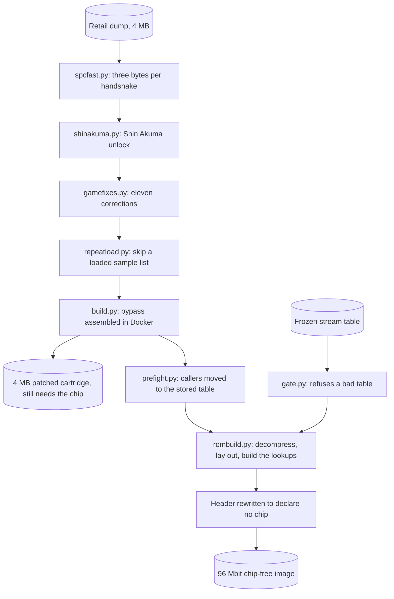

<div align="center">

# Street Fighter Alpha 2 without the S-DD1

<strong>Tooling that rebuilds Street Fighter Alpha 2 and Street Fighter Zero 2 for the Super Nintendo with the S-DD1 decompression chip designed out, held to snes9x's own decompressor and to the retail cartridges you supply.</strong>

English | [日本語](README.ja.md) | [简体中文](README.zh-Hans.md) | [繁體中文 (香港)](README.zh-HK.md)

[](https://github.com/gufranco/snes-street-fighter-alpha-2-nochip/actions/workflows/ci.yml)
[](https://github.com/gufranco/snes-street-fighter-alpha-2-nochip/releases)
[](LICENSE)

</div>

<p align="center">
  <a href="#install">Install</a> |
  <a href="#the-interface">Interface</a> |
  <a href="#is-it-right">Is it right</a> |
  <a href="#working-on-it">Working on it</a> |
  <a href="https://github.com/gufranco/snes-street-fighter-alpha-2-nochip/issues">Issues</a>
</p>

---

5,672 streams decompressed and compared byte for byte with snes9x's `sdd1emu.cpp`, 0 differing; 20 images run for 12,000 frames each, 0 lookup misses; 1,253 tests; a 100% statement and branch coverage gate; no Python dependencies outside the standard library.

```python
import hardware

mapper = hardware.load("mapper")
addresses = ((0x00, 0x8000), (0x40, 0x0000), (0x40, 0x8000), (0xC0, 0x0000), (0xC0, 0x8000))

for bank, address in addresses:
    offset = mapper.address_to_file(bank, address, 192)
    print(f"${bank:02X}:{address:04X} is file offset {offset:#09x}")
```

```
$00:8000 is file offset 0x0000000
$40:0000 is file offset 0x0800000
$40:8000 is file offset 0x0200000
$C0:0000 is file offset 0x0a00000
$C0:8000 is file offset 0x0600000
```

The example asks the pinned cartridge map where five console addresses land in a 192 bank image, the size of the 96 Mbit chip-free image this project builds. The file holds two planes of half banks. Bank `$00` reads the high half of bank 0 at offset 0. Bank `$40` exposes both halves of its own storage. Bank `$C0` owns no storage: its two halves are the low halves of banks `$80` and `$00`, which is how the original 4 MB ROM stays readable at `$C0`-`$FF` while the decompressed graphics fill `$40`-`$7D`.

## Install

| Requirement | Version |
|:--|:--|
| Python | 3.12 or newer |
| git | Any, to fetch the nine submodules |
| Docker | Any current release, running. [`build.py`](build.py), [`pack.py`](pack.py) and the checks against snes9x run their toolchains in containers |
| Your own cartridge dumps | 4,194,304 bytes each, in `roms/`, named as [The dumps](#the-dumps) lists them |

```bash
git clone --recurse-submodules https://github.com/gufranco/snes-street-fighter-alpha-2-nochip.git
cd snes-street-fighter-alpha-2-nochip
python3 doctor.py
```

> [!IMPORTANT]
> Every model this project measures itself against is its own repository, pinned as a submodule at the root, so `--recurse-submodules` is required. A clone made without it is repaired with `git submodule update --init --recursive`. A source archive from the download-zip link carries no submodule content and cannot be repaired, so clone instead.

The doctor prints the machine, the version of every pinned model, the state and SHA-256 of each dump in `roms/`, whether the decompressor decodes, whether `docker` is on the path, and the report each model's own doctor gives. A dump that is not in `roms/` counts as a check that did not pass. The report ends with one line, and the exit code is 0 for the first form and 1 for the second:

```
  N checks, nothing to report
  K of N checks did not pass
```

Paste the whole output into any bug report.

Releases follow [Semantic Versioning](https://semver.org/) and are cut from the commit history by semantic-release. Every release is tagged and listed on the [releases page](https://github.com/gufranco/snes-street-fighter-alpha-2-nochip/releases). A release ships no image: each image [`pack.py`](pack.py) writes carries the version in its file name.

## The interface

### Building the images

```bash
python3 tools/identify.py
python3 pack.py
python3 pack.py jp
```

[`tools/identify.py`](tools/identify.py) checks each dump in `roms/` against [`artifacts.manifest.json`](artifacts.manifest.json). [`pack.py`](pack.py) builds the chip-free image for each region named, or both when none is named, writes each one twice to `dist/`, and lists all of them in a `SHA256SUMS` manifest:

```
  sfz2-jp-nochip-v<version>.sfc  12,582,912 bytes
  sfz2-jp-nochip-sd2snes-v<version>.smc  12,583,424 bytes
  sfa2-usa-nochip-v<version>.sfc  12,582,912 bytes
  sfa2-usa-nochip-sd2snes-v<version>.smc  12,583,424 bytes
  SHA256SUMS  4 images
```

The `.sfc` declares no chip. The `.smc` is for the sd2snes firmware that runs the SD2SNES and the FXPAK Pro. That firmware uses its 96 Mbit map only for a header declaring chip `$43` or `$45`, and release v1.11.2 only for a file of exactly 12,583,424 bytes. So the `.smc` declares chip `$43` in all six header copies and starts with a 512 byte copier header. Everything after that header is the same image.

[`pack.py`](pack.py) runs every patch below in order on the retail dump, assembles the bypass in Docker, adds the pre-fight table, lays out the image from the frozen stream table, and rewrites the header to declare a plain ROM. Before writing anything it runs [`gate.py`](gate.py) over each region's stream table and stops on any finding.

| Command | Arguments | Exit codes |
|:--|:--|:--|
| [`pack.py`](pack.py) | `[usa] [jp]` | 0 written, 1 a dump is missing, the gate failed or the assembly failed, 2 an unknown region |
| [`tools/identify.py`](tools/identify.py) | `[file name ...]`, default every dump the manifest declares | 0 at least one dump correct and none wrong, 1 a dump is wrong or none is correct, 2 no declared dump has that name |
| [`gate.py`](gate.py) | `[usa] [jp]` | 0 every table passes, 1 a finding, 2 an unknown region |
| [`doctor.py`](doctor.py) | none | 0 every check passed, 1 otherwise |

[`tools/identify.py`](tools/identify.py) names each dump with one of seven states: `ok`, `missing`, `no digest published`, `wrong size`, `wrong content`, `known bad dump` or `another entry`. The last four block a build. For each blocking or missing dump it prints the digest command for macOS, Linux and Windows PowerShell.

```
  sfa2-usa-final.sfc: ok  [Street Fighter Alpha 2, USA]
      read as bare, 4,194,304 bytes
      crc32  9C59DDFF
      sha256 910a29f834199c63c22beddc749baba746da9922196a553255deade59f4fc127
  sfz2-jp-final.sfc: ok  [Street Fighter Zero 2, Japan]
      read as bare, 4,194,304 bytes
      crc32  7455A7CF
      sha256 f15731675e22dbf3882b777b2d8cd541a637dfdf5d8880c83903cf1e0b64590e
  sfa2-usa-vc-sound-restored.sfc: ok  [SNES Classic dump with the sound restored]
      read as bare, 4,194,304 bytes
      crc32  72A9E2C1
      sha256 f8aa2ae1f4bc993092fc282a883ecaf669269c17a175a5f43fa95e9da6459dc0

  3 of 3 declared dumps present and correct
```

[`gate.py`](gate.py) refuses a table with a repeated source, an entry that does not decode to its recorded length, a recorded hardware request the table does not cover, or a key scan longer than 64 slots. On the frozen tables it prints:

```
  jp: 2,855 streams, ok
  usa: 2,817 streams, ok
```

### The patches

Each patch is a module with an `apply(rom)` call and a command line. `apply` takes the bytes of a ROM and returns the patched bytes. Every patch except `prefight.apply` also rewrites the header checksum. Each finds its sites by byte signature, so one module covers both regions. Applying a patch twice returns the input unchanged. A ROM that matches none of the signatures is refused with `ValueError`.

| Module | Command | What it changes |
|:--|:--|:--|
| [`spcfast.py`](spcfast.py) | `spcfast.py <source-rom> <output-rom>` | The sample upload, 420 bytes in 21 runs |
| [`shinakuma.py`](shinakuma.py) | `shinakuma.py <source-rom> <output-rom>` | The Shin Akuma unlock, two bytes |
| [`gamefixes.py`](gamefixes.py) | `gamefixes.py <source-rom> <output-rom>` | The eleven corrections listed under [What you get](#what-you-get) |
| [`repeatload.py`](repeatload.py) | `repeatload.py <source-rom> <output-rom>` | Skips a base sample list that is already loaded, with a 61 byte routine at `$C7:F600` |
| [`prefight.py`](prefight.py) | `prefight.py <source-rom> <output-rom>` | Redirects both callers of the pre-fight table builder to a 61 byte routine that moves the finished table with one DMA |

Every command exits 0 when it wrote the output, 1 when the output path is the source path, and 2 on a wrong argument count. A refused ROM ends with the `ValueError` traceback.

```python
import gamefixes
import prefight
import repeatload
import shinakuma
import spcfast

blank = bytes(0x400000)
for patch in (spcfast, shinakuma, gamefixes, repeatload, prefight):
    try:
        patch.apply(blank)
    except ValueError as refusal:
        print(f"{patch.__name__}: {refusal}")

print(spcfast.patch_bytes(), len(spcfast.PATCH), len(prefight.table()))
print(len(gamefixes.FIXES), len(gamefixes.EMPTY_CALLS))
```

```
spcfast: this is not an unpatched retail Alpha 2 or Zero 2 ROM
shinakuma: no Shin Akuma unlock gate found
gamefixes: this ROM carries none of the sites these fixes name
repeatload: the sound engine's allocator setup is not where this patch expects it
prefight: no pre-fight table builder found
420 21 24704
8 3
```

A 4 MB block of zeroes carries none of the signatures, so every patch refuses it. The last two lines are the size of the sample upload patch, the 24,704 byte pre-fight table, and the eight signature fixes plus three empty-call rewrites that make up the eleven corrections.

| Call | Returns |
|:--|:--|
| `spcfast.is_stock(rom)`, `spcfast.is_patched(rom)` | Whether the driver is the retail one, or already patched |
| `spcfast.checksum(rom)`, `spcfast.write_checksum(rom)` | The header checksum, and the ROM with checksum and complement written at `$7FDC` |
| `shinakuma.find_gate(rom)` | The file offset of the unlock gate, or `None`. Raises `ValueError` when it appears more than once |
| `gamefixes.survey(rom)` | Each entry's name mapped to `applied`, `already` or `absent` |
| `gamefixes.changed_bytes(rom)` | How many bytes the entries would change, not counting the checksum |
| `gamefixes.report(rom, say=print)` | Prints the survey, one line per entry |
| `repeatload.is_patched(rom)`, `repeatload.report(rom, say=print)` | Whether the skip is in, and the hook, routine and marker addresses |
| `prefight.table()` | The 24,704 byte table, 193 rows of 64 sixteen bit words |
| `prefight.find_builder(rom)`, `prefight.find_callers(rom)` | The builder's file offset, and the offset of each call to it |

### The image builder

[`rombuild.py`](rombuild.py) lays out the 96 Mbit image. `rombuild.build(rom, entries, image_banks=192, extra=())` takes the bypassed 4 MB ROM and a list of streams, and returns a `Result` with `image`, `destinations`, `tables` and `regions`. `extra` is a tuple of `(address, bytes)` pairs placed after the streams, which is how [`pack.py`](pack.py) adds the pre-fight table at `$5F0000`. A ROM that is not 4,194,304 bytes raises `ValueError`. Streams that do not fit raise `rombuild.AllocationError`, naming the largest gap left.

`rombuild.entries_from_map(mapping)` turns a `{source: length}` mapping into entries. [`usastreams.py`](usastreams.py) and [`jpstreams.py`](jpstreams.py) each hold a frozen table as `STREAMS`, a tuple of `(source, length)` pairs.

[`sdd1tables.py`](sdd1tables.py) builds the four lookup tables the translate routine reads. A stream whose source shares its low 16 bits with another goes in the first free slot after it:

```python
from collections import namedtuple

import sdd1tables

Stream = namedtuple("Stream", "source")
tables = sdd1tables.build(
    [
        (Stream(0x001234), 0x400000),
        (Stream(0x011234), 0x410000),
        (Stream(0x001235), 0x420000),
    ]
)
for slot in tables.slots:
    destination = tables.dest_bank[slot] << 16 | tables.dest_high[slot] << 8 | tables.dest_low[slot]
    print(f"slot {slot:#06x}  key ${tables.key[slot]:02X}  destination ${destination:06X}")
```

```
slot 0x1234  key $C0  destination $400000
slot 0x1235  key $C1  destination $410000
slot 0x1236  key $C0  destination $420000
```

The second stream collides with the first at `$1234` and moves one slot on. The third then finds its own slot taken and moves to `$1236`. The routine scans forward from the low 16 bits of the source until the key byte matches the source bank, so all three resolve. `sdd1tables.build` raises `sdd1tables.PlacementError` when no placement leaves every scan unambiguous, and `ValueError` for a destination in bank `$00`, which the scan cannot tell from an empty slot.

### Naming and the release manifest

```python
import pack

print(pack.output_name("usa", "2.0.0"))
print(pack.output_name("jp", "0.0.0"))
print(pack.manifest_line("sfz2-jp-nochip-v2.0.0.sfc", b""))
```

```
sfa2-usa-nochip-v2.0.0.sfc
sfz2-jp-nochip-v0.0.0-dev.sfc
e3b0c44298fc1c149afbf4c8996fb92427ae41e4649b934ca495991b7852b855  sfz2-jp-nochip-v2.0.0.sfc
```

`pack.output_name(region, release=None)` stamps the version from [`version.py`](version.py), and version `0.0.0` is marked `-dev`. `pack.sd2snes_name(region, release=None)` names the `.smc` the same way. `pack.for_sd2snes(image)` returns that form of a finished image, and raises `NoHeader` for an image with no header. `pack.unify_headers(image)` copies the first header over every copy at a bank end that shares its title and map byte, so the rewrite that follows reaches all six. `pack.manifest_line(name, image)` is one line of `SHA256SUMS`. `pack.build(region, workdir)` returns the finished image for one region and needs Docker and the retail dump. `pack.REGIONS` names each region's retail dump and bypass patch. A failed assembly raises `pack.AssemblyFailed` carrying the output of [`build.py`](build.py).

### Every command

| Command | Arguments | What it does |
|:--|:--|:--|
| [`build.py`](build.py) | `<patch.asm> <source-rom> <output-rom>`, or `--image` | Assembles a patch with asar 1.81 in a container with no network, writing the output beside the patch. `--image` only builds the container |
| [`rombuild.py`](rombuild.py) | `<patched-rom> <tagged-rom> <output.sfc>` | Lays out the 96 Mbit image from the stream map in a tagged dump |
| [`mapcheck.py`](mapcheck.py) | `<rom>` | Checks the frozen table for the dump's region: duplicates, undecodable entries and scan distance |
| [`patchrun.py`](patchrun.py) | `<built-image> <patched-rom> <tagged-rom>` | Runs the assembled translate routine on the 65816 model for every stream and compares where it points |
| [`sdd1ref.py`](sdd1ref.py) | `<rom> [cases] [seed]`, default 500 cases and seed 20260813 | Decompresses random offsets with snes9x's `sdd1emu.cpp` in a container and with the Python model, and compares |
| [`sdd1map.py`](sdd1map.py) | `<tagged-rom> <source-rom> [output.bin]` | Reads the stream map out of the `SDD1` tags in a tagged dump |
| [`sdd1find.py`](sdd1find.py) | `<source-rom> <reference-rom> [start] [stop]` | Finds streams by content, against a dump that holds the same graphics decompressed |
| [`sdd1sites.py`](sdd1sites.py) | `<source-rom> <tagged-rom>` | Lists every store to the chip's registers outside compressed data, and disassembles each arm site |
| [`analyse.py`](analyse.py) | four ROM paths | Profiles compressed-looking blocks in two Star Ocean dumps and two Alpha 2 dumps |
| [`tools/verify_streams.py`](tools/verify_streams.py) | `[usa] [jp]` | Every stream in the frozen tables through snes9x's `sdd1emu.cpp`, compared with the Python decompressor |
| [`tools/verify_image.py`](tools/verify_image.py) | `[image]`, default `build/all/jp-both-free.sfc` | Walks a finished image's lookup tables as the console does and compares the bytes at each destination |
| [`tools/rebuild_all.py`](tools/rebuild_all.py) | none | Builds every region and patch set into `build/all/` as a cartridge, a bypass and a chip-free image |
| [`tools/validate_all.py`](tools/validate_all.py) | `[name filter]` | Runs each image in `build/all/` for 12,000 frames on the emulator harness and prints the verification table |
| [`tools/compare_audio.py`](tools/compare_audio.py) | `[--fights] [--roster N] [--budget N] <stock> <patched>` | Compares two builds upload by upload |
| [`tools/tour_audio.py`](tools/tour_audio.py) | `[name filter] [roster] [budget]`, default `both-cart`, 18 and 12000 | Plays every fighter in turn and reports stalls and corrupt uploads |
| [`tools/driver_run.py`](tools/driver_run.py) | `<rom>` | Runs the audio driver before and after the patch on the SPC700 model and on the whole S-SMP, and counts cycles |
| [`tools/sample_audit.py`](tools/sample_audit.py) | `<apu-ram-image> <directory-page> [sample ...]` | Reads a 64 KB sound RAM image as the audio chip does, from the sample directory at that address, and reports samples that run off, loop outside themselves or share bytes |
| [`tools/sample_reuse.py`](tools/sample_reuse.py) | `[log ...]`, default `build/soundwalk/grp-*.txt` | Replays every sample upload in a harness log against a shadow of sound RAM |
| [`tools/stage_diff.py`](tools/stage_diff.py) | `[before] [after] [tag]` | Drives two builds through every matchup and counts the frames that differ |
| [`tools/tile_shape.py`](tools/tile_shape.py) | `<rom> [streams]` | Measures how often decompressed streams repeat a 4bpp tile, against random bytes of equal length |
| [`tools/tour_oracle.py`](tools/tour_oracle.py) | none | Drives the retail cartridge and records what it asks the chip for |
| [`tools/harvest_jp.py`](tools/harvest_jp.py) | none | Proposes Japanese stream candidates for the gate to judge |
| [`tools/converge_jp.py`](tools/converge_jp.py) | none | Repeats those runs until a round adds nothing |
| [`tools/freeze_spcfast.py`](tools/freeze_spcfast.py) | `[--check]` | Assembles the sample upload patch and rewrites [`spcfast.py`](spcfast.py) from the difference. `--check` compares without writing |

A command given the wrong number of required arguments exits 2. [`mapcheck.py`](mapcheck.py), [`patchrun.py`](patchrun.py), [`sdd1ref.py`](sdd1ref.py), the two verify tools, [`tools/validate_all.py`](tools/validate_all.py), [`tools/compare_audio.py`](tools/compare_audio.py) and [`tools/tour_audio.py`](tools/tour_audio.py) exit 1 when a check fails and 0 otherwise.

```bash
python3 tools/verify_streams.py
python3 tools/verify_image.py build/all/usa-both-free.sfc
```

```
  jp: all 2855 streams identical to the reference
  usa: all 2817 streams identical to the reference
```

```
  image usa-both-free.sfc, 2,817 streams
  unresolved lookups: 0
  streams whose bytes in the image are wrong: 0
```

[`tools/verify_streams.py`](tools/verify_streams.py) also prints a progress line every 200 streams. [`tools/verify_image.py`](tools/verify_image.py) reads the region from the image's file name.

## How it works

Street Fighter Alpha 2 keeps most of its graphics compressed. The S-DD1 inside the retail cartridge decompresses them mid-DMA as the game asks for them. Without the chip there are no graphics.

This project decompresses every stream ahead of time, lays the result out in a larger image, and patches the seven places where the game arms the chip so they read the finished bytes instead. The result is an ordinary SNES ROM with no coprocessor and no mapper chip, and the cartridge has to hold 96 Mbit and serve it.

The pause before every fight sits in the sound driver, which hands samples to the audio chip one byte per handshake. Rewriting the receiving loop to carry three bytes per handshake removes most of it.

[`pack.py`](pack.py) runs these steps in order:

1. [`spcfast.py`](spcfast.py) makes the sample upload carry three bytes per handshake.
2. [`shinakuma.py`](shinakuma.py) unlocks Shin Akuma.
3. [`gamefixes.py`](gamefixes.py) applies the eleven corrections.
4. [`repeatload.py`](repeatload.py) skips a sample list that is already loaded.
5. [`build.py`](build.py) assembles the bypass over the seven arm sites. The result is the 4 MB patched cartridge, which still needs the chip.
6. [`prefight.py`](prefight.py) redirects the pre-fight table builder's callers.
7. [`rombuild.py`](rombuild.py) decompresses every stream, lays out the image and builds the lookup tables.
8. The header is rewritten to declare a plain ROM with no chip.

The bypass comes before the layout because the layout reclaims the compressed data the bypass reads. The header comes last because it checksums the finished image.



### The chip, and what replaces it

The S-DD1 maps memory, which Alpha 2 never uses, leaving banks `$C0` to `$FF` exposing the 4 MB linearly. It also decompresses: when the CPU writes a non-zero byte to `$4801` and starts a DMA whose channel has a fixed A-bus address, the chip decodes a stream into the destination instead of copying raw bytes. `$4801` clears itself, so the game re-arms it before every stream.

Seven sites in each region arm it, listed in [`asm/sdd1-bypass.asm`](asm/sdd1-bypass.asm) and [`asm/sdd1-bypass-jp.asm`](asm/sdd1-bypass-jp.asm). Each is replaced by a call to a shared routine in [`asm/sdd1-translate.asm`](asm/sdd1-translate.asm). The routine looks up where the decompressed copy was placed, rewrites the DMA source, and clears the fixed A-bus bit so the transfer becomes an ordinary incrementing read.

The lookup is four 64 KB tables in banks `$60` to `$63`, indexed by the low 16 bits of the source address: the source bank as the key, then the destination low byte, high byte and bank. A colliding key goes in the first free slot at or after its address, and the routine scans forward until the bank byte matches. [`mapcheck.py`](mapcheck.py) measures the scan distance on the USA table:

```
  streams        2,817
  duplicates     0
  undecodable    0
  scan distance  median 0, worst 31 (budget 64)
  RESULT         OK
```

The Japanese table has 2,855 streams, with the same median of 0 and worst of 31.

### Why the image is 96 Mbit, and how it is addressed

Decompressed, the graphics come to 5,013,058 bytes for the USA table and 5,047,300 for the Japanese one, which does not fit a 4 MB cartridge. The image grows to 12 MB, and 192 banks of 64 KB do not fit the 24-bit address space once mirrors and work RAM are accounted for.

The layout splits every bank in two and stores the halves in two planes of the file. Banks `$C0` and above own no storage and are a window onto the second plane.

| Banks | Exposed | Served from |
|:--|:--|:--|
| `$00`-`$3F`, `$80`-`$BF` | `$8000`-`$FFFF` only, LoROM | The high-half plane |
| `$40`-`$7D` | Full 64 KB, HiROM style | Both planes |
| `$C0`-`$FF` | Full 64 KB | The low-half plane, and never its own |

Bank `$C0+k` exposes the low half of bank `k` at `$8000`-`$FFFF` and the low half of bank `$80+k` at `$0000`-`$7FFF`. That is how 192 banks of storage cover a 256-bank address space with no bank switching and no mapping registers. This document calls it a windowed LoROM map. ExLoROM, ExHiROM and Jumbo LoROM extend the address space by adding linear banks, and this map aliases a region onto a second storage plane instead. The rule comes from neviksti's Star Ocean chip-free conversion, recovered by inspection, and the pinned cartridge map implements it as `address_to_file`.

| Region | Contents |
|:--|:--|
| Banks `$00`-`$3F` | The original ROM's LoROM view |
| Banks `$40`-`$7D` | Decompressed graphics |
| Bank `$5F` | The pre-fight table at `$5F0000` |
| Banks `$60`-`$63` | The four lookup tables |
| Banks `$7E`-`$7F` | Reserved for work RAM |
| Banks `$80`-`$BF` | FastROM mirror of `$00`-`$3F` |
| Banks `$C0`-`$FF` | The original 4 MB ROM, linear, as the window |

The free banks do not hold every decompressed stream, so once a stream is decompressed the compressed bytes it came from are reclaimed in the window banks, using each stream's real consumed extent.

### The pause

One pre-fight burst on the retail cartridge is 47,915 bytes at roughly 260 bytes per frame, one byte per scanline. The bottleneck is the receiving loop in the audio chip's RAM: the game uploads its own sound driver, which reimplements the boot protocol at 55 cycles per byte.

Because that driver lives in RAM it can be replaced. The shipped receiver carries three bytes per handshake, one in each data port, at 49 cycles per handshake. [`tools/driver_run.py`](tools/driver_run.py) measures 48 bytes through both on the whole audio unit:

```
  48 bytes through the driver as it ships and as it is patched
  stock     48 handshakes,   720 instructions
  patched   16 handshakes,   192 instructions
  landed at 0x2000: 000306090c0f1215
  landed at 0x3000: 0104070a0d101316
  landed at 0x4000: 0205080b0e111417
  the same two runs on the whole audio unit, which counts cycles
  stock     48 handshakes,   2640 cycles
  patched   16 handshakes,    784 cycles
  faster by 3.37 times
  stand-in and unit agree on every byte: True
```

| | Cycles per byte | Longest stall, Japan | Longest stall, USA |
|:--|:--|:--|:--|
| Retail | 55 | 2.60 s | 2.90 s |
| This build | 16.3 | 0.72 s | 0.78 s |

The three destination pointers sit a third of a block apart, so the store index steps by one and the page carry happens once per 256 handshakes.

The two sides of an audio port are not clocked together, so a read that lands while the console writes the port can return a mixture of old and new bits. The receiver reads the counter once while it matches. It reads it a second time before it believes a new block has begun, as the audio chip's boot program does at `$FFE9` to `$FFED`. A wrong guess there is the one decision the driver never takes back. On the SPC700 model, one counter read that looks ahead leaves a loop without that second read spinning forever, which is the black screen after the Capcom logo reported on cartridges in [issue 31](https://github.com/gufranco/snes-street-fighter-alpha-2-nochip/issues/31). The second read costs nothing on the path that moves bytes.

The game has seven uploaders, and one of them also drives the audio chip's mask-ROM boot loader, which takes one byte per handshake. The driver dispatches on the kind byte already present in each block header: 3 means triples, and the boot path is untouched. That covers 93% of the driver traffic.

The skip in [`repeatload.py`](repeatload.py) saves 840,766 bytes on the USA cartridge and 303,340 on the Japanese one across a full roster tour.

### The pre-fight table

Before every fight the game spends 27 frames computing a 24,704 byte table that never changes. The chip-free image ships the finished table at `$5F0000` and moves it with one DMA. The 4 MB cartridge keeps the builder, because the longest run of `$FF` filler in either retail ROM is 3,197 bytes and the table does not fit at any address.

## What you get

| Form | Size | Needs the chip | Written by |
|:--|:--|:--|:--|
| 96 Mbit chip-free | 12,582,912 bytes | No | [`pack.py`](pack.py), and [`tools/rebuild_all.py`](tools/rebuild_all.py) as `*-free.sfc` |
| 96 Mbit chip-free for sd2snes firmware | 12,583,424 bytes | No, though the header declares it | [`pack.py`](pack.py) as `*-sd2snes-*.smc` |
| 4 MB patched cartridge | 4,194,304 bytes | Yes, for hardware that already emulates the S-DD1 | [`tools/rebuild_all.py`](tools/rebuild_all.py) as `*-bypass.sfc` |

Both carry the faster sample upload, the Shin Akuma unlock and the corrections. Only the chip-free image carries the pre-fight table.

The unlock is two bytes. Shin Akuma has been in the retail cartridge since 1996, behind a cheat that went undocumented until 2021.

### The corrections

Eleven entries in [`gamefixes.py`](gamefixes.py). They change 218 bytes of the USA file and 60 of the Japanese one, each count including the four checksum bytes. Every entry is found by a byte signature, so one table covers both regions, a ROM that does not match refuses the patch, and applying it twice is a no-op.

| Fix | Regions | What it does |
|:--|:--|:--|
| Sodom name, four screens | USA | Restores the name the USA release changed, under the life bar, on the select screen, on the versus screen and on the results screen. The Japanese ROM already carries it |
| Akuma win pose order | Both | Arcade order, with the silent pose index moved to match |
| Object table overflow | Both | Stops the live-object count exceeding the number of objects that exist when a ninth shadow frame is requested |
| Thrown father sprite | Both | Three sprite records in the frame where Sagat holds Dan's father |
| Empty call removal | Both | 45 long calls to a bare `rtl` whose next byte is `rts`, rewritten to return directly |

[`gamefixes.py`](gamefixes.py) prints the survey before it writes. On the USA dump after the first two patches:

```
  thrown father sprite             applied  0x3ea956  regions usa, jp
  sodom name on the life bar       applied  0x0088c7  regions usa
  sodom name on the select screen  applied  0x00d68c  regions usa
  sodom name on the vs screen      applied  0x002260  regions usa
  sodom name on the vs results screen applied  0x1ab82e  regions usa
  object table overflow            applied  0x057537  regions usa, jp
  akuma win pose order             applied  0x020048  regions usa, jp
  akuma silent win pose index      applied  0x01e944  regions usa, jp
  empty routine at $FF:FF4D        applied  42 call sites
  empty routine at $F0:1EEF        applied  1 call sites
  empty routine at $FF:FEA1        applied  2 call sites
  214 bytes to change across 11 entries
[done] build/step3.sfc (4,194,304 bytes)
```

## The dumps

Named as No-Intro names them. Every digest is of the whole file with no copier header, and [`tools/identify.py`](tools/identify.py) strips one before measuring. SHA-256 decides, and CRC32 is there to cross-check against databases that still key on it.

| File | Read as | SHA-256 | CRC32 |
|:--|:--|:--|:--|
| Street Fighter Alpha 2, USA | `roms/sfa2-usa-final.sfc` | `910a29f834199c63c22beddc749baba746da9922196a553255deade59f4fc127` | `9C59DDFF` |
| Street Fighter Zero 2, Japan | `roms/sfz2-jp-final.sfc` | `f15731675e22dbf3882b777b2d8cd541a637dfdf5d8880c83903cf1e0b64590e` | `7455A7CF` |
| DarkAkuma's SNES Classic dump | `roms/sfa2-usa-vc-sound-restored.sfc` | `f8aa2ae1f4bc993092fc282a883ecaf669269c17a175a5f43fa95e9da6459dc0` | `72A9E2C1` |

The third file is not a retail cartridge. It carries the `SDD1` stream tags that [`usastreams.py`](usastreams.py) was generated from, and only [`rombuild.py`](rombuild.py), [`sdd1map.py`](sdd1map.py), [`sdd1sites.py`](sdd1sites.py) and [`patchrun.py`](patchrun.py) read it. Both stream tables are frozen into the repository, so [`pack.py`](pack.py) needs the two retail dumps and nothing else.

## Building the stages by hand

```bash
mkdir -p build
python3 spcfast.py    roms/sfa2-usa-final.sfc  build/step1.sfc
python3 shinakuma.py  build/step1.sfc          build/step2.sfc
python3 gamefixes.py  build/step2.sfc          build/step3.sfc
python3 repeatload.py build/step3.sfc          build/step4.sfc
python3 build.py      asm/sdd1-bypass.asm build/step4.sfc bypass.sfc
python3 rombuild.py   asm/bypass.sfc roms/sfa2-usa-vc-sound-restored.sfc build/nochip.sfc
python3 -c 'import hardware, pathlib; r = hardware.load("romimage"); pathlib.Path("build/final.sfc").write_bytes(r.rewrite.declare_rom_only(r.dump.read("build/nochip.sfc")))'
```

This route builds the USA image without the pre-fight table, from the stream map in the tagged dump. [`rombuild.py`](rombuild.py) reads 2,815 streams from the tags, two fewer than the 2,817 in the frozen table [`pack.py`](pack.py) uses:

```
  streams   2,815
  graphics  5,012,738 bytes across 90 banks
  image     12,582,912 bytes (96 Mbit)
```

[`build.py`](build.py) writes its output beside the patch, so the bypass lands in `asm/bypass.sfc`. The Japanese region has no tagged dump, so its image comes only from [`pack.py`](pack.py).

## Known limits

**The Japanese stream table cannot be proved complete.** A stream nobody asks for cannot be found. The table covers all 1,661 requests recorded from working hardware in [`requests_jp.py`](requests_jp.py), and the search converged. If a screen ever comes up wrong, drive the retail cartridge to that screen, read what it asks the chip for, and add it. The USA table came out of a tagged dump and does not have this limit.

**Two corrections are not demonstrated on screen.** The object table overflow needs eight simultaneous shadow frames plus a projectile collision, and the thrown father sprite sits in a scene no driver here reaches. Both rest on the disassembly, and the same runs show neither changes anything that is reached.

**The Japanese build has only been run under emulation.** It is the same construction as the USA one and passes the same checks.

**The guarded sample upload and the `.smc` are not yet seen on a cartridge.** Both answer [issue 31](https://github.com/gufranco/snes-street-fighter-alpha-2-nochip/issues/31), where 1.5.4 shows a black screen after the Capcom logo on SD2SNES cartridges and an SD2SNES Pro. The model shows the guarded upload surviving the torn read that stops 1.5.4, and the firmware source shows the `.smc` reaching the right map. Only a cartridge can show that either is the whole fix.

[`OPEN-QUESTIONS.md`](OPEN-QUESTIONS.md) lists every open question with the measurement that would close it.

## Emulator support

These images need a map no emulator had. It is merged into snes9x as [pull request 1082](https://github.com/snes9xgit/snes9x/pull/1082), so a current build loads them. The discussion is in [issue 1081](https://github.com/snes9xgit/snes9x/issues/1081), and the work is on the [`sdd1-decompressed-map`](https://github.com/gufranco/snes9x/tree/sdd1-decompressed-map) branch of a fork.

Circulating chip-free conversions keep the retail header, so they claim a chip they no longer contain, and an emulator matching on that enables chip emulation and applies the wrong layout. The image package rewrites the chipset and size fields at all six places the header appears in these images, because the original ROM is mirrored into the window banks and the FastROM mirror. With an honest header, the remaining gap was the layout itself, which the merged change adds.

ares, Mesen2, bsnes and Mednafen have not been run against these images.

## Checking a patch that changes the audio path

[`spcfast.py`](spcfast.py) replaces the sample upload loop and [`repeatload.py`](repeatload.py) skips an upload when the list asked for is already loaded. Neither may change which bytes the audio processor ends up holding. Diffing the audio processor's memory at the end of two runs cannot settle that, because the patch changes timing and the two runs stop with the driver at different points.

```bash
python3 tools/compare_audio.py build/all/jp-base-cart.sfc build/all/jp-spc-cart.sfc
python3 tools/compare_audio.py --fights build/all/jp-spc-cart.sfc build/all/jp-both-cart.sfc
```

The comparison is per upload. Every block the cartridge hands over is checked against the bytes still in the cartridge, so a loop that drops a byte fails on the block it dropped it in. It also reports which sources were uploaded at all, since a skip may upload fewer of them and never different ones, and the writes per byte, which is the number a faster loop changes. `--roster` and `--budget` set the fighters toured and the frames per fighter, 18 and 4000 by default.

The roster tour alone never reaches the skip, because every character loads a different list. `--fights` enters a fight and returns, which is the only way to ask for a list that is already loaded.

## The models underneath

Every claim about what a part does is made by a model on the import path, never here. Each is its own repository, pinned as a submodule at the root, and [`hardware.py`](hardware.py) is the only way any of them is reached. `hardware.load(name)` returns the package, or raises `hardware.ModelMissing` with the command that fills in the checkout. A name not in the list raises `hardware.UnknownPackage`.

| Name | Repository | What it answers |
|:--|:--|:--|
| `sdd1` | [snes-sdd1-python](https://github.com/gufranco/snes-sdd1-python) | What the decompressor produces for a stream |
| `mos65xx` | [mos65xx-python](https://github.com/gufranco/mos65xx-python) | What the cartridge's own code does when run |
| `spc700` | [sony-spc700-python](https://github.com/gufranco/sony-spc700-python) | What the audio processor does |
| `ssmp` | [sony-s-smp-python](https://github.com/gufranco/sony-s-smp-python) | The audio processor with the sound generator and boot program, counting cycles |
| `sdsp` | [sony-s-dsp-python](https://github.com/gufranco/sony-s-dsp-python) | What reaches the mixer |
| `mapper` | [snes-mapper-python](https://github.com/gufranco/snes-mapper-python) | Where an address lands in a cartridge |
| `romimage` | [snes-rom-image-python](https://github.com/gufranco/snes-rom-image-python) | What a header says, how to rewrite it, and a dump's digests |
| `snesgfx` | [snes-graphics-python](https://github.com/gufranco/snes-graphics-python) | Whether a decompressed stream reads as tiles |
| `snesdriver` | [snes-driver-python](https://github.com/gufranco/snes-driver-python) | Where in the code the cartridge talks to its chip |

The models start dirty: memory and registers hold arbitrary but reproducible values, and anything here that wants a cleared machine sets it.

## Is it right

The decompressor is compared with snes9x 1.63's `sdd1emu.cpp`, built from source in the pinned container under [`ref/`](ref). [`tools/verify_streams.py`](tools/verify_streams.py) runs all 2,817 USA and 2,855 Japanese streams through both, and none differ. [`tools/verify_image.py`](tools/verify_image.py) then reads every stream back out of a finished image through its lookup tables.

The image matrix is two regions by four patch sets by two cartridge forms, sixteen images, plus four USA control builds that each drop one patch. [`tools/validate_all.py`](tools/validate_all.py) runs each on the harness under [`emu/`](emu) for 12,000 frames. In the last recorded run all 20 loaded, all delivered 12,000 of 12,000 frames, and none missed a lookup.

| Checked | How |
|:--|:--|
| Boots and renders | Frames delivered, and frame brightness sampled every 300 frames |
| Sound runs | APU port write counts |
| Sample uploads intact | Every block compared byte for byte against its ROM source |
| Menus respond | Fights load, which only happens by passing through the menus |
| Pause | Longest pre-fight upload burst |
| Graphics lookups | Table scan length, where anything over 64 steps is a miss |
| Shin Akuma | `$7E:1B09` reads `$4A4B` only where patched |

| Region | Patches | 4 MB cartridge | 96 Mbit chip-free |
|:--|:--|:--|:--|
| USA | None | 2.90 s | 3.13 s |
| USA | Fast upload | 0.78 s | 0.77 s |
| USA | Both | 0.78 s | 0.77 s |
| Japan | None | 2.60 s | 2.60 s |
| Japan | Fast upload | 0.72 s | 0.72 s |
| Japan | Both | 0.72 s | 0.72 s |

Every image carrying the sound patch is also driven through all eighteen fighters in turn, resetting between them: 50,652 sample uploads verified, none bad.

| Hardware | Image | Result |
|:--|:--|:--|
| Game Doctor SF7, 128 Mbit DRAM | USA, 96 Mbit chip-free | Runs |
| FXPAK Pro | USA, 96 Mbit chip-free | Runs |
| FXPAK Pro | USA, 4 MB patched cartridge | Runs |
| Super EverDrive | USA, 96 Mbit chip-free | Title screen, in a [photograph](https://x.com/yoshinokentarou/status/2111959864163664247/photo/1) by @yoshinokentarou |
| SD2SNES, an SD2SNES Mk.II clone on firmware 1.11.2-br-2.17, and an SD2SNES Pro | USA, 96 Mbit chip-free, 1.5.4 | Black screen after the Capcom logo, reported in [issue 31](https://github.com/gufranco/snes-street-fighter-alpha-2-nochip/issues/31) |

The FXPAK Pro emulates the S-DD1 in its FPGA, which is why the 4 MB form runs there, and that emulation is idle for the chip-free image.

The Super EverDrive row rests on the photograph alone. That cartridge has no S-DD1, the screen carries Capcom U.S.A.'s copyright line and the post links this project, which together point to the USA chip-free image. Nothing past the title screen has been seen there.

`tools/freeze_spcfast.py --check` confirms the frozen patch in [`spcfast.py`](spcfast.py) still reproduces the assembler's output byte for byte. The divergences between sources are in [`conformance/divergences.json`](conformance/divergences.json), which [`conformance/divergences.test.py`](conformance/divergences.test.py) holds to [`OPEN-QUESTIONS.md`](OPEN-QUESTIONS.md).

## Working on it

| Need | Where |
|:--|:--|
| Every gate and the order to run them | [CONTRIBUTING.md](CONTRIBUTING.md) |
| The same material for a coding agent | [AGENTS.md](AGENTS.md) |
| The standard this repository shares with the rest of the family | [FAMILY.md](FAMILY.md) |
| Bug reports and wrong screens | [GitHub Issues](https://github.com/gufranco/snes-street-fighter-alpha-2-nochip/issues) |
| Security reports | [SECURITY.md](SECURITY.md) |
| Conduct | [CODE_OF_CONDUCT.md](CODE_OF_CONDUCT.md) |

```bash
uvx ruff@0.16.3 format --check .
uvx ruff@0.16.3 check .
pnpm install --frozen-lockfile && pnpm run format:check
uvx --python 3.12 mypy==1.14.1
for module in *.test.py tools/*.test.py conformance/*.test.py; do python3 "$module" || echo "FAILED $module"; done
python3 doctor.py
```

The suite is 1,253 tests across 49 modules: 725 beside the analysis modules, 510 beside the tools and 18 under [`conformance/`](conformance). Each module has its test file beside it, named after it, and runs on its own. A test that needs a retail dump lives in a `<module>.retail.test.py` file beside the module and reports as skipped without one. Coverage is a 100% statement and branch gate set in [`pyproject.toml`](pyproject.toml), measured without those files, so it holds on a machine with no dump and CI enforces it on every push.

Builds run in Docker with pinned toolchains, no network and a non-root user, never on the host. The assembly in [`asm/`](asm) is the only source carrying comments: entry and exit state, register widths, and where each recovered address came from.

<details>
<summary><strong>Project structure</strong></summary>

| Path | Holds |
|:--|:--|
| [`asm/`](asm) | The patches in 65816 and SPC700 assembly, among them the bypass, the translate routine and the fast upload, with the container that runs asar 1.81 |
| [`tools/`](tools) | Sixteen tools: dump identification, stream and image verification, the image matrix, audio comparison and the Japanese stream search |
| [`emu/`](emu) | The emulator harness the image matrix runs on, built on snes9x 1.63 with the windowed map added |
| [`ref/`](ref) | The container that builds snes9x 1.63's `sdd1emu.cpp` as the decompression reference |
| [`conformance/`](conformance) | The divergences record and the test that holds it to [`OPEN-QUESTIONS.md`](OPEN-QUESTIONS.md) |
| [`scripts/`](scripts) | The release script that stamps [`version.py`](version.py) and [`CITATION.cff`](CITATION.cff) |
| The root | Twenty-four modules: the patches, the image builder, the gate, the doctor and the frozen stream tables |
| Nine submodules | The pinned models listed under [The models underneath](#the-models-underneath) |

</details>

> [!CAUTION]
> A wrong screen is the most useful report, because it is the one failure the checks here cannot find. Say which image and region, and capture the frame. Never attach a cartridge or anything decoded out of one, and never link to where one can be downloaded. A digest identifies a file without carrying it.

## References

- Modern Vintage Gamer, [A closer look at Street Fighter Alpha 2 on the Super Nintendo](https://www.youtube.com/watch?v=fB9GlZUYNUQ), which made the point that the pause comes from the sound driver.
- [Street Fighter Alpha 2 thread on Zeldix](https://www.zeldix.net/t1831-street-fighter-alpha-2), gizaha's patches and the changelog that served as a specification for the pause work.
- Nintendo Life, [After 25 Years, A New Cheat Code Has Been Discovered For Street Fighter Alpha 2 On The SNES](https://www.nintendolife.com/news/2021/01/after_25_years_a_new_cheat_code_has_been_discovered_for_street_fighter_alpha_2_on_the_snes).
- Retroware, [The Curious Case of Street Fighter Alpha 2 on the SNES](https://articles.retroware.com/2021/03/08/the-curious-case-of-street-fighter-alpha-2-on-the-snes/).
- [snes9x](https://github.com/snes9xgit/snes9x) 1.63, `sdd1emu.cpp` for the compression reference and `iplrom.cpp` for the S-SMP boot ROM listing.
- [snes9x issue 1081](https://github.com/snes9xgit/snes9x/issues/1081) and [pull request 1082](https://github.com/snes9xgit/snes9x/pull/1082).

Written about this project:

- 吉野@連邦 ([@yoshinokentarou](https://x.com/yoshinokentarou)), [post on X](https://x.com/yoshinokentarou/status/2111959864163664247), 2026-10-18, in Japanese, with a photograph of the USA image on a Super EverDrive.
- Junior Candido, [Street Fighter Alpha 2 de Super Nintendo ganha versão sem o chip S-DD1 e com pausa pré-luta bem menor](https://arkade.com.br/street-fighter-alpha-2-ganha-versao-para-super-nintendo-sem-o-chip-s-dd1-e-com-pausa-pre-luta-bem-menor/), Arkade, 2026-10-20, in Portuguese.
- Sonymaster, [the same article reposted on the Adrenaline forum](https://forum.adrenaline.com.br/threads/street-fighter-alpha-2-de-super-nintendo-ganha-versao-sem-o-chip-s-dd1-e-com-pausa-pre-luta-bem-menor.721807/), 2026-10-21, in Portuguese.

Andreas Naive reverse engineered the S-DD1 compression algorithm. DarkAkuma produced the SNES Classic patch whose `SDD1` tags gave the USA stream map. neviksti's Star Ocean chip-free conversion was the ground truth for the decompressor and the source of the addressing rule. The bsnes project's disassembler tables are the source of both disassemblers used here.

## Citing this

[`CITATION.cff`](CITATION.cff) is updated with each release by [`scripts/set-version.sh`](scripts/set-version.sh), the script that stamps [`version.py`](version.py).

## License

MIT. See [LICENSE](LICENSE). It covers the tooling, the assembly and this document, and grants no rights in the game. No ROM data is distributed here: everything operates on dumps you supply.
