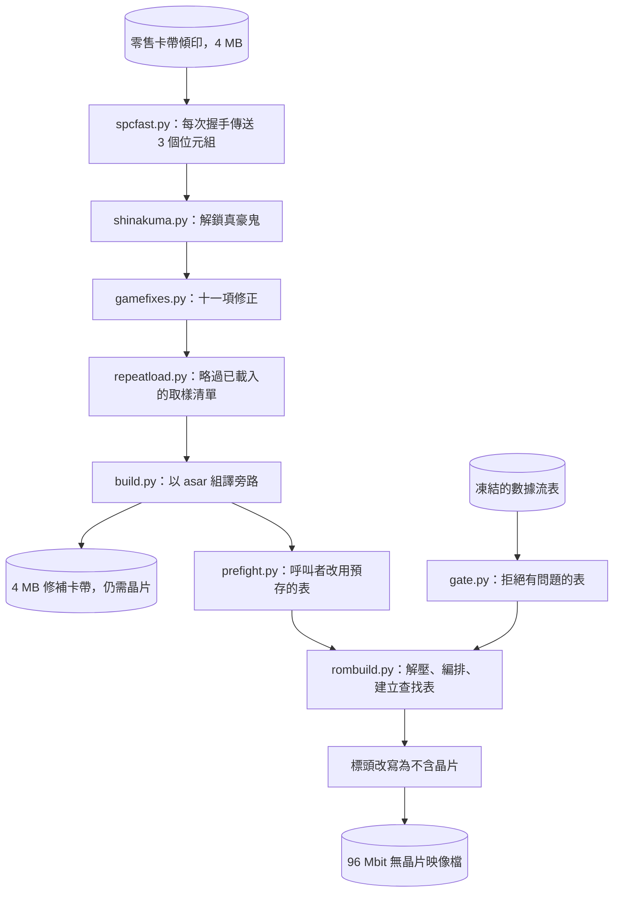

<div align="center">

# 不用 S-DD1 的 Street Fighter Alpha 2

<strong>一套工具，用來為 Super Nintendo 重新建構 Street Fighter Alpha 2 與 Street Fighter Zero 2，從設計上去掉 S-DD1 解壓晶片，並以 snes9x 本身的解壓器和你自備的零售版卡帶作為驗證標準。</strong>

[English](README.md) | [日本語](README.ja.md) | [简体中文](README.zh-Hans.md) | 繁體中文 (香港)

[](https://github.com/gufranco/snes-street-fighter-alpha-2-nochip/actions/workflows/ci.yml)
[](https://github.com/gufranco/snes-street-fighter-alpha-2-nochip/releases/latest)
[](https://github.com/gufranco/snes-street-fighter-alpha-2-nochip/actions/workflows/ci.yml)
[](LICENSE)

</div>

<p align="center">
  <a href="#install">安裝</a> |
  <a href="#the-interface">介面</a> |
  <a href="#is-it-right">是否正確</a> |
  <a href="#working-on-it">參與開發</a> |
  <a href="https://github.com/gufranco/snes-street-fighter-alpha-2-nochip/issues">問題回報</a>
</p>

---

5,672 個數據流經解壓後與 snes9x 的 `sdd1emu.cpp` 逐位元組比較，0 個有差異；20 個映像檔各執行 12,000 幀，查找未命中 0 次；1,309 個測試；100% 語句及分支覆蓋率關卡檢查；除標準庫外不依賴任何 Python 套件。

```python
import hardware

mapper = hardware.load("mapper")
addresses = ((0x00, 0x8000), (0x40, 0x0000), (0x40, 0x8000), (0xC0, 0x0000), (0xC0, 0x8000))

for bank, address in addresses:
    offset = mapper.address_to_file(bank, address, 192)
    print(f"${bank:02X}:{address:04X} is file offset {offset:#09x}")
```

```
$00:8000 is file offset 0x0000000
$40:0000 is file offset 0x0800000
$40:8000 is file offset 0x0200000
$C0:0000 is file offset 0x0a00000
$C0:8000 is file offset 0x0600000
```

這個示例向已固定版本的卡帶映射查詢五個主機位址在 192 個 bank 的映像檔中落在哪裏，這正是本項目建構的 96 Mbit 無晶片映像檔的大小。檔案以兩個平面存放半個 bank。Bank `$00` 在偏移 0 讀取 bank 0 的高半部。Bank `$40` 公開其自身儲存的兩個半部。Bank `$C0` 沒有自己的儲存：它的兩個半部是 bank `$80` 與 `$00` 的低半部，原本 4 MB 的 ROM 因此仍可在 `$C0`-`$FF` 讀取，而解壓後的圖像則填滿 `$40`-`$7D`。

<a id="install"></a>

## 安裝

### 逐步操作

由零開始到可用的副本共五步。第 4 步的 doctor 會確認前三步。

1. **只安裝 git 和 Docker。** Python 以及建構用到的每個工具都在本專案的 Docker 映像裏，第一個指令會建構它。

   | | Windows | macOS | Linux |
   |:--|:--|:--|:--|
   | git | `winget install Git.Git` | `xcode-select --install` | 發行版的 `git` 套件 |
   | Docker | `winget install Docker.DockerDesktop`，然後啟動 Docker Desktop | Docker Desktop，或 `brew install colima docker` 後執行 `colima start` | Docker Engine，然後 `sudo systemctl start docker` |

   在 Windows 上，本頁寫 `./run.sh` 的地方請輸入 `.\run.cmd`。

2. **複製儲存庫，不要下載。**

   ```bash
   git clone --recurse-submodules https://github.com/gufranco/snes-street-fighter-alpha-2-nochip.git
   cd snes-street-fighter-alpha-2-nochip
   ```

   > [!CAUTION]
   > 只有複製才能得到可用的副本。GitHub 上綠色的 **Code** 按鈕亦提供 **Download ZIP**，但 ZIP 在這裏永遠無法使用：本專案依賴的 9 個模型是以 git 子模組固定的獨立倉庫，ZIP 一個都不包含，之後亦無法補上。啟動腳本會拒絕這樣的副本並說明原因；請刪除它並複製。沒有加 `--recurse-submodules` 的複製，可以用 `git submodule update --init --recursive` 就地修復。

3. **把傾印檔放進 `roms/`**，檔名按[傾印檔清單](#the-dumps)：`sfa2-usa-final.sfc`, `sfz2-jp-final.sfc`。然後檢查，你提供的每個傾印檔都應顯示 `ok`。這第一個指令會建構映像，需時數分鐘；之後的指令會即時開始：

   ```bash
   ./run.sh tools/identify.py
   ```

4. **執行 doctor。** 它檢查副本、每個模型、每個傾印檔和映像中的工具，最後說明下一步執行甚麼：

   ```bash
   ./run.sh doctor.py
   ```

   ```
     N checks, nothing to report
     next: ./run.sh pack.py, or on Windows .\run.cmd pack.py
   ```

   標有 `!` 的行，下一行寫着該怎麼做。doctor 和啟動腳本能發現的設定錯誤：

   | 提示 | 怎樣做 |
   |:--|:--|
   | `This folder has no git metadata` | 刪除資料夾並複製，第 2 步 |
   | `Docker is not installed` | 第 1 步 |
   | `Docker is installed but its engine is not answering` | 啟動 Docker Desktop，或 `sudo systemctl start docker` |
   | `... is not checked out` | `git submodule update --init --recursive` |
   | `cartridge ...: missing` | 第 3 步 |

5. **建構。** 它把每個映像檔寫入 `dist/v<version>/`，每種裝置一個資料夾；從以你的卡帶或模擬器命名的資料夾中複製檔案。

   ```bash
   ./run.sh pack.py
   ```

### 所需項目與 doctor

| 需求 | 版本 |
|:--|:--|
| git | 任何版本，用來取得九個子模組 |
| Docker | 任何現行版本，並須正在運行。Python 3.12、asar 1.81 和 snes9x 的建構都在 [`Dockerfile`](Dockerfile) 描述的映像中，[`run.sh`](run.sh) 在其中執行每個指令 |
| 你自己的卡帶傾印 | 每個 4,194,304 位元組，放在 `roms/`，按[傾印檔案](#the-dumps)所列命名 |

診斷腳本在映像中執行，列印機器資訊、該資料夾是否為 git 複製、每個已固定模型的版本、`roms/` 中每個傾印的狀態與 SHA-256、解壓器能否解碼、映像中的 asar、sfemu 和 sdd1ref 是否存在，以及每個模型自身診斷腳本給出的報告。不在 `roms/` 中的傾印算作一項未通過的檢查。報告以兩行結束，第二行說明下一步執行甚麼。第一種形式的退出碼為 0，第二種為 1：

```
  N checks, nothing to report
  next: ./run.sh pack.py, or on Windows .\run.cmd pack.py

  K of N checks did not pass
  next: fix the first line marked ! above, then run ./run.sh doctor.py, or on Windows .\run.cmd doctor.py
```

提交錯誤報告時，請貼上完整輸出。

發佈版本遵循[語義化版本](https://semver.org/)，由 semantic-release 根據提交歷史切出。每個發佈版本都有標籤，並列在[發佈頁面](https://github.com/gufranco/snes-street-fighter-alpha-2-nochip/releases)。發佈版本不附帶映像檔：[`pack.py`](pack.py) 寫出的每個映像檔都在檔案名稱中帶有版本號。

<a id="the-interface"></a>

## 介面

### 建構映像檔

```bash
./run.sh tools/identify.py
./run.sh pack.py
./run.sh pack.py usa
```

[`tools/identify.py`](tools/identify.py) 按 [`artifacts.manifest.json`](artifacts.manifest.json) 檢查 `roms/` 中的每個傾印。[`pack.py`](pack.py) 為每個指定的地區建構無晶片映像檔，未指定時則兩個都建構。映像檔按裝置各寫一次，寫入 `dist/v<version>/` 下每個裝置一個資料夾，所有檔案都列於一份 `SHA256SUMS` 清單中。美國版如下：

```
  v<version>/emulator/sfa2-usa-nochip-v<version>.sfc  12,582,912 bytes
  v<version>/supereverdrive/sfa2-usa-nochip-v<version>.sfc  12,582,912 bytes
  v<version>/sd2snes/sfa2-usa-nochip-v<version>.smc  12,583,424 bytes
  v<version>/fxpak/sfa2-usa-nochip-v<version>.smc  12,583,424 bytes
  v<version>/gamedoctor/sfa2-usa-nochip-v<version>.smc  12,583,424 bytes
  v<version>/SHA256SUMS  5 images
```

請選擇以卡帶或模擬器命名的資料夾。每個檔案都是同一個映像檔，分別在於映像檔前面的 512 位元組，以及標頭宣告的晶片組，因為每種裝置都據此決定如何映射映像檔。

| 資料夾 | 用於 | 映像檔前面的內容 |
|:--|:--|:--|
| `emulator` | snes9x 等模擬器 | 沒有。標頭不宣告晶片，這與映像檔本身相符 |
| `supereverdrive` | Super EverDrive | 與 `emulator` 相同的檔案 |
| `sd2snes` | SD2SNES 及 SD2SNES Pro | 512 位元組的空複製機標頭，並在全部六個標頭副本中宣告晶片 `$43` |
| `fxpak` | FXPAK Pro | 與 `sd2snes` 相同的檔案，它運行同一個韌體 |
| `gamedoctor` | Game Doctor SF7 | 映射全部 24 個 4 Mbit 區塊的 512 位元組 Game Doctor 標頭 |

sd2snes 韌體只會在標頭宣告晶片 `$43` 或 `$45` 時使用其 96 Mbit 映射，v1.11.2 版本更要求檔案剛好是 12,583,424 位元組，而且它從不讀取前面的 512 位元組。Game Doctor 只讀取這 512 位元組，以放置位址空間的每個區域。兩種標頭都由 [snes-rom-image-python](https://github.com/gufranco/snes-rom-image-python) 的 `copier` 模組寫出：Game Doctor 映射從卡帶映射推導，並逐槽檢查，它與 herrkuhn 在 Game Doctor SF7 上運行兩個地區時所用的標頭逐位元組相同。

[`pack.py`](pack.py) 依次在零售版傾印上執行下列每個修補，以映像中的 asar 組譯旁路，加入戰前表，根據凍結的數據流表排列映像檔，並改寫標頭以宣告為普通 ROM。寫入任何內容之前，它會對每個地區的數據流表執行 [`gate.py`](gate.py)，有任何發現即停止。

| 命令 | 參數 | 退出碼 |
|:--|:--|:--|
| [`pack.py`](pack.py) | `[usa] [jp]` | 0 已寫入，1 缺少傾印、關卡檢查失敗或組譯失敗，2 未知地區 |
| [`tools/identify.py`](tools/identify.py) | `[file name ...]`，預設為清單宣告的每個傾印 | 0 至少一個傾印正確且沒有錯誤的，1 有傾印錯誤或沒有正確的，2 沒有已宣告的傾印用該名稱 |
| [`gate.py`](gate.py) | `[usa] [jp]` | 0 每個表都通過，1 有發現，2 未知地區 |
| [`doctor.py`](doctor.py) | 無 | 0 每項檢查都通過，1 其他情況 |

[`tools/identify.py`](tools/identify.py) 以七種狀態之一標示每個傾印：`ok`、`missing`、`no digest published`、`wrong size`、`wrong content`、`known bad dump` 或 `another entry`。最後四種會阻止建構。對每個造成阻止或缺失的傾印，它會列印 macOS、Linux 與 Windows PowerShell 的摘要計算命令。

```
  sfa2-usa-final.sfc: ok  [Street Fighter Alpha 2, USA]
      read as bare, 4,194,304 bytes
      crc32  9C59DDFF
      sha256 910a29f834199c63c22beddc749baba746da9922196a553255deade59f4fc127
  sfz2-jp-final.sfc: ok  [Street Fighter Zero 2, Japan]
      read as bare, 4,194,304 bytes
      crc32  7455A7CF
      sha256 f15731675e22dbf3882b777b2d8cd541a637dfdf5d8880c83903cf1e0b64590e
  sfa2-usa-vc-sound-restored.sfc: ok  [SNES Classic dump with the sound restored]
      read as bare, 4,194,304 bytes
      crc32  72A9E2C1
      sha256 f8aa2ae1f4bc993092fc282a883ecaf669269c17a175a5f43fa95e9da6459dc0

  3 of 3 declared dumps present and correct
```

[`gate.py`](gate.py) 會拒絕以下的表：來源重複、有條目解碼後不等於記錄的長度、有已記錄的硬件請求未被表覆蓋，或鍵掃描長於 64 個槽位。對凍結的表，它列印：

```
  jp: 2,855 streams, ok
  usa: 2,817 streams, ok
```

### 修補

每個修補都是一個模組，帶有 `apply(rom)` 呼叫和一個命令行介面。`apply` 接收 ROM 的位元組，傳回修補後的位元組。除 `prefight.apply` 外，每個修補也會改寫標頭校驗和。每個修補都以位元組特徵尋找修改位置，所以一個模組涵蓋兩個地區。對同一輸入套用修補兩次，結果不變。不符合任何特徵的 ROM 會以 `ValueError` 被拒絕。

| 模組 | 命令 | 改動內容 |
|:--|:--|:--|
| [`spcfast.py`](spcfast.py) | `spcfast.py <source-rom> <output-rom>` | 取樣上傳，21 段共 420 位元組 |
| [`shinakuma.py`](shinakuma.py) | `shinakuma.py <source-rom> <output-rom>` | Shin Akuma 解鎖，兩個位元組 |
| [`gamefixes.py`](gamefixes.py) | `gamefixes.py <source-rom> <output-rom>` | [你會得到甚麼](#what-you-get)下列出的十一項修正 |
| [`repeatload.py`](repeatload.py) | `repeatload.py <source-rom> <output-rom>` | 以位於 `$C7:F600` 的 61 位元組常式，跳過已載入的基本取樣清單 |
| [`prefight.py`](prefight.py) | `prefight.py <source-rom> <output-rom>` | 把戰前表建構器的兩個呼叫者重新導向至一個 61 位元組常式，該常式以一次 DMA 搬移完成的表 |

每個命令在寫出輸出時以 0 退出，輸出路徑等於來源路徑時以 1 退出，參數數目錯誤時以 2 退出。被拒絕的 ROM 以 `ValueError` 的回溯訊息結束。

```python
import gamefixes
import prefight
import repeatload
import shinakuma
import spcfast

blank = bytes(0x400000)
for patch in (spcfast, shinakuma, gamefixes, repeatload, prefight):
    try:
        patch.apply(blank)
    except ValueError as refusal:
        print(f"{patch.__name__}: {refusal}")

print(spcfast.patch_bytes(), len(spcfast.PATCH), len(prefight.table()))
print(len(gamefixes.FIXES), len(gamefixes.EMPTY_CALLS))
```

```
spcfast: this is not an unpatched retail Alpha 2 or Zero 2 ROM
shinakuma: no Shin Akuma unlock gate found
gamefixes: this ROM carries none of the sites these fixes name
repeatload: the sound engine's allocator setup is not where this patch expects it
prefight: no pre-fight table builder found
420 21 24704
8 3
```

一個 4 MB 的全零區塊不含任何特徵，所以每個修補都會拒絕它。最後兩行是取樣上傳修補的大小、24,704 位元組的戰前表，以及構成十一項修正的八項特徵修正加三項空呼叫改寫。

| 呼叫 | 傳回 |
|:--|:--|
| `spcfast.is_stock(rom)`、`spcfast.is_patched(rom)` | 驅動程式是否為零售版原裝，或是否已修補 |
| `spcfast.checksum(rom)`、`spcfast.write_checksum(rom)` | 標頭校驗和，以及在 `$7FDC` 寫入校驗和與其補數後的 ROM |
| `shinakuma.find_gate(rom)` | 解鎖關卡的檔案偏移，或 `None`。出現多於一次時引發 `ValueError` |
| `gamefixes.survey(rom)` | 每個條目名稱對應到 `applied`、`already` 或 `absent` |
| `gamefixes.changed_bytes(rom)` | 各條目會改動多少位元組，不計校驗和 |
| `gamefixes.report(rom, say=print)` | 列印調查結果，每個條目一行 |
| `repeatload.is_patched(rom)`、`repeatload.report(rom, say=print)` | 跳過是否已加入，以及掛鈎、常式與標記的位址 |
| `prefight.table()` | 24,704 位元組的表，193 列，每列 64 個十六位元字 |
| `prefight.find_builder(rom)`、`prefight.find_callers(rom)` | 建構器的檔案偏移，以及每個對它的呼叫的偏移 |

### 映像檔建構器

[`rombuild.py`](rombuild.py) 排列 96 Mbit 的映像檔。`rombuild.build(rom, entries, image_banks=192, extra=())` 接收已加入旁路的 4 MB ROM 與一份數據流清單，傳回一個帶有 `image`、`destinations`、`tables` 和 `regions` 的 `Result`。`extra` 是由 `(address, bytes)` 對組成的 tuple，放在數據流之後，[`pack.py`](pack.py) 正是以此在 `$5F0000` 加入戰前表。不是 4,194,304 位元組的 ROM 會引發 `ValueError`。放不下的數據流會引發 `rombuild.AllocationError`，並指出剩餘最大的空隙。

`rombuild.entries_from_map(mapping)` 把 `{source: length}` 映射轉為條目。[`usastreams.py`](usastreams.py) 與 [`jpstreams.py`](jpstreams.py) 各以 `STREAMS` 存放一個凍結的表，即由 `(source, length)` 對組成的 tuple。

[`sdd1tables.py`](sdd1tables.py) 建構轉換常式讀取的四個查找表。來源的低 16 位元與另一個相同的數據流，會放在其後第一個空槽位：

```python
from collections import namedtuple

import sdd1tables

Stream = namedtuple("Stream", "source")
tables = sdd1tables.build(
    [
        (Stream(0x001234), 0x400000),
        (Stream(0x011234), 0x410000),
        (Stream(0x001235), 0x420000),
    ]
)
for slot in tables.slots:
    destination = tables.dest_bank[slot] << 16 | tables.dest_high[slot] << 8 | tables.dest_low[slot]
    print(f"slot {slot:#06x}  key ${tables.key[slot]:02X}  destination ${destination:06X}")
```

```
slot 0x1234  key $C0  destination $400000
slot 0x1235  key $C1  destination $410000
slot 0x1236  key $C0  destination $420000
```

第二個數據流在 `$1234` 與第一個衝突，於是後移一個槽位。第三個隨後發現自己的槽位已被佔用，移到 `$1236`。常式從來源的低 16 位元開始向前掃描，直至鍵位元組與來源 bank 相符，所以三個都能解析。當沒有任何放置方式能令每次掃描都無歧義時，`sdd1tables.build` 引發 `sdd1tables.PlacementError`；目的地位於 bank `$00` 時則引發 `ValueError`，因為掃描無法把它與空槽位區分。

### 命名與發佈清單

```python
import pack

print(pack.output_name("usa", "2.0.0"))
print(pack.output_name("jp", "0.0.0"))
print(pack.manifest_line("sfz2-jp-nochip-v2.0.0.sfc", b""))
```

```
sfa2-usa-nochip-v2.0.0.sfc
sfz2-jp-nochip-v0.0.0-dev.sfc
e3b0c44298fc1c149afbf4c8996fb92427ae41e4649b934ca495991b7852b855  sfz2-jp-nochip-v2.0.0.sfc
```

`pack.output_name(region, release=None)` 從 [`version.py`](version.py) 加上版本號，版本 `0.0.0` 標記為 `-dev`。`pack.headed_name(region, release=None)` 以同樣方式為帶複製機標頭的形式命名，以 `.smc` 結尾。`pack.release_folder(release=None)` 是 `dist/` 下的 `v<version>` 資料夾。`pack.forms_of(region, image)` 列出一個地區寫出的每個檔案的路徑及位元組，`pack.DEVICES` 中每一項對應一個，對沒有標頭的映像檔引發 `NoHeader`。`pack.unify_headers(image)` 把第一個標頭複製到每個標題和映射位元組與之相同、位於庫末尾的副本上，令隨後的改寫覆蓋全部六處。`pack.manifest_line(name, image)` 是 `SHA256SUMS` 的一行。`pack.build(region, workdir)` 傳回一個地區的完成映像檔，需要映像中的 asar 和零售版傾印。`pack.REGIONS` 列出每個地區的零售版傾印與旁路修補。組譯失敗會引發 `pack.AssemblyFailed`，其中帶有 [`build.py`](build.py) 的輸出。

### 全部命令

| 命令 | 參數 | 作用 |
|:--|:--|:--|
| [`build.py`](build.py) | `<patch.asm> <source-rom> <output-rom>` | 以映像中的 asar 1.81 組譯修補，把輸出寫在修補旁邊 |
| [`rombuild.py`](rombuild.py) | `<patched-rom> <tagged-rom> <output.sfc>` | 根據帶標籤傾印中的數據流映射排列 96 Mbit 映像檔 |
| [`mapcheck.py`](mapcheck.py) | `<rom>` | 檢查該傾印所屬地區的凍結表：重複、無法解碼的條目和掃描距離 |
| [`patchrun.py`](patchrun.py) | `<built-image> <patched-rom> <tagged-rom>` | 對每個數據流在 65816 模型上執行組譯後的轉換常式，並比較其指向位置 |
| [`sdd1ref.py`](sdd1ref.py) | `<rom> [cases] [seed]`，預設 500 個案例，種子 20260813 | 以建構進映像的 snes9x `sdd1emu.cpp` 和 Python 模型解壓隨機偏移，並作比較 |
| [`sdd1map.py`](sdd1map.py) | `<tagged-rom> <source-rom> [output.bin]` | 從帶標籤傾印中的 `SDD1` 標籤讀出數據流映射 |
| [`sdd1find.py`](sdd1find.py) | `<source-rom> <reference-rom> [start] [stop]` | 對照一個存有相同圖像解壓版本的傾印，按內容尋找數據流 |
| [`sdd1sites.py`](sdd1sites.py) | `<source-rom> <tagged-rom>` | 列出壓縮數據以外每個寫入晶片暫存器的儲存指令，並反組譯每個啟動位置 |
| [`analyse.py`](analyse.py) | 四個 ROM 路徑 | 分析兩個 Star Ocean 傾印與兩個 Alpha 2 傾印中看似壓縮的區塊 |
| [`tools/verify_streams.py`](tools/verify_streams.py) | `[usa] [jp]` | 把凍結表中的每個數據流送經 snes9x 的 `sdd1emu.cpp`，並與 Python 解壓器比較 |
| [`tools/verify_image.py`](tools/verify_image.py) | `[image]`，預設 `build/all/jp-both-free.sfc` | 以主機的方式走訪完成映像檔的查找表，並比較每個目的地的位元組 |
| [`tools/rebuild_all.py`](tools/rebuild_all.py) | 無 | 把每個地區與修補組合建構到 `build/all/`，分為卡帶、旁路與無晶片映像檔 |
| [`tools/validate_all.py`](tools/validate_all.py) | `[name filter]` | 在模擬器測試裝置上把 `build/all/` 中的每個映像檔執行 12,000 幀，並列印驗證表 |
| [`tools/compare_audio.py`](tools/compare_audio.py) | `[--fights] [--roster N] [--budget N] <stock> <patched>` | 逐次上傳比較兩個建構 |
| [`tools/tour_audio.py`](tools/tour_audio.py) | `[name filter] [roster] [budget]`，預設 `both-cart`、18 與 12000 | 依次使用每名角色，報告停頓與損壞的上傳 |
| [`tools/driver_run.py`](tools/driver_run.py) | `<rom>` | 在 SPC700 模型與整個 S-SMP 上執行修補前後的音效驅動程式，並計算週期 |
| [`tools/sample_audit.py`](tools/sample_audit.py) | `<apu-ram-image> <directory-page> [sample ...]` | 以音效晶片的方式，從該位址的取樣目錄讀取 64 KB 音效 RAM 映像檔，並報告越界、在自身範圍外循環或共用位元組的取樣 |
| [`tools/sample_reuse.py`](tools/sample_reuse.py) | `[log ...]`，預設 `build/soundwalk/grp-*.txt` | 在音效 RAM 的影子副本上重播測試裝置記錄中的每次取樣上傳 |
| [`tools/stage_diff.py`](tools/stage_diff.py) | `[before] [after] [tag]` | 驅動兩個建構走過每個對戰組合，並計算有差異的幀數 |
| [`tools/tile_shape.py`](tools/tile_shape.py) | `<rom> [streams]` | 量度解壓後的數據流重複 4bpp 圖塊的頻率，並與等長的隨機位元組對照 |
| [`tools/tour_oracle.py`](tools/tour_oracle.py) | 無 | 驅動零售版卡帶，記錄它向晶片請求的內容 |
| [`tools/harvest_jp.py`](tools/harvest_jp.py) | 無 | 提出日本版數據流候選，交由關卡檢查判定 |
| [`tools/converge_jp.py`](tools/converge_jp.py) | 無 | 重複這些執行，直至某一輪不再新增任何內容 |
| [`tools/freeze_spcfast.py`](tools/freeze_spcfast.py) | `[--check]` | 組譯取樣上傳修補，並根據差異改寫 [`spcfast.py`](spcfast.py)。`--check` 只比較不寫入 |

必需參數數目錯誤的命令以 2 退出。[`mapcheck.py`](mapcheck.py)、[`patchrun.py`](patchrun.py)、[`sdd1ref.py`](sdd1ref.py)、兩個驗證工具、[`tools/validate_all.py`](tools/validate_all.py)、[`tools/compare_audio.py`](tools/compare_audio.py) 與 [`tools/tour_audio.py`](tools/tour_audio.py) 在檢查失敗時以 1 退出，否則以 0 退出。

```bash
./run.sh tools/verify_streams.py
./run.sh tools/verify_image.py build/all/usa-both-free.sfc
```

```
  jp: all 2855 streams identical to the reference
  usa: all 2817 streams identical to the reference
```

```
  image usa-both-free.sfc, 2,817 streams
  unresolved lookups: 0
  streams whose bytes in the image are wrong: 0
```

[`tools/verify_streams.py`](tools/verify_streams.py) 也會每 200 個數據流列印一行進度。[`tools/verify_image.py`](tools/verify_image.py) 從映像檔的檔案名稱讀取地區。

## 運作原理

Street Fighter Alpha 2 的大部分圖像以壓縮形式存放。零售版卡帶內的 S-DD1 在遊戲請求時，於 DMA 進行中途將其解壓。沒有這枚晶片，就沒有圖像。

本項目預先解壓每個數據流，把結果排列在一個更大的映像檔中，並修補遊戲啟動晶片的七個位置，令它們改為讀取已完成的位元組。結果是一個普通的 SNES ROM，沒有協同處理器，也沒有映射晶片，而卡帶必須容納並提供 96 Mbit。

每場對戰前的停頓源自音效驅動程式，它每次握手只把一個位元組的取樣交給音效晶片。改寫接收迴圈，令每次握手傳送三個位元組，可消除大部分停頓。

[`pack.py`](pack.py) 依次執行以下步驟：

1. [`spcfast.py`](spcfast.py) 令取樣上傳每次握手傳送三個位元組。
2. [`shinakuma.py`](shinakuma.py) 解鎖 Shin Akuma。
3. [`gamefixes.py`](gamefixes.py) 套用十一項修正。
4. [`repeatload.py`](repeatload.py) 跳過已載入的取樣清單。
5. [`build.py`](build.py) 在七個啟動位置上組譯旁路。結果是 4 MB 的已修補卡帶，仍然需要該晶片。
6. [`prefight.py`](prefight.py) 重新導向戰前表建構器的呼叫者。
7. [`rombuild.py`](rombuild.py) 解壓每個數據流，排列映像檔，並建構查找表。
8. 改寫標頭，宣告為沒有晶片的普通 ROM。

旁路排在排列之前，因為排列會回收旁路所讀取的壓縮數據。標頭排在最後，因為它要計算完成映像檔的校驗和。



### 晶片，以及取代它的東西

S-DD1 負責記憶體映射，但 Alpha 2 從不使用這項功能，於是 bank `$C0` 至 `$FF` 以線性方式公開 4 MB。它也負責解壓：當 CPU 向 `$4801` 寫入非零位元組，並啟動一個通道 A-bus 位址固定的 DMA 時，晶片會把一個數據流解碼到目的地，而不是複製原始位元組。`$4801` 會自行清除，所以遊戲在每個數據流之前重新啟動它。

每個地區有七個位置啟動它，列在 [`asm/sdd1-bypass.asm`](asm/sdd1-bypass.asm) 與 [`asm/sdd1-bypass-jp.asm`](asm/sdd1-bypass-jp.asm)。每個位置都換成呼叫 [`asm/sdd1-translate.asm`](asm/sdd1-translate.asm) 中的一個共用常式。該常式查出解壓副本放在哪裏，改寫 DMA 來源，並清除固定 A-bus 位元，令傳輸變成普通的遞增讀取。

查找表是 bank `$60` 至 `$63` 中的四個 64 KB 表，以來源位址的低 16 位元作索引：來源 bank 作為鍵，然後是目的地的低位元組、高位元組與 bank。衝突的鍵放在其位址或之後的第一個空槽位，常式向前掃描直至 bank 位元組相符。[`mapcheck.py`](mapcheck.py) 量度美國版表的掃描距離：

```
  streams        2,817
  duplicates     0
  undecodable    0
  scan distance  median 0, worst 31 (budget 64)
  RESULT         OK
```

日本版表有 2,855 個數據流，中位數同樣為 0，最差同樣為 31。

### 映像檔為何是 96 Mbit，以及如何定址

解壓後，美國版表的圖像共 5,013,058 位元組，日本版為 5,047,300 位元組，放不進 4 MB 的卡帶。映像檔增至 12 MB，而計及鏡像與工作 RAM 後，192 個 64 KB 的 bank 放不進 24 位元位址空間。

排列方式把每個 bank 一分為二，並把兩半存放在檔案的兩個平面中。Bank `$C0` 及以上沒有自己的儲存，是通往第二個平面的窗口。

| Bank | 公開範圍 | 來源 |
|:--|:--|:--|
| `$00`-`$3F`、`$80`-`$BF` | 只有 `$8000`-`$FFFF`，LoROM | 高半部平面 |
| `$40`-`$7D` | 完整 64 KB，HiROM 方式 | 兩個平面 |
| `$C0`-`$FF` | 完整 64 KB | 低半部平面，而從不是自己的儲存 |

Bank `$C0+k` 在 `$8000`-`$FFFF` 公開 bank `k` 的低半部，在 `$0000`-`$7FFF` 公開 bank `$80+k` 的低半部。192 個 bank 的儲存就是這樣覆蓋 256 個 bank 的位址空間，既不切換 bank，也沒有映射暫存器。本文件稱之為窗口式 LoROM 映射。ExLoROM、ExHiROM 與 Jumbo LoROM 以增加線性 bank 擴展位址空間，而這個映射則把一個區域別名到第二個儲存平面。這條規則來自 neviksti 的 Star Ocean 無晶片轉換，經檢查還原，已固定版本的卡帶映射以 `address_to_file` 實現它。

| 區域 | 內容 |
|:--|:--|
| Bank `$00`-`$3F` | 原本 ROM 的 LoROM 視圖 |
| Bank `$40`-`$7D` | 解壓後的圖像 |
| Bank `$5F` | 位於 `$5F0000` 的戰前表 |
| Bank `$60`-`$63` | 四個查找表 |
| Bank `$7E`-`$7F` | 保留給工作 RAM |
| Bank `$80`-`$BF` | `$00`-`$3F` 的 FastROM 鏡像 |
| Bank `$C0`-`$FF` | 原本 4 MB 的 ROM，線性，作為窗口 |

空閒的 bank 容納不下每個解壓後的數據流，所以數據流一經解壓，其來源的壓縮位元組便在窗口 bank 中被回收，並以每個數據流實際讀取的範圍為準。

### 停頓

零售版卡帶上一次戰前上傳爆發為 47,915 位元組，速度約每幀 260 位元組，即每條掃描行一個位元組。瓶頸在音效晶片 RAM 中的接收迴圈：遊戲上傳自己的音效驅動程式，該程式以每位元組 55 個週期重新實現開機協定。

由於那個驅動程式位於 RAM，它可以被替換。隨附的接收器每次握手傳送三個位元組，每個數據埠一個，每次握手 49 個週期。[`tools/driver_run.py`](tools/driver_run.py) 在整個音效單元上量度 48 個位元組分別經過兩者的情況：

```
  48 bytes through the driver as it ships and as it is patched
  stock     48 handshakes,   720 instructions
  patched   16 handshakes,   192 instructions
  landed at 0x2000: 000306090c0f1215
  landed at 0x3000: 0104070a0d101316
  landed at 0x4000: 0205080b0e111417
  the same two runs on the whole audio unit, which counts cycles
  stock     48 handshakes,   2640 cycles
  patched   16 handshakes,    784 cycles
  faster by 3.37 times
  stand-in and unit agree on every byte: True
```

| | 每位元組週期 | 最長停頓，日本 | 最長停頓，美國 |
|:--|:--|:--|:--|
| 零售版 | 55 | 2.60 s | 2.90 s |
| 本建構 | 16.3 | 0.72 s | 0.80 s |

三個目的地指標彼此相隔三分之一個區塊，所以儲存索引每次加一，頁進位每 256 次握手才發生一次。

音效埠的兩端並非由同一時鐘驅動，所以在主機寫入埠的同時讀取，可能得到新舊位元混合的值。接收端在計數器相符時只讀一次。在認定新區塊已經開始之前，它會再讀一次，正如音效晶片的開機程式在 `$FFE9` 至 `$FFED` 所做。在那裏判斷錯誤，是驅動程式唯一無法撤回的決定。在 SPC700 模型上，只要有一次看似超前的計數器讀取，沒有第二次讀取的迴圈就會永遠空轉，這正是卡帶上報告的、[issue 31](https://github.com/gufranco/snes-street-fighter-alpha-2-nochip/issues/31) 中 Capcom 標誌之後的黑畫面。第二次讀取不會為傳送位元組的路徑增加任何成本。在 SD2SNES Mk.II 仿製品上，只加了這個上傳的 4 MB 零售 ROM，讀一次時在標誌之後出現黑畫面，讀兩次時能玩完整個遊戲。

遊戲有七個上傳程式，其中一個也驅動音效晶片的遮罩 ROM 開機載入器，而該載入器每次握手只接收一個位元組。驅動程式按每個區塊標頭中已有的種類位元組分派：3 代表三位元組模式，開機路徑保持不變。這覆蓋了驅動程式 93% 的流量。

在完整走遍所有角色的過程中，[`repeatload.py`](repeatload.py) 中的跳過在美國版卡帶上節省 840,766 位元組，在日本版上節省 303,340 位元組。

### 戰前表

每場對戰前，遊戲花 27 幀計算一個從不改變的 24,704 位元組表。無晶片映像檔在 `$5F0000` 附帶完成的表，並以一次 DMA 搬移它。4 MB 卡帶保留建構器，因為兩個零售版 ROM 中最長的一段 `$FF` 填充只有 3,197 位元組，表在任何位址都放不下。

<a id="what-you-get"></a>

## 你會得到甚麼

| 形式 | 大小 | 是否需要晶片 | 由誰寫出 |
|:--|:--|:--|:--|
| 96 Mbit 無晶片 | 12,582,912 位元組 | 否 | [`pack.py`](pack.py)，以及 [`tools/rebuild_all.py`](tools/rebuild_all.py) 的 `*-free.sfc` |
| 供 sd2snes 韌體使用的 96 Mbit 無晶片 | 12,583,424 位元組 | 否，雖然標頭宣告了晶片 | [`pack.py`](pack.py)，位於 `sd2snes` 及 `fxpak` 資料夾 |
| 供 Game Doctor 使用的 96 Mbit 無晶片 | 12,583,424 位元組 | 否 | [`pack.py`](pack.py)，位於 `gamedoctor` 資料夾 |
| 4 MB 已修補卡帶 | 4,194,304 位元組 | 是，用於已模擬 S-DD1 的硬件 | [`tools/rebuild_all.py`](tools/rebuild_all.py) 的 `*-bypass.sfc` |

兩者都帶有較快的取樣上傳、Shin Akuma 解鎖和各項修正。只有無晶片映像檔帶有戰前表。

解鎖只是兩個位元組。Shin Akuma 自 1996 年起已在零售版卡帶中，藏在一個直至 2021 年才有人記錄的秘技之後。

### 修正

[`gamefixes.py`](gamefixes.py) 中有十一個條目。它們改動美國版檔案 218 個位元組、日本版 60 個位元組，兩個數字都包括四個校驗和位元組。每個條目都以位元組特徵尋找，所以一個表涵蓋兩個地區，不符合的 ROM 會拒絕修補，套用兩次則不產生任何改動。

| 修正 | 地區 | 作用 |
|:--|:--|:--|
| Sodom 名稱，四個畫面 | 美國 | 在體力條下、選擇畫面、對戰畫面和結果畫面恢復被美國版改掉的名稱。日本版 ROM 本已帶有該名稱 |
| Akuma 勝利姿勢次序 | 兩者 | 改為街機次序，並相應移動無聲姿勢的索引 |
| 物件表溢出 | 兩者 | 請求第九個影子幀時，阻止活動物件計數超過實際存在的物件數目 |
| 被擲出的父親精靈 | 兩者 | Sagat 抓住 Dan 父親那一幀中的三個精靈記錄 |
| 移除空呼叫 | 兩者 | 45 個呼叫一個只有 `rtl`、且下一位元組為 `rts` 的長呼叫，改寫為直接返回 |

[`gamefixes.py`](gamefixes.py) 在寫入前列印調查結果。在套用頭兩個修補後的美國版傾印上：

```
  thrown father sprite             applied  0x3ea956  regions usa, jp
  sodom name on the life bar       applied  0x0088c7  regions usa
  sodom name on the select screen  applied  0x00d68c  regions usa
  sodom name on the vs screen      applied  0x002260  regions usa
  sodom name on the vs results screen applied  0x1ab82e  regions usa
  object table overflow            applied  0x057537  regions usa, jp
  akuma win pose order             applied  0x020048  regions usa, jp
  akuma silent win pose index      applied  0x01e944  regions usa, jp
  empty routine at $FF:FF4D        applied  42 call sites
  empty routine at $F0:1EEF        applied  1 call sites
  empty routine at $FF:FEA1        applied  2 call sites
  214 bytes to change across 11 entries
[done] build/step3.sfc (4,194,304 bytes)
```

<a id="the-dumps"></a>

## 傾印檔案

按 No-Intro 的命名方式命名。每個摘要都針對不含拷貝機標頭的完整檔案，[`tools/identify.py`](tools/identify.py) 會在量度前去除這種標頭。以 SHA-256 為準，CRC32 則用於與仍以它作鍵的數據庫交叉核對。

| 檔案 | 讀取路徑 | SHA-256 | CRC32 |
|:--|:--|:--|:--|
| Street Fighter Alpha 2，美國 | `roms/sfa2-usa-final.sfc` | `910a29f834199c63c22beddc749baba746da9922196a553255deade59f4fc127` | `9C59DDFF` |
| Street Fighter Zero 2，日本 | `roms/sfz2-jp-final.sfc` | `f15731675e22dbf3882b777b2d8cd541a637dfdf5d8880c83903cf1e0b64590e` | `7455A7CF` |
| DarkAkuma 的 SNES Classic 傾印 | `roms/sfa2-usa-vc-sound-restored.sfc` | `f8aa2ae1f4bc993092fc282a883ecaf669269c17a175a5f43fa95e9da6459dc0` | `72A9E2C1` |

第三個檔案不是零售版卡帶。它帶有生成 [`usastreams.py`](usastreams.py) 所用的 `SDD1` 數據流標籤，只有 [`rombuild.py`](rombuild.py)、[`sdd1map.py`](sdd1map.py)、[`sdd1sites.py`](sdd1sites.py) 和 [`patchrun.py`](patchrun.py) 會讀取它。兩個數據流表都已凍結在儲存庫中，所以 [`pack.py`](pack.py) 只需要兩個零售版傾印。

## 手動逐步建構

```bash
mkdir -p build
./run.sh spcfast.py    roms/sfa2-usa-final.sfc  build/step1.sfc
./run.sh shinakuma.py  build/step1.sfc          build/step2.sfc
./run.sh gamefixes.py  build/step2.sfc          build/step3.sfc
./run.sh repeatload.py build/step3.sfc          build/step4.sfc
./run.sh build.py      asm/sdd1-bypass.asm build/step4.sfc bypass.sfc
./run.sh rombuild.py   asm/bypass.sfc roms/sfa2-usa-vc-sound-restored.sfc build/nochip.sfc
./run.sh -c 'import hardware, pathlib; r = hardware.load("romimage"); pathlib.Path("build/final.sfc").write_bytes(r.rewrite.declare_rom_only(r.dump.read("build/nochip.sfc")))'
```

這個途徑根據帶標籤傾印中的數據流映射，建構不含戰前表的美國版映像檔。[`rombuild.py`](rombuild.py) 從標籤讀取 2,815 個數據流，比 [`pack.py`](pack.py) 所用凍結表中的 2,817 個少兩個：

```
  streams   2,815
  graphics  5,012,738 bytes across 90 banks
  image     12,582,912 bytes (96 Mbit)
```

[`build.py`](build.py) 把輸出寫在修補旁邊，所以旁路落在 `asm/bypass.sfc`。日本版沒有帶標籤的傾印，所以其映像檔只能由 [`pack.py`](pack.py) 產生。

## 已知限制

**日本版數據流表無法證明完整。** 沒有人請求的數據流無法被找到。該表覆蓋 [`requests_jp.py`](requests_jp.py) 中從實際運作的硬件記錄的全部 1,661 個請求，而搜尋已收斂。如果某個畫面出錯，請把零售版卡帶驅動到該畫面，讀出它向晶片請求的內容，並把它加入。美國版表來自帶標籤的傾印，沒有這項限制。

**有兩項修正未在畫面上展示。** 物件表溢出需要八個同時存在的影子幀加上一次飛行道具碰撞，而被擲出的父親精靈所在的場景，這裏沒有任何驅動程式能到達。兩者都以反組譯為依據，而同樣的執行顯示兩者都沒有改變任何可到達的內容。

**FXPAK Pro 運行 `.sfc` 的結果無法解釋。** FXPAK Pro 運行 sd2snes 韌體，按其原始碼，晶片 `$00` 的標頭會被當作普通 LoROM 映射，而運行韌體 1.11.2 的 SD2SNES Mk.II 仿製品用 `.sfc` 也一直是黑畫面。下面的 FXPAK Pro 一行是在知道這一點之前記錄的。在記下韌體版本重新運行之前，該卡帶請使用 `fxpak` 資料夾中的檔案。

[`OPEN-QUESTIONS.md`](OPEN-QUESTIONS.md) 列出每個未解決的問題，以及能解決它的量度。

## 模擬器支援

這些映像檔需要一種從前沒有模擬器支援的映射。它已作為 [pull request 1082](https://github.com/snes9xgit/snes9x/pull/1082) 合併入 snes9x，所以現行建構可以載入它們。討論見 [issue 1081](https://github.com/snes9xgit/snes9x/issues/1081)，相關工作在一個分支儲存庫的 [`sdd1-decompressed-map`](https://github.com/gufranco/snes9x/tree/sdd1-decompressed-map) 分支上。

流傳的無晶片轉換保留零售版標頭，所以它們聲稱帶有一枚其實已不存在的晶片，而據此判斷的模擬器會啟用晶片模擬並套用錯誤的排列。映像檔套件會在這些映像檔中標頭出現的全部六個位置改寫晶片組與大小欄位，因為原本的 ROM 被鏡像到窗口 bank 和 FastROM 鏡像中。標頭如實之後，餘下的差距就是排列本身，而已合併的改動補上了它。

ares、Mesen2、bsnes 和 Mednafen 尚未以這些映像檔測試過。

## 檢查改動音效路徑的修補

[`spcfast.py`](spcfast.py) 替換取樣上傳迴圈，[`repeatload.py`](repeatload.py) 則在請求的清單已載入時跳過上傳。兩者都不可改變音效處理器最終持有的位元組。比較兩次執行結束時音效處理器的記憶體無法判定這一點，因為修補改變了時序，兩次執行停止時驅動程式處於不同位置。

```bash
./run.sh tools/compare_audio.py build/all/jp-base-cart.sfc build/all/jp-spc-cart.sfc
./run.sh tools/compare_audio.py --fights build/all/jp-spc-cart.sfc build/all/jp-both-cart.sfc
```

比較以每次上傳為單位。卡帶交出的每個區塊都與仍在卡帶中的位元組核對，所以丟失一個位元組的迴圈會在丟失它的那個區塊上失敗。它也報告哪些來源曾被上傳，因為跳過只可能令上傳的來源變少，而不會變成不同的來源；它還報告每位元組的寫入次數，這正是較快的迴圈所改變的數字。`--roster` 和 `--budget` 設定走訪的角色和每名角色的幀數，預設為 18 和 4000。

單靠走訪角色永遠不會觸發跳過，因為每名角色載入的清單都不同。`--fights` 進入一場對戰再返回，這是請求一個已載入清單的唯一方法。

<a id="the-models-underneath"></a>

## 底層模型

關於某個部件行為的每項斷言，都由匯入路徑上的模型作出，從不在這裏作出。每個模型都是獨立的儲存庫，以子模組形式固定在根目錄，而 [`hardware.py`](hardware.py) 是存取它們的唯一途徑。`hardware.load(name)` 傳回該套件，或引發 `hardware.ModelMissing`，並附上填補該檢出的命令。不在清單中的名稱會引發 `hardware.UnknownPackage`。

| 名稱 | 儲存庫 | 回答的問題 |
|:--|:--|:--|
| `sdd1` | [snes-sdd1-python](https://github.com/gufranco/snes-sdd1-python) | 解壓器對一個數據流產生甚麼 |
| `mos65xx` | [mos65xx-python](https://github.com/gufranco/mos65xx-python) | 卡帶自身的程式碼執行時做甚麼 |
| `spc700` | [sony-spc700-python](https://github.com/gufranco/sony-spc700-python) | 音效處理器做甚麼 |
| `ssmp` | [sony-s-smp-python](https://github.com/gufranco/sony-s-smp-python) | 連同聲音產生器和開機程式的音效處理器，並計算週期 |
| `sdsp` | [sony-s-dsp-python](https://github.com/gufranco/sony-s-dsp-python) | 甚麼會到達混音器 |
| `mapper` | [snes-mapper-python](https://github.com/gufranco/snes-mapper-python) | 一個位址在卡帶中落在哪裏 |
| `romimage` | [snes-rom-image-python](https://github.com/gufranco/snes-rom-image-python) | 標頭說了甚麼、如何改寫它，以及傾印的摘要 |
| `snesgfx` | [snes-graphics-python](https://github.com/gufranco/snes-graphics-python) | 解壓後的數據流能否讀作圖塊 |
| `snesdriver` | [snes-driver-python](https://github.com/gufranco/snes-driver-python) | 卡帶在程式碼的哪裏與其晶片通訊 |

模型啟動時處於未清理狀態：記憶體和暫存器持有任意但可重現的值，這裏任何需要已清空機器的部分都會自行設定。

<a id="is-it-right"></a>

## 是否正確

解壓器與 snes9x 1.63 的 `sdd1emu.cpp` 作比較，後者由 [`Dockerfile`](Dockerfile) 的 reference 階段連同 [`ref/`](ref) 中的驅動程式從原始碼建構。[`tools/verify_streams.py`](tools/verify_streams.py) 把美國版全部 2,817 個與日本版 2,855 個數據流送經兩者，沒有任何差異。[`tools/verify_image.py`](tools/verify_image.py) 然後透過完成映像檔的查找表，把每個數據流從映像檔中讀回。

映像檔矩陣為兩個地區乘四種修補組合乘兩種卡帶形式，共十六個映像檔，另加四個各去掉一個修補的美國版對照建構。[`tools/validate_all.py`](tools/validate_all.py) 在 [`emu/`](emu) 下的測試裝置上把每個映像檔執行 12,000 幀。在最近一次記錄的執行中，全部 20 個都能載入，全部交付 12,000 幀中的 12,000 幀，沒有一個出現查找未命中。

| 檢查項目 | 方法 |
|:--|:--|
| 開機與渲染 | 已交付的幀數，以及每 300 幀取樣一次的畫面亮度 |
| 聲音運行 | APU 埠寫入次數 |
| 取樣上傳完好 | 每個區塊與其 ROM 來源逐位元組比較 |
| 選單有回應 | 對戰能載入，而這只有經過選單才會發生 |
| 停頓 | 最長的戰前上傳爆發 |
| 圖像查找 | 表掃描長度，超過 64 步即為未命中 |
| Shin Akuma | 只有在已修補時，`$7E:1B09` 才讀出 `$4A4B` |

| 地區 | 修補 | 4 MB 卡帶 | 96 Mbit 無晶片 |
|:--|:--|:--|:--|
| 美國 | 無 | 2.90 s | 3.13 s |
| 美國 | 快速上傳 | 0.78 s | 0.78 s |
| 美國 | 兩者 | 0.78 s | 0.80 s |
| 日本 | 無 | 2.60 s | 2.60 s |
| 日本 | 快速上傳 | 0.72 s | 0.72 s |
| 日本 | 兩者 | 0.72 s | 0.72 s |

每個帶有聲音修補的映像檔，也會依次驅動走過全部十八名角色，每名角色之間重設：共驗證 50,652 次取樣上傳，沒有一次有誤。

| 硬件 | 映像檔 | 結果 |
|:--|:--|:--|
| Game Doctor SF7，128 Mbit DRAM | 美國版，96 Mbit 無晶片 | 可運行 |
| FXPAK Pro | 美國版，96 Mbit 無晶片 | 可運行 |
| FXPAK Pro | 美國版，4 MB 已修補卡帶 | 可運行 |
| Super EverDrive | 美國版，96 Mbit 無晶片 | 到達標題畫面，見 @yoshinokentarou 發佈的[相片](https://x.com/yoshinokentarou/status/2111959864163664247/photo/1) |
| SD2SNES、韌體 1.11.2-br-2.17 的 SD2SNES Mk.II 仿製品，以及 SD2SNES Pro | 美國版，96 Mbit 無晶片，1.5.4 | Capcom 標誌之後出現黑畫面，見 [issue 31](https://github.com/gufranco/snes-street-fighter-alpha-2-nochip/issues/31) 中的報告 |
| SD2SNES Mk.II 仿製品，韌體 1.11.2 | 美國版，供 sd2snes 韌體使用的 96 Mbit 無晶片，帶保護的上傳 | 用 Ken、Ryu 和 Akuma 玩完整個遊戲 |
| SD2SNES Mk.II 仿製品，韌體 1.11.2 | 美國版，只加帶保護上傳的 4 MB 零售 ROM | 用 Ken、Ryu 和 Akuma 玩完整個遊戲 |
| SD2SNES Mk.II 仿製品，韌體 1.11.2 | 美國版，96 Mbit 無晶片 `.sfc`，帶保護的上傳 | 開機即是黑畫面，與韌體原始碼的預測一致 |
| SD2SNES，韌體 1.11.2 | 美國版及日本版，供 sd2snes 韌體使用的 96 Mbit 無晶片，1.6.0 | 能進入對戰 |
| SD2SNES Pro，韌體 1.11.2 | 美國版及日本版，供 sd2snes 韌體使用的 96 Mbit 無晶片，1.6.0 | 能進入對戰 |
| Game Doctor SF7，128 Mbit DRAM | 美國版及日本版，帶 Game Doctor 標頭的 96 Mbit 無晶片，1.6.0 | 能進入對戰 |

FXPAK Pro 在其 FPGA 中模擬 S-DD1，所以 4 MB 形式能在其上運行，而對無晶片映像檔而言，該模擬處於閒置狀態。

標示 1.6.0 的三行是 herrkuhn 的運行結果，於 2026-10-28 在 [issue 31](https://github.com/gufranco/snes-street-fighter-alpha-2-nochip/issues/31) 及 [issue 37](https://github.com/gufranco/snes-street-fighter-alpha-2-nochip/issues/37) 中報告，也是日本版建構首次在硬件上運行。

SD2SNES Mk.II 仿製品的三行是 Hamilton Pimentel 的運行結果，於 2026-10-27 在 [issue 31](https://github.com/gufranco/snes-street-fighter-alpha-2-nochip/issues/31) 中報告。下面九張相片也出自 Hamilton Pimentel，是在那裏為本文件分享的，由插在 Super Famicom 上的卡帶一直到結尾畫面：

<p align="center">
  
  
  
  
  
  
  
  
  
</p>

Super EverDrive 這一行只以該相片為依據。這款卡帶沒有 S-DD1，畫面上有 Capcom U.S.A. 的版權聲明，而該帖文連結到本項目，由此可判斷是美國版無晶片映像檔。標題畫面之後的內容尚未有人見過。

`tools/freeze_spcfast.py --check` 確認 [`spcfast.py`](spcfast.py) 中凍結的修補仍然逐位元組重現組譯器的輸出。各來源之間的分歧記錄在 [`conformance/divergences.json`](conformance/divergences.json)，並由 [`conformance/divergences.test.py`](conformance/divergences.test.py) 確保它與 [`OPEN-QUESTIONS.md`](OPEN-QUESTIONS.md) 一致。

<a id="working-on-it"></a>

## 參與開發

| 需要 | 位置 |
|:--|:--|
| 每項關卡檢查及其執行次序 | [CONTRIBUTING.md](CONTRIBUTING.md) |
| 給編程代理的相同材料 | [AGENTS.md](AGENTS.md) |
| 本儲存庫與同系列其他儲存庫共用的標準 | [FAMILY.md](FAMILY.md) |
| 錯誤報告與出錯的畫面 | [GitHub Issues](https://github.com/gufranco/snes-street-fighter-alpha-2-nochip/issues) |
| 安全報告 | [SECURITY.md](SECURITY.md) |
| 行為守則 | [CODE_OF_CONDUCT.md](CODE_OF_CONDUCT.md) |

```bash
./run.sh --gates
./run.sh doctor.py
```

測試套件共 1,309 個測試，分佈於 51 個模組：775 個在分析模組旁，516 個在工具旁，18 個在 [`conformance/`](conformance) 下。每個模組的測試檔案都在其旁邊，以其命名，並可獨立執行。需要零售版傾印的測試放在模組旁邊的 `<module>.retail.test.py` 檔案內，在沒有傾印時報告為跳過。覆蓋率是在 [`pyproject.toml`](pyproject.toml) 中設定的 100% 語句及分支關卡檢查，量度時不計這些檔案，所以在沒有傾印的機器上同樣成立，CI 每次推送都會強制執行。

每個指令都在專案映像中執行，使用已固定版本的工具鏈、無網絡和你自己的用戶 ID，主機上不安裝任何東西。`./run.sh --gates` 以與 CI 相同的版本依次執行所有檢查。[`asm/`](asm) 中的組合語言是唯一帶有註解的原始碼：進入與退出狀態、暫存器寬度，以及每個還原位址的來源。

<details>
<summary><strong>專案結構</strong></summary>

| 路徑 | 內容 |
|:--|:--|
| [`asm/`](asm) | 以 65816 和 SPC700 組合語言寫成的修補，包括旁路、轉換程序和快速上傳 |
| [`tools/`](tools) | 十六個工具：傾印識別、數據流與映像檔驗證、映像檔矩陣、音效比較和日版數據流搜尋 |
| [`emu/`](emu) | 映像檔矩陣所用的模擬器測試框架，以 snes9x 1.63 建構，並加入窗口式映射 |
| [`ref/`](ref) | 映像圍繞 snes9x 1.63 的 `sdd1emu.cpp` 建構的驅動程式，即解壓基準 |
| [`Dockerfile`](Dockerfile) | 每個指令執行所在的唯一映像：asar、模擬器測試框架、基準、Python 3.12，以及包含所有檢查和測試工具的 gates 階段 |
| [`run.sh`](run.sh)、[`run.ps1`](run.ps1)、[`run.cmd`](run.cmd) | 建構映像並在其中執行指令的啟動腳本 |
| [`conformance/`](conformance) | 來源分歧紀錄，以及令它與 [`OPEN-QUESTIONS.md`](OPEN-QUESTIONS.md) 保持一致的測試 |
| [`photos/`](photos) | 映像檔在硬件上運行的相片，在本文件出現處註明作者 |
| [`scripts/`](scripts) | 為 [`version.py`](version.py) 和 [`CITATION.cff`](CITATION.cff) 寫入版本號的發佈腳本 |
| 根目錄 | 二十四個模組：修補、映像檔建構器、關卡、診斷工具和凍結的數據流表 |
| 九個子模組 | [底層模型](#the-models-underneath)所列的固定版本模型 |

</details>

> [!CAUTION]
> 出錯的畫面是最有用的報告，因為這是這裏的檢查唯一找不到的失敗。請說明是哪個映像檔和地區，並擷取該幀。切勿附上卡帶或任何從卡帶解碼出來的內容，也切勿連結到可下載卡帶的地方。摘要能識別檔案而不攜帶檔案。

## 參考資料

- Modern Vintage Gamer，[A closer look at Street Fighter Alpha 2 on the Super Nintendo](https://www.youtube.com/watch?v=fB9GlZUYNUQ)，指出停頓來自音效驅動程式。
- [Zeldix 上的 Street Fighter Alpha 2 討論串](https://www.zeldix.net/t1831-street-fighter-alpha-2)，gizaha 的修補，以及作為停頓相關工作規格的更新記錄。
- Nintendo Life，[After 25 Years, A New Cheat Code Has Been Discovered For Street Fighter Alpha 2 On The SNES](https://www.nintendolife.com/news/2021/01/after_25_years_a_new_cheat_code_has_been_discovered_for_street_fighter_alpha_2_on_the_snes)。
- Retroware，[The Curious Case of Street Fighter Alpha 2 on the SNES](https://articles.retroware.com/2021/03/08/the-curious-case-of-street-fighter-alpha-2-on-the-snes/)。
- [snes9x](https://github.com/snes9xgit/snes9x) 1.63，`sdd1emu.cpp` 作為壓縮參考，`iplrom.cpp` 作為 S-SMP 開機 ROM 列表。
- [snes9x issue 1081](https://github.com/snes9xgit/snes9x/issues/1081) 與 [pull request 1082](https://github.com/snes9xgit/snes9x/pull/1082)。

報道過本項目的文章和帖文：

- 吉野@連邦（[@yoshinokentarou](https://x.com/yoshinokentarou)），[X 上的帖文](https://x.com/yoshinokentarou/status/2111959864163664247)，2026-10-18，日文，附有美國版映像檔在 Super EverDrive 上運行的相片。
- Junior Candido，[Street Fighter Alpha 2 de Super Nintendo ganha versão sem o chip S-DD1 e com pausa pré-luta bem menor](https://arkade.com.br/street-fighter-alpha-2-ganha-versao-para-super-nintendo-sem-o-chip-s-dd1-e-com-pausa-pre-luta-bem-menor/)，Arkade，2026-10-20，葡萄牙文。
- Sonymaster，[在 Adrenaline 論壇轉載的同一篇文章](https://forum.adrenaline.com.br/threads/street-fighter-alpha-2-de-super-nintendo-ganha-versao-sem-o-chip-s-dd1-e-com-pausa-pre-luta-bem-menor.721807/)，2026-10-21，葡萄牙文。

Andreas Naive 逆向工程了 S-DD1 壓縮演算法。DarkAkuma 製作了 SNES Classic 修補，其 `SDD1` 標籤提供了美國版數據流映射。neviksti 的 Star Ocean 無晶片轉換是解壓器的基準真相，也是定址規則的來源。bsnes 項目的反組譯器表是這裏所用兩個反組譯器的來源。

## 引用

[`CITATION.cff`](CITATION.cff) 在每次發佈時由 [`scripts/set-version.sh`](scripts/set-version.sh) 更新，該腳本也負責為 [`version.py`](version.py) 加上版本號。

## 授權

MIT。見 [LICENSE](LICENSE)。它涵蓋工具、組合語言和本文件，並不授予遊戲的任何權利。這裏不分發任何 ROM 數據：一切都在你自備的傾印上運作。
