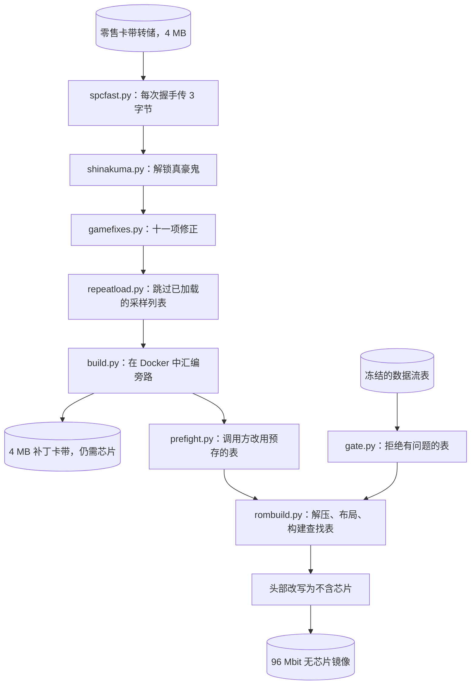

<div align="center">

# 去除 S-DD1 的 Street Fighter Alpha 2

<strong>一套工具，用于为 Super Nintendo 重建 Street Fighter Alpha 2 和 Street Fighter Zero 2，在设计上去掉 S-DD1 解压芯片，并以 snes9x 自己的解压器和你提供的零售版卡带为准进行校验。</strong>

[English](README.md) | [日本語](README.ja.md) | 简体中文 | [繁體中文 (香港)](README.zh-HK.md)

[](https://github.com/gufranco/snes-street-fighter-alpha-2-nochip/actions/workflows/ci.yml)
[](https://github.com/gufranco/snes-street-fighter-alpha-2-nochip/releases)
[](LICENSE)

</div>

<p align="center">
  <a href="#install">安装</a> |
  <a href="#the-interface">接口</a> |
  <a href="#is-it-right">它是否正确</a> |
  <a href="#working-on-it">参与开发</a> |
  <a href="https://github.com/gufranco/snes-street-fighter-alpha-2-nochip/issues">问题反馈</a>
</p>

---

5,672 个数据流经过解压，并与 snes9x 的 `sdd1emu.cpp` 逐字节比较，0 个不同；20 个镜像各运行 12,000 帧，查表未命中 0 次；1,253 项测试；100% 的语句与分支覆盖率门禁检查；除标准库外没有任何 Python 依赖。

```python
import hardware

mapper = hardware.load("mapper")
addresses = ((0x00, 0x8000), (0x40, 0x0000), (0x40, 0x8000), (0xC0, 0x0000), (0xC0, 0x8000))

for bank, address in addresses:
    offset = mapper.address_to_file(bank, address, 192)
    print(f"${bank:02X}:{address:04X} is file offset {offset:#09x}")
```

```
$00:8000 is file offset 0x0000000
$40:0000 is file offset 0x0800000
$40:8000 is file offset 0x0200000
$C0:0000 is file offset 0x0a00000
$C0:8000 is file offset 0x0600000
```

这个示例向固定版本的卡带映射询问：五个主机地址分别落在一个 192 bank 镜像的什么位置。192 bank 正是本项目构建的 96 Mbit 无芯片镜像的大小。文件由两个半 bank 平面组成。Bank `$00` 在偏移 0 处读取 bank 0 的高半部分。Bank `$40` 同时暴露自身存储的两个半部分。Bank `$C0` 没有自己的存储：它的两个半部分是 bank `$80` 和 `$00` 的低半部分。正因如此，原始的 4 MB ROM 在 `$C0`-`$FF` 仍可读取，而解压后的图形填满 `$40`-`$7D`。

<a id="install"></a>

## 安装

| 要求 | 版本 |
|:--|:--|
| Python | 3.12 或更新 |
| git | 任意版本，用于获取九个子模块 |
| Docker | 任意当前版本，且正在运行。[`build.py`](build.py)、[`pack.py`](pack.py) 以及与 snes9x 的比对检查都在容器中运行各自的工具链 |
| 你自己的卡带转储 | 每个 4,194,304 字节，放在 `roms/` 中，按 [转储文件](#the-dumps) 一节所列命名 |

```bash
git clone --recurse-submodules https://github.com/gufranco/snes-street-fighter-alpha-2-nochip.git
cd snes-street-fighter-alpha-2-nochip
python3 doctor.py
```

> [!IMPORTANT]
> 本项目用来衡量自身的每个模型都是独立的仓库，以子模块形式固定在根目录，所以必须使用 `--recurse-submodules`。不带该参数克隆的仓库可以用 `git submodule update --init --recursive` 修复。通过下载 zip 链接得到的源码归档不含任何子模块内容，无法修复，请改用克隆。

诊断脚本会打印机器信息、每个固定模型的版本、`roms/` 中每个转储的状态和 SHA-256、解压器能否解码、`docker` 是否在路径上，以及每个模型自身诊断脚本给出的报告。不在 `roms/` 中的转储计为一项未通过的检查。报告以一行结束，第一种形式的退出码为 0，第二种为 1：

```
  N checks, nothing to report
  K of N checks did not pass
```

提交任何缺陷报告时，请粘贴完整输出。

版本遵循 [语义化版本](https://semver.org/)，由 semantic-release 根据提交历史生成。每个版本都打上标签，并列在 [发布页面](https://github.com/gufranco/snes-street-fighter-alpha-2-nochip/releases) 上。发布不附带任何镜像：[`pack.py`](pack.py) 写出的每个镜像都在文件名中带有版本号。

<a id="the-interface"></a>

## 接口

### 构建镜像

```bash
python3 tools/identify.py
python3 pack.py
python3 pack.py jp
```

[`tools/identify.py`](tools/identify.py) 根据 [`artifacts.manifest.json`](artifacts.manifest.json) 检查 `roms/` 中的每个转储。[`pack.py`](pack.py) 为指定的每个地区构建无芯片镜像，未指定时两个地区都构建，并连同一个 `SHA256SUMS` 清单写入 `dist/`：

```
  sfa2-usa-nochip-v<version>.sfc  12,582,912 bytes
  sfz2-jp-nochip-v<version>.sfc  12,582,912 bytes
  SHA256SUMS  2 images
```

[`pack.py`](pack.py) 在零售版转储上依次执行下面的每个补丁，在 Docker 中汇编旁路代码，加入赛前表，依据冻结的数据流表布置镜像，并改写文件头，声明为普通 ROM。写出任何内容之前，它会对每个地区的数据流表运行 [`gate.py`](gate.py)，一旦有发现就停止。

| 命令 | 参数 | 退出码 |
|:--|:--|:--|
| [`pack.py`](pack.py) | `[usa] [jp]` | 0 已写出，1 缺少转储、门禁检查失败或汇编失败，2 未知地区 |
| [`tools/identify.py`](tools/identify.py) | `[file name ...]`，默认为清单声明的所有转储 | 0 至少一个转储正确且没有错误的，1 有转储错误或没有一个正确，2 没有声明该名称的转储 |
| [`gate.py`](gate.py) | `[usa] [jp]` | 0 所有表均通过，1 有发现，2 未知地区 |
| [`doctor.py`](doctor.py) | 无 | 0 所有检查均通过，1 其他情况 |

[`tools/identify.py`](tools/identify.py) 用七种状态之一标记每个转储：`ok`、`missing`、`no digest published`、`wrong size`、`wrong content`、`known bad dump` 或 `another entry`。后四种会阻止构建。对每个阻止构建或缺失的转储，它会打印适用于 macOS、Linux 和 Windows PowerShell 的摘要计算命令。

```
  sfa2-usa-final.sfc: ok  [Street Fighter Alpha 2, USA]
      read as bare, 4,194,304 bytes
      crc32  9C59DDFF
      sha256 910a29f834199c63c22beddc749baba746da9922196a553255deade59f4fc127
  sfz2-jp-final.sfc: ok  [Street Fighter Zero 2, Japan]
      read as bare, 4,194,304 bytes
      crc32  7455A7CF
      sha256 f15731675e22dbf3882b777b2d8cd541a637dfdf5d8880c83903cf1e0b64590e
  sfa2-usa-vc-sound-restored.sfc: ok  [SNES Classic dump with the sound restored]
      read as bare, 4,194,304 bytes
      crc32  72A9E2C1
      sha256 f8aa2ae1f4bc993092fc282a883ecaf669269c17a175a5f43fa95e9da6459dc0

  3 of 3 declared dumps present and correct
```

[`gate.py`](gate.py) 拒绝以下情况的表：来源重复、某个条目解码后与记录的长度不符、表未覆盖某个已记录的硬件请求，或键扫描超过 64 个槽位。对冻结的表，它打印：

```
  jp: 2,855 streams, ok
  usa: 2,817 streams, ok
```

### 补丁

每个补丁都是一个模块，提供一个 `apply(rom)` 调用和一个命令行。`apply` 接收 ROM 的字节，返回打过补丁的字节。除 `prefight.apply` 外，每个补丁也会改写文件头校验和。每个补丁都按字节特征查找修改位置，所以一个模块可以覆盖两个地区。对同一输入应用两次补丁，返回的结果与输入相同。不匹配任何特征的 ROM 会以 `ValueError` 被拒绝。

| 模块 | 命令 | 修改内容 |
|:--|:--|:--|
| [`spcfast.py`](spcfast.py) | `spcfast.py <source-rom> <output-rom>` | 采样上传，412 字节，分 27 段 |
| [`shinakuma.py`](shinakuma.py) | `shinakuma.py <source-rom> <output-rom>` | Shin Akuma 解锁，两个字节 |
| [`gamefixes.py`](gamefixes.py) | `gamefixes.py <source-rom> <output-rom>` | [你得到什么](#what-you-get) 一节列出的十一项修正 |
| [`repeatload.py`](repeatload.py) | `repeatload.py <source-rom> <output-rom>` | 跳过已加载的基础采样列表，使用位于 `$C7:F600` 的一段 61 字节例程 |
| [`prefight.py`](prefight.py) | `prefight.py <source-rom> <output-rom>` | 将赛前表构建器的两个调用方重定向到一段 61 字节例程，由它用一次 DMA 搬运已完成的表 |

每个命令在写出输出时退出码为 0，输出路径与源路径相同时为 1，参数个数错误时为 2。被拒绝的 ROM 以 `ValueError` 的回溯信息结束。

```python
import gamefixes
import prefight
import repeatload
import shinakuma
import spcfast

blank = bytes(0x400000)
for patch in (spcfast, shinakuma, gamefixes, repeatload, prefight):
    try:
        patch.apply(blank)
    except ValueError as refusal:
        print(f"{patch.__name__}: {refusal}")

print(spcfast.patch_bytes(), len(spcfast.PATCH), len(prefight.table()))
print(len(gamefixes.FIXES), len(gamefixes.EMPTY_CALLS))
```

```
spcfast: this is not an unpatched retail Alpha 2 or Zero 2 ROM
shinakuma: no Shin Akuma unlock gate found
gamefixes: this ROM carries none of the sites these fixes name
repeatload: the sound engine's allocator setup is not where this patch expects it
prefight: no pre-fight table builder found
412 27 24704
8 3
```

一个 4 MB 的全零块不含任何特征，所以每个补丁都拒绝它。最后两行分别是：采样上传补丁的大小、24,704 字节的赛前表，以及构成十一项修正的八项特征修正加三项空调用改写。

| 调用 | 返回 |
|:--|:--|
| `spcfast.is_stock(rom)`, `spcfast.is_patched(rom)` | 驱动是零售版原样，还是已打过补丁 |
| `spcfast.checksum(rom)`, `spcfast.write_checksum(rom)` | 文件头校验和，以及在 `$7FDC` 写入校验和及其补码后的 ROM |
| `shinakuma.find_gate(rom)` | 解锁门的文件偏移，或 `None`。出现不止一次时抛出 `ValueError` |
| `gamefixes.survey(rom)` | 每个条目名称映射到 `applied`、`already` 或 `absent` |
| `gamefixes.changed_bytes(rom)` | 这些条目会修改多少字节，不计校验和 |
| `gamefixes.report(rom, say=print)` | 打印调查结果，每个条目一行 |
| `repeatload.is_patched(rom)`, `repeatload.report(rom, say=print)` | 是否已加入跳过逻辑，以及挂钩、例程和标记的地址 |
| `prefight.table()` | 24,704 字节的表，193 行，每行 64 个十六位字 |
| `prefight.find_builder(rom)`, `prefight.find_callers(rom)` | 构建器的文件偏移，以及每个对它的调用的偏移 |

### 镜像构建器

[`rombuild.py`](rombuild.py) 布置 96 Mbit 镜像。`rombuild.build(rom, entries, image_banks=192, extra=())` 接收已加入旁路的 4 MB ROM 和一个数据流列表，返回一个 `Result`，含 `image`、`destinations`、`tables` 和 `regions`。`extra` 是一个 `(address, bytes)` 对的元组，放在数据流之后，[`pack.py`](pack.py) 就是这样在 `$5F0000` 加入赛前表的。大小不是 4,194,304 字节的 ROM 会抛出 `ValueError`。放不下的数据流会抛出 `rombuild.AllocationError`，并指出剩余的最大空隙。

`rombuild.entries_from_map(mapping)` 将 `{source: length}` 映射转换为条目。[`usastreams.py`](usastreams.py) 和 [`jpstreams.py`](jpstreams.py) 各自以 `STREAMS` 保存一张冻结的表，它是一个 `(source, length)` 对的元组。

[`sdd1tables.py`](sdd1tables.py) 构建转换例程读取的四张查找表。若某个数据流的来源与另一个数据流的低 16 位相同，它就放入后者之后的第一个空闲槽位：

```python
from collections import namedtuple

import sdd1tables

Stream = namedtuple("Stream", "source")
tables = sdd1tables.build(
    [
        (Stream(0x001234), 0x400000),
        (Stream(0x011234), 0x410000),
        (Stream(0x001235), 0x420000),
    ]
)
for slot in tables.slots:
    destination = tables.dest_bank[slot] << 16 | tables.dest_high[slot] << 8 | tables.dest_low[slot]
    print(f"slot {slot:#06x}  key ${tables.key[slot]:02X}  destination ${destination:06X}")
```

```
slot 0x1234  key $C0  destination $400000
slot 0x1235  key $C1  destination $410000
slot 0x1236  key $C0  destination $420000
```

第二个数据流在 `$1234` 与第一个冲突，向后移了一个槽位。第三个随后发现自己的槽位已被占用，移到 `$1236`。例程从来源的低 16 位开始向前扫描，直到键字节与来源 bank 相符，所以三个都能解析。若没有任何放置方式能让每次扫描都无歧义，`sdd1tables.build` 抛出 `sdd1tables.PlacementError`；目标位于 bank `$00` 时抛出 `ValueError`，因为扫描无法将其与空槽位区分开。

### 命名与发布清单

```python
import pack

print(pack.output_name("usa", "2.0.0"))
print(pack.output_name("jp", "0.0.0"))
print(pack.manifest_line("sfz2-jp-nochip-v2.0.0.sfc", b""))
```

```
sfa2-usa-nochip-v2.0.0.sfc
sfz2-jp-nochip-v0.0.0-dev.sfc
e3b0c44298fc1c149afbf4c8996fb92427ae41e4649b934ca495991b7852b855  sfz2-jp-nochip-v2.0.0.sfc
```

`pack.output_name(region, release=None)` 从 [`version.py`](version.py) 取得版本号写入名称，版本 `0.0.0` 会标上 `-dev`。`pack.manifest_line(name, image)` 是 `SHA256SUMS` 的一行。`pack.build(region, workdir)` 返回一个地区的完成镜像，需要 Docker 和零售版转储。`pack.REGIONS` 列出每个地区的零售版转储和旁路补丁。汇编失败时抛出 `pack.AssemblyFailed`，其中带有 [`build.py`](build.py) 的输出。

### 全部命令

| 命令 | 参数 | 作用 |
|:--|:--|:--|
| [`build.py`](build.py) | `<patch.asm> <source-rom> <output-rom>`，或 `--image` | 在无网络的容器中用 asar 1.81 汇编补丁，输出写在补丁旁边。`--image` 只构建容器 |
| [`rombuild.py`](rombuild.py) | `<patched-rom> <tagged-rom> <output.sfc>` | 根据带标签转储中的数据流映射布置 96 Mbit 镜像 |
| [`mapcheck.py`](mapcheck.py) | `<rom>` | 检查该转储所属地区的冻结表：重复项、无法解码的条目和扫描距离 |
| [`patchrun.py`](patchrun.py) | `<built-image> <patched-rom> <tagged-rom>` | 在 65816 模型上针对每个数据流运行汇编后的转换例程，并比较它指向的位置 |
| [`sdd1ref.py`](sdd1ref.py) | `<rom> [cases] [seed]`，默认 500 个用例，种子 20260813 | 在容器中用 snes9x 的 `sdd1emu.cpp` 并用 Python 模型解压随机偏移，然后比较 |
| [`sdd1map.py`](sdd1map.py) | `<tagged-rom> <source-rom> [output.bin]` | 从带标签转储中的 `SDD1` 标签读出数据流映射 |
| [`sdd1find.py`](sdd1find.py) | `<source-rom> <reference-rom> [start] [stop]` | 对照一个包含相同图形解压版本的转储，按内容查找数据流 |
| [`sdd1sites.py`](sdd1sites.py) | `<source-rom> <tagged-rom>` | 列出压缩数据之外对芯片寄存器的每一次写入，并反汇编每个启动位置 |
| [`analyse.py`](analyse.py) | 四个 ROM 路径 | 分析两个 Star Ocean 转储和两个 Alpha 2 转储中看似压缩的数据块 |
| [`tools/verify_streams.py`](tools/verify_streams.py) | `[usa] [jp]` | 冻结表中的每个数据流都经过 snes9x 的 `sdd1emu.cpp`，并与 Python 解压器比较 |
| [`tools/verify_image.py`](tools/verify_image.py) | `[image]`，默认 `build/all/jp-both-free.sfc` | 像主机那样遍历完成镜像的查找表，并比较每个目标处的字节 |
| [`tools/rebuild_all.py`](tools/rebuild_all.py) | 无 | 将每个地区和补丁组合构建到 `build/all/` 中，分别生成卡带、旁路和无芯片镜像 |
| [`tools/validate_all.py`](tools/validate_all.py) | `[name filter]` | 在模拟器测试框架上将 `build/all/` 中的每个镜像运行 12,000 帧，并打印验证表 |
| [`tools/compare_audio.py`](tools/compare_audio.py) | `[--fights] [--roster N] [--budget N] <stock> <patched>` | 逐次上传地比较两个构建 |
| [`tools/tour_audio.py`](tools/tour_audio.py) | `[name filter] [roster] [budget]`，默认 `both-cart`、18 和 12000 | 依次使用每个角色，报告卡顿和损坏的上传 |
| [`tools/driver_run.py`](tools/driver_run.py) | `<rom>` | 在 SPC700 模型和完整 S-SMP 上分别运行打补丁前后的音频驱动，并统计周期 |
| [`tools/sample_audit.py`](tools/sample_audit.py) | `<apu-ram-image> <directory-page> [sample ...]` | 像音频芯片那样，从该地址的采样目录读取一个 64 KB 的声音 RAM 镜像，报告越界、在自身之外循环或共享字节的采样 |
| [`tools/sample_reuse.py`](tools/sample_reuse.py) | `[log ...]`，默认 `build/soundwalk/grp-*.txt` | 在声音 RAM 的影子副本上重放测试框架日志中的每次采样上传 |
| [`tools/stage_diff.py`](tools/stage_diff.py) | `[before] [after] [tag]` | 让两个构建走过每一组对战，统计不同的帧数 |
| [`tools/tile_shape.py`](tools/tile_shape.py) | `<rom> [streams]` | 测量解压后的数据流重复出现 4bpp 图块的频率，并与等长的随机字节对照 |
| [`tools/tour_oracle.py`](tools/tour_oracle.py) | 无 | 驱动零售版卡带，记录它向芯片请求了什么 |
| [`tools/harvest_jp.py`](tools/harvest_jp.py) | 无 | 提出日版数据流候选，交由门禁检查判断 |
| [`tools/converge_jp.py`](tools/converge_jp.py) | 无 | 重复这些运行，直到某一轮不再新增任何内容 |
| [`tools/freeze_spcfast.py`](tools/freeze_spcfast.py) | `[--check]` | 汇编采样上传补丁，并根据差异改写 [`spcfast.py`](spcfast.py)。`--check` 只比较，不写入 |

必需参数个数错误的命令退出码为 2。[`mapcheck.py`](mapcheck.py)、[`patchrun.py`](patchrun.py)、[`sdd1ref.py`](sdd1ref.py)、两个验证工具、[`tools/validate_all.py`](tools/validate_all.py)、[`tools/compare_audio.py`](tools/compare_audio.py) 和 [`tools/tour_audio.py`](tools/tour_audio.py) 在检查失败时退出码为 1，否则为 0。

```bash
python3 tools/verify_streams.py
python3 tools/verify_image.py build/all/usa-both-free.sfc
```

```
  jp: all 2855 streams identical to the reference
  usa: all 2817 streams identical to the reference
```

```
  image usa-both-free.sfc, 2,817 streams
  unresolved lookups: 0
  streams whose bytes in the image are wrong: 0
```

[`tools/verify_streams.py`](tools/verify_streams.py) 还会每 200 个数据流打印一行进度。[`tools/verify_image.py`](tools/verify_image.py) 从镜像的文件名读取地区。

## 工作原理

Street Fighter Alpha 2 的大部分图形以压缩形式保存。零售版卡带中的 S-DD1 在游戏请求时于 DMA 过程中解压这些图形。没有这块芯片，就没有图形。

本项目提前解压每个数据流，将结果布置到一个更大的镜像中，并修改游戏启动芯片的七个位置，让它们改为读取已解压好的字节。结果是一个普通的 SNES ROM，没有协处理器，也没有映射芯片，卡带必须能容纳并提供 96 Mbit 的数据。

每场对战前的停顿发生在声音驱动中，它每次握手只向音频芯片传送一个字节的采样。改写接收循环，让每次握手传送三个字节，就消除了大部分停顿。

[`pack.py`](pack.py) 按顺序执行以下步骤：

1. [`spcfast.py`](spcfast.py) 让采样上传每次握手传送三个字节。
2. [`shinakuma.py`](shinakuma.py) 解锁 Shin Akuma。
3. [`gamefixes.py`](gamefixes.py) 应用十一项修正。
4. [`repeatload.py`](repeatload.py) 跳过已加载的采样列表。
5. [`build.py`](build.py) 在七个启动位置上汇编旁路代码。结果是 4 MB 的已打补丁卡带，它仍然需要芯片。
6. [`prefight.py`](prefight.py) 重定向赛前表构建器的调用方。
7. [`rombuild.py`](rombuild.py) 解压每个数据流，布置镜像并构建查找表。
8. 改写文件头，声明为没有芯片的普通 ROM。

旁路在布置之前进行，因为布置会回收旁路所读取的压缩数据。文件头最后处理，因为它要对完成的镜像计算校验和。



### 芯片，以及替代它的东西

S-DD1 负责内存映射，Alpha 2 从未用到这一功能，于是 bank `$C0` 到 `$FF` 线性地暴露整个 4 MB。它还负责解压：当 CPU 向 `$4801` 写入非零字节，并启动一个 A 总线地址固定的通道的 DMA 时，芯片会将一个数据流解码到目标处，而不是复制原始字节。`$4801` 会自动清零，所以游戏在每个数据流之前都会重新启动它。

每个地区有七个位置启动芯片，列在 [`asm/sdd1-bypass.asm`](asm/sdd1-bypass.asm) 和 [`asm/sdd1-bypass-jp.asm`](asm/sdd1-bypass-jp.asm) 中。每个位置都被替换为对 [`asm/sdd1-translate.asm`](asm/sdd1-translate.asm) 中一个共享例程的调用。该例程查找解压副本的存放位置，改写 DMA 来源，并清除固定 A 总线地址位，使这次传输变成普通的递增读取。

查找结构是位于 bank `$60` 到 `$63` 的四张 64 KB 表，以来源地址的低 16 位为索引：来源 bank 作为键，然后是目标的低字节、高字节和 bank。键冲突时放入其地址处或之后的第一个空闲槽位，例程向前扫描，直到 bank 字节相符。[`mapcheck.py`](mapcheck.py) 测量美版表的扫描距离：

```
  streams        2,817
  duplicates     0
  undecodable    0
  scan distance  median 0, worst 31 (budget 64)
  RESULT         OK
```

日版表有 2,855 个数据流，中位数同样为 0，最差同样为 31。

### 镜像为何是 96 Mbit，以及如何寻址

解压后，美版表的图形共 5,013,058 字节，日版为 5,047,300 字节，放不进 4 MB 卡带。镜像增大到 12 MB，而在计入镜像区和工作 RAM 之后，192 个 64 KB 的 bank 放不进 24 位地址空间。

这种布局把每个 bank 一分为二，将两个半部分分别存放在文件的两个平面中。Bank `$C0` 及以上没有自己的存储，是通往第二个平面的窗口。

| Bank | 暴露范围 | 数据来源 |
|:--|:--|:--|
| `$00`-`$3F`, `$80`-`$BF` | 仅 `$8000`-`$FFFF`，LoROM | 高半部分平面 |
| `$40`-`$7D` | 完整 64 KB，HiROM 方式 | 两个平面 |
| `$C0`-`$FF` | 完整 64 KB | 低半部分平面，从不使用自己的存储 |

Bank `$C0+k` 在 `$8000`-`$FFFF` 暴露 bank `k` 的低半部分，在 `$0000`-`$7FFF` 暴露 bank `$80+k` 的低半部分。这样，192 个 bank 的存储就覆盖了 256 个 bank 的地址空间，无需切换 bank，也无需映射寄存器。本文档称之为窗口式 LoROM 映射。ExLoROM、ExHiROM 和 Jumbo LoROM 通过增加线性 bank 来扩展地址空间，而这种映射则是把一个区域别名到第二个存储平面上。这条规则来自 neviksti 的 Star Ocean 无芯片转换版，通过检查还原得到，固定版本的卡带映射以 `address_to_file` 实现了它。

| 区域 | 内容 |
|:--|:--|
| Bank `$00`-`$3F` | 原始 ROM 的 LoROM 视图 |
| Bank `$40`-`$7D` | 解压后的图形 |
| Bank `$5F` | 位于 `$5F0000` 的赛前表 |
| Bank `$60`-`$63` | 四张查找表 |
| Bank `$7E`-`$7F` | 保留给工作 RAM |
| Bank `$80`-`$BF` | `$00`-`$3F` 的 FastROM 镜像区 |
| Bank `$C0`-`$FF` | 原始的 4 MB ROM，线性排列，作为窗口 |

空闲的 bank 装不下所有解压后的数据流，所以一个数据流解压后，它来源处的压缩字节会在窗口 bank 中被回收，回收范围依据每个数据流实际消耗的长度。

### 停顿

零售版卡带上，一次赛前突发传输为 47,915 字节，速度约每帧 260 字节，即每行一个字节。瓶颈在音频芯片 RAM 中的接收循环：游戏上传自己的声音驱动，该驱动以每字节 55 个周期重新实现了启动协议。

由于该驱动位于 RAM 中，它可以被替换。随附的接收程序每次握手传送三个字节，每个数据端口一个，每次握手 49 个周期。[`tools/driver_run.py`](tools/driver_run.py) 在完整音频单元上测量两者传送 48 字节的情况：

```
  48 bytes through the driver as it ships and as it is patched
  stock     48 handshakes,   720 instructions
  patched   16 handshakes,   192 instructions
  landed at 0x2000: 000306090c0f1215
  landed at 0x3000: 0104070a0d101316
  landed at 0x4000: 0205080b0e111417
  the same two runs on the whole audio unit, which counts cycles
  stock     48 handshakes,   2640 cycles
  patched   16 handshakes,    784 cycles
  faster by 3.37 times
  stand-in and unit agree on every byte: True
```

| | 每字节周期数 | 最长卡顿，日版 | 最长卡顿，美版 |
|:--|:--|:--|:--|
| 零售版 | 55 | 2.60 s | 2.90 s |
| 本构建 | 16.3 | 0.72 s | 0.78 s |

三个目标指针彼此相距三分之一个数据块，因此存储索引每次加一，页进位每 256 次握手才发生一次。

游戏有七个上传程序，其中一个还驱动音频芯片掩膜 ROM 中的启动加载器，后者每次握手只接收一个字节。驱动根据每个数据块头中已有的类型字节进行分派：3 表示三字节传送，启动路径不受影响。这覆盖了 93% 的驱动流量。

[`repeatload.py`](repeatload.py) 中的跳过逻辑，在完整走一遍角色阵容的过程中，为美版卡带节省 840,766 字节，为日版节省 303,340 字节。

### 赛前表

每场对战前，游戏都要花 27 帧计算一张 24,704 字节、内容从不变化的表。无芯片镜像直接附带位于 `$5F0000` 的完成表，并用一次 DMA 搬运。4 MB 卡带保留构建器，因为两个零售版 ROM 中最长的一段 `$FF` 填充只有 3,197 字节，这张表在任何地址都放不下。

<a id="what-you-get"></a>

## 你得到什么

| 形式 | 大小 | 是否需要芯片 | 写出者 |
|:--|:--|:--|:--|
| 96 Mbit 无芯片 | 12,582,912 字节 | 否 | [`pack.py`](pack.py)，以及 [`tools/rebuild_all.py`](tools/rebuild_all.py)，后者输出为 `*-free.sfc` |
| 4 MB 已打补丁卡带 | 4,194,304 字节 | 是，适用于已经模拟 S-DD1 的硬件 | [`tools/rebuild_all.py`](tools/rebuild_all.py)，输出为 `*-bypass.sfc` |

两者都带有更快的采样上传、Shin Akuma 解锁和各项修正。只有无芯片镜像带有赛前表。

解锁只有两个字节。Shin Akuma 自 1996 年起就在零售版卡带中，藏在一个直到 2021 年才被公开的秘技之后。

### 修正

[`gamefixes.py`](gamefixes.py) 中有十一个条目。它们修改美版文件的 218 个字节和日版文件的 60 个字节，两个数字都包含四个校验和字节。每个条目都按字节特征查找，所以一张表覆盖两个地区，不匹配的 ROM 会拒绝补丁，应用两次则不产生任何变化。

| 修正 | 地区 | 作用 |
|:--|:--|:--|
| Sodom 名称，四个画面 | 美版 | 恢复美版改动过的名称，涉及体力条下方、角色选择画面、对战画面和结果画面。日版 ROM 原本就是这个名称 |
| Akuma 胜利姿势顺序 | 两者 | 改为街机版顺序，并相应移动静音姿势索引 |
| 对象表溢出 | 两者 | 在请求第九个阴影帧时，阻止存活对象计数超过实际存在的对象数 |
| 被投掷的父亲精灵 | 两者 | Sagat 抓住 Dan 父亲的那一帧中的三条精灵记录 |
| 移除空调用 | 两者 | 45 处对一条单独 `rtl` 的长调用，该 `rtl` 的下一个字节是 `rts`，改写为直接返回 |

[`gamefixes.py`](gamefixes.py) 在写入前打印调查结果。在应用前两个补丁后的美版转储上：

```
  thrown father sprite             applied  0x3ea956  regions usa, jp
  sodom name on the life bar       applied  0x0088c7  regions usa
  sodom name on the select screen  applied  0x00d68c  regions usa
  sodom name on the vs screen      applied  0x002260  regions usa
  sodom name on the vs results screen applied  0x1ab82e  regions usa
  object table overflow            applied  0x057537  regions usa, jp
  akuma win pose order             applied  0x020048  regions usa, jp
  akuma silent win pose index      applied  0x01e944  regions usa, jp
  empty routine at $FF:FF4D        applied  42 call sites
  empty routine at $F0:1EEF        applied  1 call sites
  empty routine at $FF:FEA1        applied  2 call sites
  214 bytes to change across 11 entries
[done] build/step3.sfc (4,194,304 bytes)
```

<a id="the-dumps"></a>

## 转储文件

按 No-Intro 的命名方式命名。每个摘要都针对不含拷贝机文件头的完整文件计算，[`tools/identify.py`](tools/identify.py) 在计算前会去掉这类文件头。以 SHA-256 为准，CRC32 用于与仍以它为键的数据库交叉核对。

| 文件 | 读取路径 | SHA-256 | CRC32 |
|:--|:--|:--|:--|
| Street Fighter Alpha 2，美版 | `roms/sfa2-usa-final.sfc` | `910a29f834199c63c22beddc749baba746da9922196a553255deade59f4fc127` | `9C59DDFF` |
| Street Fighter Zero 2，日版 | `roms/sfz2-jp-final.sfc` | `f15731675e22dbf3882b777b2d8cd541a637dfdf5d8880c83903cf1e0b64590e` | `7455A7CF` |
| DarkAkuma 的 SNES Classic 转储 | `roms/sfa2-usa-vc-sound-restored.sfc` | `f8aa2ae1f4bc993092fc282a883ecaf669269c17a175a5f43fa95e9da6459dc0` | `72A9E2C1` |

第三个文件不是零售版卡带。它带有 `SDD1` 数据流标签，[`usastreams.py`](usastreams.py) 就是由这些标签生成的；只有 [`rombuild.py`](rombuild.py)、[`sdd1map.py`](sdd1map.py)、[`sdd1sites.py`](sdd1sites.py) 和 [`patchrun.py`](patchrun.py) 会读取它。两张数据流表都已冻结在仓库中，所以 [`pack.py`](pack.py) 只需要两个零售版转储。

## 手动构建各个阶段

```bash
mkdir -p build
python3 spcfast.py    roms/sfa2-usa-final.sfc  build/step1.sfc
python3 shinakuma.py  build/step1.sfc          build/step2.sfc
python3 gamefixes.py  build/step2.sfc          build/step3.sfc
python3 repeatload.py build/step3.sfc          build/step4.sfc
python3 build.py      asm/sdd1-bypass.asm build/step4.sfc bypass.sfc
python3 rombuild.py   asm/bypass.sfc roms/sfa2-usa-vc-sound-restored.sfc build/nochip.sfc
python3 -c 'import hardware, pathlib; r = hardware.load("romimage"); pathlib.Path("build/final.sfc").write_bytes(r.rewrite.declare_rom_only(r.dump.read("build/nochip.sfc")))'
```

这条路线根据带标签转储中的数据流映射构建不含赛前表的美版镜像。[`rombuild.py`](rombuild.py) 从标签中读出 2,815 个数据流，比 [`pack.py`](pack.py) 使用的冻结表中的 2,817 个少两个：

```
  streams   2,815
  graphics  5,012,738 bytes across 90 banks
  image     12,582,912 bytes (96 Mbit)
```

[`build.py`](build.py) 将输出写在补丁旁边，所以旁路结果位于 `asm/bypass.sfc`。日版没有带标签的转储，因此日版镜像只能由 [`pack.py`](pack.py) 生成。

## 已知限制

**日版数据流表无法证明是完整的。** 没有被请求的数据流无法被找到。该表覆盖了 [`requests_jp.py`](requests_jp.py) 中记录的、来自实际硬件的全部 1,661 个请求，并且搜索已经收敛。如果某个画面显示出错，请驱动零售版卡带到达该画面，读取它向芯片请求了什么，然后把它加入表中。美版表来自带标签的转储，没有这个限制。

**有两项修正未在画面上得到演示。** 对象表溢出需要同时出现八个阴影帧，外加一次飞行道具碰撞；被投掷的父亲精灵位于这里的任何驱动程序都到达不了的场景中。两者都以反汇编为依据，而同样的运行表明，在能到达的部分，两者都没有改变任何东西。

**日版构建只在模拟环境中运行过。** 它与美版的构造方式相同，并通过相同的检查。

[`OPEN-QUESTIONS.md`](OPEN-QUESTIONS.md) 列出了每个未解决的问题，以及能解决它的测量方法。

## 模拟器支持

这些镜像需要一种此前没有任何模拟器支持的映射。它已作为 [拉取请求 1082](https://github.com/snes9xgit/snes9x/pull/1082) 合并进 snes9x，所以当前版本可以加载这些镜像。相关讨论见 [议题 1081](https://github.com/snes9xgit/snes9x/issues/1081)，相关工作位于一个分叉仓库的 [`sdd1-decompressed-map`](https://github.com/gufranco/snes9x/tree/sdd1-decompressed-map) 分支。

流传的无芯片转换版保留了零售版文件头，因此声称带有一块它们已不再包含的芯片，而依据文件头匹配的模拟器会启用芯片模拟，并采用错误的布局。镜像包会在这些镜像中文件头出现的全部六个位置改写芯片组和大小字段，因为原始 ROM 被镜像到了窗口 bank 和 FastROM 镜像区中。文件头如实之后，剩下的差距就是布局本身，而已合并的改动补上了它。

尚未用 ares、Mesen2、bsnes 和 Mednafen 运行过这些镜像。

## 检查改动音频路径的补丁

[`spcfast.py`](spcfast.py) 替换采样上传循环，[`repeatload.py`](repeatload.py) 在请求的列表已加载时跳过上传。两者都不得改变音频处理器最终持有的字节。在两次运行结束时比较音频处理器的内存无法确定这一点，因为补丁改变了时序，两次运行停止时驱动处于不同的位置。

```bash
python3 tools/compare_audio.py build/all/jp-base-cart.sfc build/all/jp-spc-cart.sfc
python3 tools/compare_audio.py --fights build/all/jp-spc-cart.sfc build/all/jp-both-cart.sfc
```

比较以每次上传为单位进行。卡带交出的每个数据块都与卡带中仍然存在的字节核对，所以丢了一个字节的循环会在丢字节的那个数据块上失败。它还报告哪些来源被上传过，因为跳过只可能上传更少的来源，绝不会上传不同的来源；它也报告每字节的写入次数，这正是更快的循环所改变的数字。`--roster` 和 `--budget` 设置巡览的角色数和每个角色的帧数，默认分别为 18 和 4000。

仅巡览角色阵容永远不会触发跳过，因为每个角色加载的列表都不同。`--fights` 会进入一场对战再返回，这是请求一个已加载列表的唯一方式。

<a id="the-models-underneath"></a>

## 底层模型

关于某个部件做什么的每一项论断，都由导入路径上的模型给出，从不在这里给出。每个模型都是独立的仓库，以子模块形式固定在根目录，[`hardware.py`](hardware.py) 是访问它们的唯一途径。`hardware.load(name)` 返回对应的包，或抛出 `hardware.ModelMissing`，其中带有补全检出内容的命令。不在列表中的名称会抛出 `hardware.UnknownPackage`。

| 名称 | 仓库 | 回答的问题 |
|:--|:--|:--|
| `sdd1` | [snes-sdd1-python](https://github.com/gufranco/snes-sdd1-python) | 解压器对一个数据流产生什么 |
| `mos65xx` | [mos65xx-python](https://github.com/gufranco/mos65xx-python) | 卡带自身的代码运行时做什么 |
| `spc700` | [sony-spc700-python](https://github.com/gufranco/sony-spc700-python) | 音频处理器做什么 |
| `ssmp` | [sony-s-smp-python](https://github.com/gufranco/sony-s-smp-python) | 带有声音发生器和启动程序的音频处理器，并统计周期 |
| `sdsp` | [sony-s-dsp-python](https://github.com/gufranco/sony-s-dsp-python) | 什么会到达混音器 |
| `mapper` | [snes-mapper-python](https://github.com/gufranco/snes-mapper-python) | 一个地址落在卡带的什么位置 |
| `romimage` | [snes-rom-image-python](https://github.com/gufranco/snes-rom-image-python) | 文件头写了什么、如何改写它，以及转储的摘要 |
| `snesgfx` | [snes-graphics-python](https://github.com/gufranco/snes-graphics-python) | 解压后的数据流能否作为图块读出 |
| `snesdriver` | [snes-driver-python](https://github.com/gufranco/snes-driver-python) | 卡带在代码的什么位置与其芯片通信 |

这些模型以非清零状态启动：内存和寄存器保存的是任意但可复现的值，这里任何需要清零机器的地方都会自行设置。

<a id="is-it-right"></a>

## 它是否正确

解压器与 snes9x 1.63 的 `sdd1emu.cpp` 进行比较，后者在 [`ref/`](ref) 下的固定容器中从源码构建。[`tools/verify_streams.py`](tools/verify_streams.py) 让全部 2,817 个美版数据流和 2,855 个日版数据流都经过两者，没有任何差异。[`tools/verify_image.py`](tools/verify_image.py) 随后通过查找表，从完成的镜像中读回每个数据流。

镜像矩阵为两个地区乘四种补丁组合乘两种卡带形式，共十六个镜像，外加四个各去掉一个补丁的美版对照构建。[`tools/validate_all.py`](tools/validate_all.py) 在 [`emu/`](emu) 下的测试框架上将每个镜像运行 12,000 帧。在最近一次记录的运行中，全部 20 个都已加载，全部交付了 12,000 帧中的 12,000 帧，且没有一次查表未命中。

| 检查项 | 方法 |
|:--|:--|
| 启动并渲染 | 交付的帧数，以及每 300 帧采样一次的帧亮度 |
| 声音运行 | APU 端口写入次数 |
| 采样上传完好 | 每个数据块都与其 ROM 来源逐字节比较 |
| 菜单有响应 | 对战能够加载，而这只有经过菜单才会发生 |
| 停顿 | 最长的赛前上传突发 |
| 图形查表 | 表扫描长度，超过 64 步即为未命中 |
| Shin Akuma | 只有打过补丁时 `$7E:1B09` 才读出 `$4A4B` |

| 地区 | 补丁 | 4 MB 卡带 | 96 Mbit 无芯片 |
|:--|:--|:--|:--|
| 美版 | 无 | 2.90 s | 3.13 s |
| 美版 | 快速上传 | 0.78 s | 0.77 s |
| 美版 | 两者 | 0.78 s | 0.77 s |
| 日版 | 无 | 2.60 s | 2.60 s |
| 日版 | 快速上传 | 0.72 s | 0.72 s |
| 日版 | 两者 | 0.72 s | 0.72 s |

每个带有声音补丁的镜像还会依次使用全部十八名角色，在角色之间复位：共验证 50,652 次采样上传，没有一次出错。

| 硬件 | 镜像 | 结果 |
|:--|:--|:--|
| Game Doctor SF7，128 Mbit DRAM | 美版，96 Mbit 无芯片 | 可运行 |
| FXPAK Pro | 美版，96 Mbit 无芯片 | 可运行 |
| FXPAK Pro | 美版，4 MB 已打补丁卡带 | 可运行 |
| Super EverDrive | 美版，96 Mbit 无芯片 | 到达标题画面，见 @yoshinokentarou 发布的[照片](https://x.com/yoshinokentarou/status/2111959864163664247/photo/1) |

FXPAK Pro 在其 FPGA 中模拟 S-DD1，这就是 4 MB 形式能在其上运行的原因；对于无芯片镜像，这一模拟处于空闲状态。

Super EverDrive 这一行仅以该照片为依据。这款卡带没有 S-DD1，画面上有 Capcom U.S.A. 的版权声明，且该帖子链接到本项目，由此可判断是美版无芯片镜像。标题画面之后的内容尚无人见到。

`tools/freeze_spcfast.py --check` 确认 [`spcfast.py`](spcfast.py) 中冻结的补丁仍能逐字节重现汇编器的输出。各来源之间的分歧记录在 [`conformance/divergences.json`](conformance/divergences.json) 中，[`conformance/divergences.test.py`](conformance/divergences.test.py) 让它与 [`OPEN-QUESTIONS.md`](OPEN-QUESTIONS.md) 保持一致。

<a id="working-on-it"></a>

## 参与开发

| 需求 | 位置 |
|:--|:--|
| 每项门禁检查及其运行顺序 | [CONTRIBUTING.md](CONTRIBUTING.md) |
| 面向编码代理的相同内容 | [AGENTS.md](AGENTS.md) |
| 本仓库与同系列其他仓库共享的标准 | [FAMILY.md](FAMILY.md) |
| 缺陷报告和画面错误 | [GitHub Issues](https://github.com/gufranco/snes-street-fighter-alpha-2-nochip/issues) |
| 安全报告 | [SECURITY.md](SECURITY.md) |
| 行为准则 | [CODE_OF_CONDUCT.md](CODE_OF_CONDUCT.md) |

```bash
uvx ruff@0.16.3 format --check .
uvx ruff@0.16.3 check .
pnpm install --frozen-lockfile && pnpm run format:check
uvx --python 3.12 mypy==1.14.1
for module in *.test.py tools/*.test.py conformance/*.test.py; do python3 "$module" || echo "FAILED $module"; done
python3 doctor.py
```

测试套件共 1,253 项测试，分布在 49 个模块中：725 项位于分析模块旁，510 项位于工具旁，18 项位于 [`conformance/`](conformance) 下。每个模块旁边都有以其命名的测试文件，可以单独运行。需要零售版转储的测试放在模块旁边的 `<module>.retail.test.py` 文件中，没有转储时报告为跳过。覆盖率门禁检查要求 100% 的语句与分支覆盖率，设置在 [`pyproject.toml`](pyproject.toml) 中，测量时不包括这些文件，因此在没有转储的机器上同样成立，CI 在每次推送时都会强制执行。

构建在 Docker 中运行，使用固定版本的工具链、无网络、非 root 用户，从不在宿主机上运行。[`asm/`](asm) 中的汇编是唯一带注释的源码：入口和出口状态、寄存器宽度，以及每个还原出的地址的来源。

<details>
<summary><strong>项目结构</strong></summary>

| 路径 | 内容 |
|:--|:--|
| [`asm/`](asm) | 用 65816 和 SPC700 汇编写成的补丁，包括旁路、转换例程和快速上传，以及运行 asar 1.81 的容器 |
| [`tools/`](tools) | 十六个工具：转储识别、数据流与镜像校验、镜像矩阵、音频比较和日版数据流搜索 |
| [`emu/`](emu) | 镜像矩阵所用的模拟器测试框架，基于 snes9x 1.63 构建，并加入了窗口式映射 |
| [`ref/`](ref) | 构建 snes9x 1.63 的 `sdd1emu.cpp` 作为解压基准的容器 |
| [`conformance/`](conformance) | 来源分歧记录，以及让它与 [`OPEN-QUESTIONS.md`](OPEN-QUESTIONS.md) 保持一致的测试 |
| [`scripts/`](scripts) | 为 [`version.py`](version.py) 和 [`CITATION.cff`](CITATION.cff) 写入版本号的发布脚本 |
| 根目录 | 二十四个模块：补丁、镜像构建器、门禁、诊断工具和冻结的数据流表 |
| 九个子模块 | [底层模型](#the-models-underneath) 一节列出的固定版本模型 |

</details>

> [!CAUTION]
> 画面错误是最有用的报告，因为这是这里的检查唯一无法发现的故障。请说明是哪个镜像和地区，并截取该帧。绝不要附上卡带或从中解码出的任何内容，也绝不要链接到可以下载它们的地方。摘要可以标识一个文件，而不携带文件本身。

## 参考资料

- Modern Vintage Gamer，[A closer look at Street Fighter Alpha 2 on the Super Nintendo](https://www.youtube.com/watch?v=fB9GlZUYNUQ)，其中指出停顿来自声音驱动。
- [Zeldix 上的 Street Fighter Alpha 2 讨论帖](https://www.zeldix.net/t1831-street-fighter-alpha-2)，gizaha 的补丁和更新日志，后者是停顿相关工作的规格依据。
- Nintendo Life，[After 25 Years, A New Cheat Code Has Been Discovered For Street Fighter Alpha 2 On The SNES](https://www.nintendolife.com/news/2021/01/after_25_years_a_new_cheat_code_has_been_discovered_for_street_fighter_alpha_2_on_the_snes)。
- Retroware，[The Curious Case of Street Fighter Alpha 2 on the SNES](https://articles.retroware.com/2021/03/08/the-curious-case-of-street-fighter-alpha-2-on-the-snes/)。
- [snes9x](https://github.com/snes9xgit/snes9x) 1.63，`sdd1emu.cpp` 作为压缩算法的参考，`iplrom.cpp` 提供 S-SMP 启动 ROM 的代码清单。
- [snes9x 议题 1081](https://github.com/snes9xgit/snes9x/issues/1081) 和 [拉取请求 1082](https://github.com/snes9xgit/snes9x/pull/1082)。

报道过本项目的文章和帖子：

- 吉野@連邦（[@yoshinokentarou](https://x.com/yoshinokentarou)），[X 上的帖子](https://x.com/yoshinokentarou/status/2111959864163664247)，2026-10-18，日文，附有美版镜像在 Super EverDrive 上运行的照片。
- Junior Candido，[Street Fighter Alpha 2 de Super Nintendo ganha versão sem o chip S-DD1 e com pausa pré-luta bem menor](https://arkade.com.br/street-fighter-alpha-2-ganha-versao-para-super-nintendo-sem-o-chip-s-dd1-e-com-pausa-pre-luta-bem-menor/)，Arkade，2026-10-20，葡萄牙文。
- Sonymaster，[在 Adrenaline 论坛转载的同一篇文章](https://forum.adrenaline.com.br/threads/street-fighter-alpha-2-de-super-nintendo-ganha-versao-sem-o-chip-s-dd1-e-com-pausa-pre-luta-bem-menor.721807/)，2026-10-21，葡萄牙文。

Andreas Naive 逆向分析了 S-DD1 压缩算法。DarkAkuma 制作了 SNES Classic 补丁，其中的 `SDD1` 标签提供了美版数据流映射。neviksti 的 Star Ocean 无芯片转换版是解压器的事实依据，也是寻址规则的来源。bsnes 项目的反汇编器表是这里使用的两个反汇编器的来源。

## 引用本项目

[`CITATION.cff`](CITATION.cff) 在每次发布时由 [`scripts/set-version.sh`](scripts/set-version.sh) 更新，这个脚本也负责写入 [`version.py`](version.py) 中的版本号。

## 许可证

MIT。见 [LICENSE](LICENSE)。它涵盖工具、汇编代码和本文档，不授予游戏的任何权利。这里不分发任何 ROM 数据：所有操作都针对你提供的转储进行。
